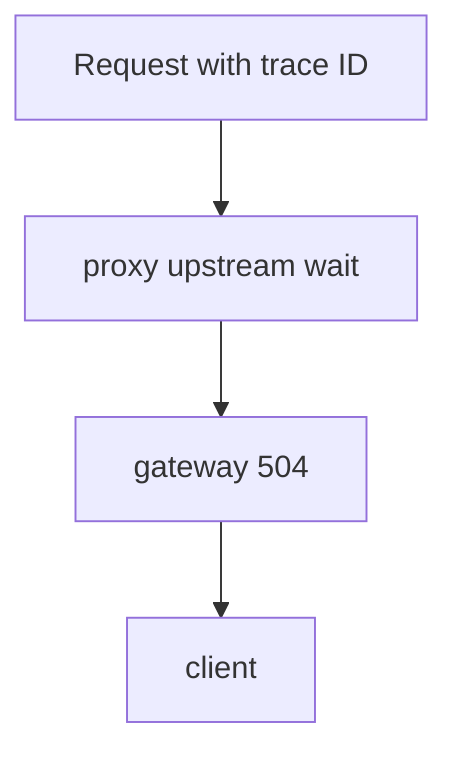

# A02.20 · headers/statuses

[Phase index](../README.md) · [Core] · 25–40 minutes

Prerequisite [A02.19](A02.19.md) · Next [A02.21](A02.21.md)

## 1. The problem & why it exists

A reverse proxy returns 504 but the application log has no matching HTTP status.

Record status, generating hop and correlation ID. Treat a 4xx or 5xx as evidence, then identify the actual failure boundary.

## 2. Visual mental model



```text
01. Request with trace ID
02. proxy upstream wait
03. gateway 504
04. client
```

This trace isolates one boundary. For a deployed path, name the observer and capture the actual protocol, timing and configuration separately.

## 3. Step-by-step mechanism & minimal dry-run

Headers carry metadata and framing. Status codes describe the HTTP hop's outcome. A gateway can time out downstream while upstream work continues. Header comparison is case-insensitive in HTTP semantics.

**Dry-run.** Request with trace ID -> proxy upstream wait -> gateway 504 -> client.

**Failure control.** Predict how the result changes if you reproduce the mistake from section 1. Use the two outputs in section 6 to locate its effect.

## 4. Formal rigor & quantitative math

A 504 after a 300 ms gateway limit with a 450 ms upstream task can leave 150 ms of work beyond the response boundary. Timer definitions vary by proxy.

Check the worked quantities with NumPy after running `uv sync --locked --extra math`.

```python
import numpy as np

actual = np.subtract(450, 300)
np.testing.assert_allclose(actual, 150)
print(actual)
```

## 5. Progressive design

Compare the two paths in the [runnable fixture](../examples/A02.20.py). Running the fixture uses a bounded in-process fixture.

| Path | Output evidence | Resource consideration | Failure to watch |
| --- | --- | --- | --- |
| Failure control | `status: 200` | Check whether the broken assumption changes time, bytes or retained state | A reverse proxy returns 504 but the application log has no matching HTTP status. |
| Normal control | `status: 504` | Same task size and local fixture | Apply the measured rule only within its modeled boundary |

## 6. Safe local lab & controlled failure injection

Predict both outputs, then run from the repository root.

```sh
uv run python "01-architecture-A01-to-A20/A02-networking-and-communication/examples/A02.20.py"
uv run python "01-architecture-A01-to-A20/A02-networking-and-communication/examples/A02.20.py" --break
```

**Observe.** Look for `status: 504` in the normal output and `status: 200` in the failure control.

**Diagnose and repair.** Identify the first incorrect boundary in the broken run. Switch back to the normal run and change the deciding input in a scratch copy. Move upstream completion below the deadline. Record normal, failure and repaired observations.

**Apply.** Connect the result to [L4](../labs/L4.md). The example exits without starting a persistent service. Remove scratch files after saving the evidence you need.

## 7. Production & multi-cloud bridge

Compare upstream and downstream status fields rather than assigning every code to the backend. At a load-balancing boundary, compare AWS Application Load Balancer, Azure Application Gateway and Google Cloud Application Load Balancer behavior for the exact route and protocol.

<details>
<summary>Principal question and answer</summary>

**Question.** Is 204 intended to carry response content?

No. Compare upstream and downstream status fields rather than assigning every code to the backend.

</details>

## 8. Memory hook & mastery checkpoint

**Recall.** Headers carry metadata and framing. Explain its boundary using the failure control.

1. Is 204 intended to carry response content?
2. What does Retry-After express?
3. Identify the observable boundary affected by the failing control.
4. Predict the normal output and the broken output before execution.
5. Change the input as directed in section 6. Recompute and justify your prediction.

<details>
<summary>Answers and reasoning</summary>

1. No.
2. A suggested delay or date before retrying, where applicable.
3. Compare upstream and downstream status fields rather than assigning every code to the backend.
4. Normal `status: 504`. Broken `status: 200`.
5. Use the relationship from section 4, then run your changed fixture with every other input held constant.

</details>
