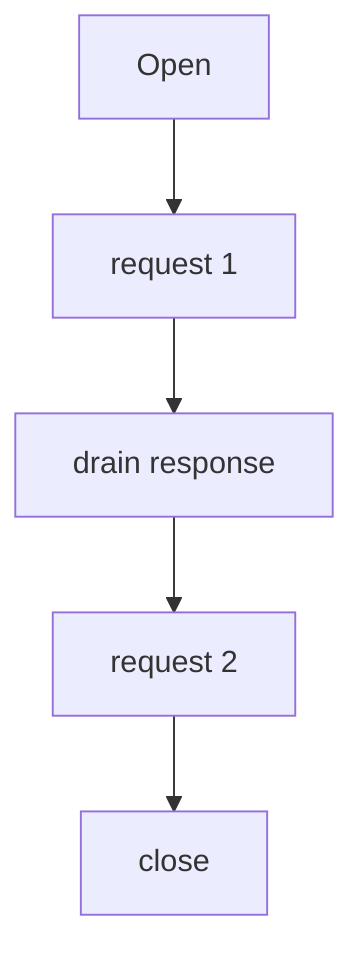

# A02.21 · keep-alive and connection pooling

[Phase index](../README.md) · [Core] · 25–40 minutes

Prerequisite [A02.20](A02.20.md) · Next [A02.22](A02.22.md)

## 1. The problem & why it exists

A burst of requests repeatedly pays connect and TLS setup time.

A fresh connection is simpler for a one-shot tool. Pool steady traffic and bound acquisition time, idle age and concurrent leases.

## 2. Visual mental model



```text
01. Open
02. request 1
03. drain response
04. request 2
05. close
```

This trace isolates one boundary. For a deployed path, name the observer and capture the actual protocol, timing and configuration separately.

## 3. Step-by-step mechanism & minimal dry-run

Persistence lets a protocol connection carry more than one request, subject to protocol and framing. A pool bounds reuse, removes stale sockets, and introduces acquisition queue time.

**Dry-run.** Open -> request 1 -> drain response -> request 2 -> close.

**Failure control.** Predict how the result changes if you reproduce the mistake from section 1. Use the two outputs in section 6 to locate its effect.

## 4. Formal rigor & quantitative math

With 20 sequential requests and 80 ms setup per connection, 20 fresh connections spend 1600 ms on setup. One reusable connection amortizes setup to 4 ms per request under the model.

Check the worked quantities with NumPy after running `uv sync --locked --extra math`.

```python
import numpy as np

actual = np.divide(80, 20)
np.testing.assert_allclose(actual, 4)
print(actual)
```

## 5. Progressive design

Compare the two paths in the [runnable fixture](../examples/A02.21.py). Running the fixture uses a bounded in-process fixture.

| Path | Output evidence | Resource consideration | Failure to watch |
| --- | --- | --- | --- |
| Failure control | `80.0 ms/request` | Check whether the broken assumption changes time, bytes or retained state | A burst of requests repeatedly pays connect and TLS setup time. |
| Normal control | `4.0 ms/request` | Same task size and local fixture | Apply the measured rule only within its modeled boundary |

## 6. Safe local lab & controlled failure injection

Predict both outputs, then run from the repository root.

```sh
uv run python "01-architecture-A01-to-A20/A02-networking-and-communication/examples/A02.21.py"
uv run python "01-architecture-A01-to-A20/A02-networking-and-communication/examples/A02.21.py" --break
```

**Observe.** Look for `4.0 ms/request` in the normal output and `80.0 ms/request` in the failure control.

**Diagnose and repair.** Identify the first incorrect boundary in the broken run. Switch back to the normal run and change the deciding input in a scratch copy. Compare one, five and twenty requests. Record normal, failure and repaired observations.

**Apply.** Connect the result to [L4](../labs/L4.md). The example exits without starting a persistent service. Remove scratch files after saving the evidence you need.

## 7. Production & multi-cloud bridge

Measure pool acquisition separately from connect and response time. At a load-balancing boundary, compare AWS Application Load Balancer, Azure Application Gateway and Google Cloud Application Load Balancer behavior for the exact route and protocol.

<details>
<summary>Principal question and answer</summary>

**Question.** Can unread response bytes prevent safe reuse in HTTP/1.1?

Yes. Measure pool acquisition separately from connect and response time.

</details>

## 8. Memory hook & mastery checkpoint

**Recall.** Persistence lets a protocol connection carry more than one request, subject to protocol and framing. Explain its boundary using the failure control.

1. Can unread response bytes prevent safe reuse in HTTP/1.1?
2. Can an idle pooled connection be closed by a server?
3. Identify the observable boundary affected by the failing control.
4. Predict the normal output and the broken output before execution.
5. Change the input as directed in section 6. Recompute and justify your prediction.

<details>
<summary>Answers and reasoning</summary>

1. Yes.
2. Yes.
3. Measure pool acquisition separately from connect and response time.
4. Normal `4.0 ms/request`. Broken `80.0 ms/request`.
5. Use the relationship from section 4, then run your changed fixture with every other input held constant.

</details>

## Standards and implementation notes

HTTP/1.1 persistence needs correct message framing and a connection that is still reusable. Pooling also changes queueing, concurrency and deadlines.

- [RFC 9112 · HTTP/1.1](https://www.rfc-editor.org/rfc/rfc9112.html)
- [RFC 9293 · TCP](https://www.rfc-editor.org/rfc/rfc9293.html)
