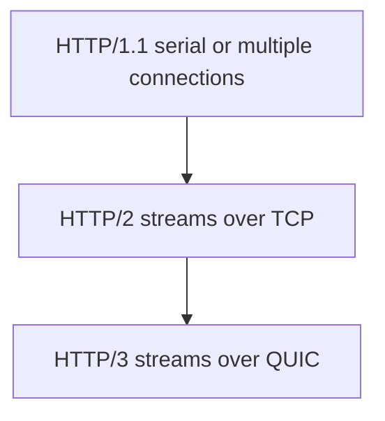

# A02.22 · HTTP/1.1 vs HTTP/2 vs HTTP/3

[Phase index](../README.md) · [Core] · 25–40 minutes

Prerequisite [A02.21](A02.21.md) · Next [A02.23](A02.23.md)

## 1. The problem & why it exists

An API shows independent streams in a trace but all pause after one packet is lost.

Use the simplest protocol that supports the client and deployment behavior. Verify the actually negotiated protocol before claiming multiplexing.

## 2. Visual mental model



```text
01. HTTP/1.1 serial or multiple connections
02. HTTP/2 streams over TCP
03. HTTP/3 streams over QUIC
```

This trace isolates one boundary. For a deployed path, name the observer and capture the actual protocol, timing and configuration separately.

## 3. Step-by-step mechanism & minimal dry-run

HTTP/1.1 commonly uses separate connections to obtain parallelism. HTTP/2 multiplexes application streams over one ordered TCP byte stream. HTTP/3 maps exchanges onto QUIC streams with separate receive ordering.

**Dry-run.** HTTP/1.1 serial or multiple connections -> HTTP/2 streams over TCP -> HTTP/3 streams over QUIC.

**Failure control.** Predict how the result changes if you reproduce the mistake from section 1. Use the two outputs in section 6 to locate its effect.

## 4. Formal rigor & quantitative math

With three messages of 30, 40 and 50 ms service, strict serial totals 120 ms while ideal full overlap is 50 ms. Loss, protocol limits and dependencies change both.

Check the worked quantities with NumPy after running `uv sync --locked --extra math`.

```python
import numpy as np

actual = np.max([30, 40, 50])
np.testing.assert_allclose(actual, 50)
print(actual)
```

## 5. Progressive design

Compare the two paths in the [runnable fixture](../examples/A02.22.py). Running the fixture uses a bounded in-process fixture.

| Path | Output evidence | Resource consideration | Failure to watch |
| --- | --- | --- | --- |
| Failure control | `ms: 120` | Check whether the broken assumption changes time, bytes or retained state | An API shows independent streams in a trace but all pause after one packet is lost. |
| Normal control | `ms: 50` | Same task size and local fixture | Apply the measured rule only within its modeled boundary |

## 6. Safe local lab & controlled failure injection

Predict both outputs, then run from the repository root.

```sh
uv run python "01-architecture-A01-to-A20/A02-networking-and-communication/examples/A02.22.py"
uv run python "01-architecture-A01-to-A20/A02-networking-and-communication/examples/A02.22.py" --break
```

**Observe.** Look for `ms: 50` in the normal output and `ms: 120` in the failure control.

**Diagnose and repair.** Identify the first incorrect boundary in the broken run. Switch back to the normal run and change the deciding input in a scratch copy. Use two unequal streams and one serial dependency. Record normal, failure and repaired observations.

**Apply.** Connect the result to [L4](../labs/L4.md). The example exits without starting a persistent service. Remove scratch files after saving the evidence you need.

## 7. Production & multi-cloud bridge

Confirm edge and upstream protocols independently because a proxy can translate. At a load-balancing boundary, compare AWS Application Load Balancer, Azure Application Gateway and Google Cloud Application Load Balancer behavior for the exact route and protocol.

<details>
<summary>Principal question and answer</summary>

**Question.** Does HTTP/2 multiplex streams?

Yes, within a single connection. Confirm edge and upstream protocols independently because a proxy can translate.

</details>

## 8. Memory hook & mastery checkpoint

**Recall.** HTTP/1.1 commonly uses separate connections to obtain parallelism. Explain its boundary using the failure control.

1. Does HTTP/2 multiplex streams?
2. Can HTTP/3 still share congestion limits?
3. Identify the observable boundary affected by the failing control.
4. Predict the normal output and the broken output before execution.
5. Change the input as directed in section 6. Recompute and justify your prediction.

<details>
<summary>Answers and reasoning</summary>

1. Yes, within a single connection.
2. Yes, across streams of one QUIC connection.
3. Confirm edge and upstream protocols independently because a proxy can translate.
4. Normal `ms: 50`. Broken `ms: 120`.
5. Use the relationship from section 4, then run your changed fixture with every other input held constant.

</details>
