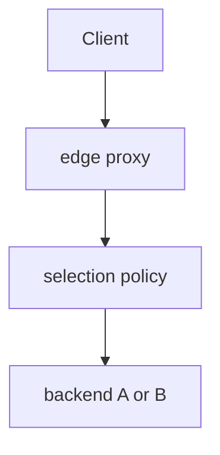

# A02.23 · reverse proxy and load balancer

[Phase index](../README.md) · [Core] · 25–40 minutes

Prerequisite [A02.22](A02.22.md) · Next [A02.24](A02.24.md)

## 1. The problem & why it exists

Requests keep landing on a backend that returned failures a second ago.

Use one backend for a local proof. Add separate backend health, timeouts, and capacity-aware policy where redundancy or load demands it.

## 2. Visual mental model



```text
01. Client
02. edge proxy
03. selection policy
04. backend A or B
```

This trace isolates one boundary. For a deployed path, name the observer and capture the actual protocol, timing and configuration separately.

## 3. Step-by-step mechanism & minimal dry-run

A reverse proxy accepts client traffic and opens or reuses upstream connections. A load-balancing policy selects a backend from eligible endpoints. Health and in-flight work vary across replicas.

**Dry-run.** Client -> edge proxy -> selection policy -> backend A or B.

**Failure control.** Predict how the result changes if you reproduce the mistake from section 1. Use the two outputs in section 6 to locate its effect.

## 4. Formal rigor & quantitative math

With 7 requests evenly distributed over two eligible backends, counts differ by at most one in strict round robin. Different request costs can still produce an imbalanced queue.

Check the worked quantities with NumPy after running `uv sync --locked --extra math`.

```python
import numpy as np

actual = np.bincount(np.arange(7) % 2)
np.testing.assert_allclose(actual, [4, 3])
print(actual)
```

## 5. Progressive design

Compare the two paths in the [runnable fixture](../examples/A02.23.py). Running the fixture uses a bounded in-process fixture.

| Path | Output evidence | Resource consideration | Failure to watch |
| --- | --- | --- | --- |
| Failure control | `failed a: 4` | Check whether the broken assumption changes time, bytes or retained state | Requests keep landing on a backend that returned failures a second ago. |
| Normal control | `failed a: 0` | Same task size and local fixture | Apply the measured rule only within its modeled boundary |

## 6. Safe local lab & controlled failure injection

Predict both outputs, then run from the repository root.

```sh
uv run python "01-architecture-A01-to-A20/A02-networking-and-communication/examples/A02.23.py"
uv run python "01-architecture-A01-to-A20/A02-networking-and-communication/examples/A02.23.py" --break
```

**Observe.** Look for `failed a: 0` in the normal output and `failed a: 4` in the failure control.

**Diagnose and repair.** Identify the first incorrect boundary in the broken run. Switch back to the normal run and change the deciding input in a scratch copy. Try three healthy backends with eight requests. Record normal, failure and repaired observations.

**Apply.** Connect the result to [L4](../labs/L4.md). The example exits without starting a persistent service. Remove scratch files after saving the evidence you need.

## 7. Production & multi-cloud bridge

Inspect per-backend load and error counts instead of relying on global averages. At a load-balancing boundary, compare AWS Application Load Balancer, Azure Application Gateway and Google Cloud Application Load Balancer behavior for the exact route and protocol.

<details>
<summary>Principal question and answer</summary>

**Question.** Does round robin ensure equal CPU load?

No. Inspect per-backend load and error counts instead of relying on global averages.

</details>

## 8. Memory hook & mastery checkpoint

**Recall.** A reverse proxy accepts client traffic and opens or reuses upstream connections. Explain its boundary using the failure control.

1. Does round robin ensure equal CPU load?
2. Is a retry another upstream request?
3. Identify the observable boundary affected by the failing control.
4. Predict the normal output and the broken output before execution.
5. Change the input as directed in section 6. Recompute and justify your prediction.

<details>
<summary>Answers and reasoning</summary>

1. No.
2. Usually yes, unless served locally or deduplicated.
3. Inspect per-backend load and error counts instead of relying on global averages.
4. Normal `failed a: 0`. Broken `failed a: 4`.
5. Use the relationship from section 4, then run your changed fixture with every other input held constant.

</details>

## Standards and implementation notes

Separate TLS termination, backend selection and check policy. Cross-provider products can differ in protocol support, timeout semantics and how they consider unhealthy backends.

- [NGINX proxy directives](https://nginx.org/en/docs/http/ngx_http_proxy_module.html)
- [AWS Application Load Balancer](https://docs.aws.amazon.com/elasticloadbalancing/latest/application/introduction.html)
- [Azure Application Gateway](https://learn.microsoft.com/en-us/azure/application-gateway/overview)
- [Google Cloud Application Load Balancer](https://cloud.google.com/load-balancing/docs/application-load-balancer)
