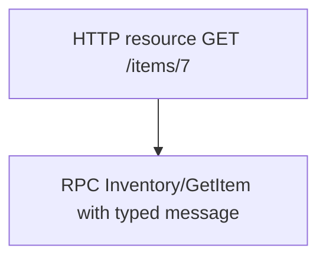

# A02.24 · REST vs gRPC

[Phase index](../README.md) · [Core] · 25–40 minutes

Prerequisite [A02.23](A02.23.md) · Next [A02.25](A02.25.md)

## 1. The problem & why it exists

A team calls every protobuf-over-HTTP endpoint gRPC and misses required status handling.

Use HTTP JSON for browser and human-centric interoperability if sufficient. Choose gRPC where typed contracts or streaming justify generated clients and support requirements.

## 2. Visual mental model



```text
01. HTTP resource GET /items/7
02. RPC Inventory/GetItem with typed message
```

This trace isolates one boundary. For a deployed path, name the observer and capture the actual protocol, timing and configuration separately.

## 3. Step-by-step mechanism & minimal dry-run

REST is an architectural style often expressed with HTTP resource semantics. gRPC defines RPC APIs, framing, protocol behavior and gRPC status. Standard gRPC commonly uses protobuf and HTTP/2.

**Dry-run.** HTTP resource GET /items/7 / RPC Inventory/GetItem with typed message.

**Failure control.** Predict how the result changes if you reproduce the mistake from section 1. Use the two outputs in section 6 to locate its effect.

## 4. Formal rigor & quantitative math

A gRPC message frame has a 1 B flag and 4 B length. A 20 B payload uses 25 B before HTTP/2 or TLS framing. Payload format and compression affect actual cost.

Check the worked quantities with NumPy after running `uv sync --locked --extra math`.

```python
import numpy as np

actual = np.sum([1, 4, 20])
np.testing.assert_allclose(actual, 25)
print(actual)
```

## 5. Progressive design

Compare the two paths in the [runnable fixture](../examples/A02.24.py). Running the fixture uses a bounded in-process fixture.

| Path | Output evidence | Resource consideration | Failure to watch |
| --- | --- | --- | --- |
| Failure control | `frame: False` | Check whether the broken assumption changes time, bytes or retained state | A team calls every protobuf-over-HTTP endpoint gRPC and misses required status handling. |
| Normal control | `frame: True` | Same task size and local fixture | Apply the measured rule only within its modeled boundary |

## 6. Safe local lab & controlled failure injection

Predict both outputs, then run from the repository root.

```sh
uv run python "01-architecture-A01-to-A20/A02-networking-and-communication/examples/A02.24.py"
uv run python "01-architecture-A01-to-A20/A02-networking-and-communication/examples/A02.24.py" --break
```

**Observe.** Look for `frame: True` in the normal output and `frame: False` in the failure control.

**Diagnose and repair.** Identify the first incorrect boundary in the broken run. Switch back to the normal run and change the deciding input in a scratch copy. Try a zero-byte payload and inspect the five-byte prefix. Record normal, failure and repaired observations.

**Apply.** Connect the result to [L4](../labs/L4.md). The example exits without starting a persistent service. Remove scratch files after saving the evidence you need.

## 7. Production & multi-cloud bridge

Check client, gateway and protocol tooling support end to end. At a load-balancing boundary, compare AWS Application Load Balancer, Azure Application Gateway and Google Cloud Application Load Balancer behavior for the exact route and protocol.

<details>
<summary>Principal question and answer</summary>

**Question.** Does HTTP 200 alone prove gRPC success?

No, inspect the gRPC status. Check client, gateway and protocol tooling support end to end.

</details>

## 8. Memory hook & mastery checkpoint

**Recall.** REST is an architectural style often expressed with HTTP resource semantics. Explain its boundary using the failure control.

1. Does HTTP 200 alone prove gRPC success?
2. What is the gRPC message prefix size?
3. Identify the observable boundary affected by the failing control.
4. Predict the normal output and the broken output before execution.
5. Change the input as directed in section 6. Recompute and justify your prediction.

<details>
<summary>Answers and reasoning</summary>

1. No, inspect the gRPC status.
2. Five bytes.
3. Check client, gateway and protocol tooling support end to end.
4. Normal `frame: True`. Broken `frame: False`.
5. Use the relationship from section 4, then run your changed fixture with every other input held constant.

</details>
