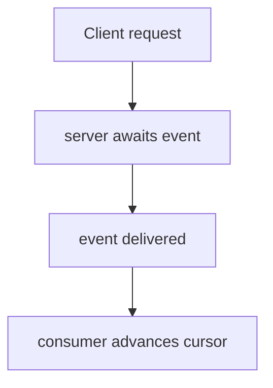

# A02.25 · WebSockets, SSE and long polling

[Phase index](../README.md) · [Core] · 25–40 minutes

Prerequisite [A02.24](A02.24.md) · Next [A02.26](A02.26.md)

## 1. The problem & why it exists

A browser polls every second for sparse updates and creates load when nothing changes.

Use short polling for simple low-rate jobs, SSE for one-way updates, and WebSockets when bidirectional messages justify the lifecycle burden.

## 2. Visual mental model



```text
01. Client request
02. server awaits event
03. event delivered
04. consumer advances cursor
```

This trace isolates one boundary. For a deployed path, name the observer and capture the actual protocol, timing and configuration separately.

## 3. Step-by-step mechanism & minimal dry-run

Short polling repeatedly fetches state. Long polling holds one request until an update or a timeout. SSE streams text server-to-client; WebSockets allow bidirectional messages.

**Dry-run.** Client request -> server awaits event -> event delivered -> consumer advances cursor.

**Failure control.** Predict how the result changes if you reproduce the mistake from section 1. Use the two outputs in section 6 to locate its effect.

## 4. Formal rigor & quantitative math

1000 clients polling each second produce 1000 requests/s while idle. Long polling with a 30 s idle limit averages about 33 renewals/s with staggered clients, while holding roughly 1000 open requests.

Check the worked quantities with NumPy after running `uv sync --locked --extra math`.

```python
import numpy as np

actual = np.divide(1000, 30)
np.testing.assert_allclose(actual, 33.333333333333336)
print(actual)
```

## 5. Progressive design

Compare the two paths in the [runnable fixture](../examples/A02.25.py). Running the fixture uses a bounded in-process fixture.

| Path | Output evidence | Resource consideration | Failure to watch |
| --- | --- | --- | --- |
| Failure control | `1000.00` | Check whether the broken assumption changes time, bytes or retained state | A browser polls every second for sparse updates and creates load when nothing changes. |
| Normal control | `33.33` | Same task size and local fixture | Apply the measured rule only within its modeled boundary |

## 6. Safe local lab & controlled failure injection

Predict both outputs, then run from the repository root.

```sh
uv run python "01-architecture-A01-to-A20/A02-networking-and-communication/examples/A02.25.py"
uv run python "01-architecture-A01-to-A20/A02-networking-and-communication/examples/A02.25.py" --break
```

**Observe.** Look for `33.33` in the normal output and `1000.00` in the failure control.

**Diagnose and repair.** Identify the first incorrect boundary in the broken run. Switch back to the normal run and change the deciding input in a scratch copy. Double the clients and halve the renewal cadence. Record normal, failure and repaired observations.

**Apply.** Connect the result to [L4](../labs/L4.md). The example exits without starting a persistent service. Remove scratch files after saving the evidence you need.

## 7. Production & multi-cloud bridge

Count connection footprint, reconnect load and buffering before selecting an approach. At a load-balancing boundary, compare AWS Application Load Balancer, Azure Application Gateway and Google Cloud Application Load Balancer behavior for the exact route and protocol.

<details>
<summary>Principal question and answer</summary>

**Question.** Can SSE send arbitrary binary frames directly?

No, it is a UTF-8 text format. Count connection footprint, reconnect load and buffering before selecting an approach.

</details>

## 8. Memory hook & mastery checkpoint

**Recall.** Short polling repeatedly fetches state. Explain its boundary using the failure control.

1. Can SSE send arbitrary binary frames directly?
2. What would replay after reconnect require?
3. Identify the observable boundary affected by the failing control.
4. Predict the normal output and the broken output before execution.
5. Change the input as directed in section 6. Recompute and justify your prediction.

<details>
<summary>Answers and reasoning</summary>

1. No, it is a UTF-8 text format.
2. A cursor and an application-side retention policy.
3. Count connection footprint, reconnect load and buffering before selecting an approach.
4. Normal `33.33`. Broken `1000.00`.
5. Use the relationship from section 4, then run your changed fixture with every other input held constant.

</details>
