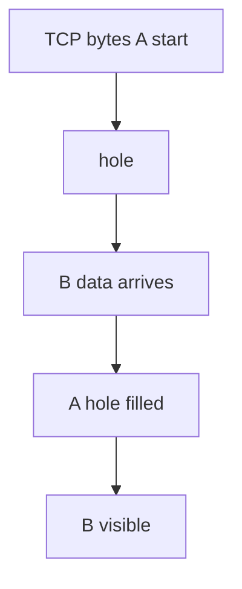

# A02.26 · TCP head-of-line blocking

[Phase index](../README.md) · [Principal] · 25–40 minutes

Prerequisite [A02.25](A02.25.md) · Next [A02.27](A02.27.md)

## 1. The problem & why it exists

Two HTTP/2 streams are ready but neither advances past a lost TCP segment.

Use a packet timeline to distinguish transport head-of-line blocking from an application queue. Protocol changes help only the former.

## 2. Visual mental model



```text
01. TCP bytes A start
02. hole
03. B data arrives
04. A hole filled
05. B visible
```

This trace isolates one boundary. For a deployed path, name the observer and capture the actual protocol, timing and configuration separately.

## 3. Step-by-step mechanism & minimal dry-run

TCP delivers bytes in order across the connection. An early hole prevents the application reading later bytes, including frames from a different HTTP/2 stream.

**Dry-run.** TCP bytes A start -> hole -> B data arrives -> A hole filled -> B visible.

**Failure control.** Predict how the result changes if you reproduce the mistake from section 1. Use the two outputs in section 6 to locate its effect.

## 4. Formal rigor & quantitative math

With B ready at 5 ms but the hole filled at 50 ms, B waits another 45 ms in the model. Separate connections can isolate this ordering dependency at connection and handshake cost.

Check the worked quantities with NumPy after running `uv sync --locked --extra math`.

```python
import numpy as np

actual = np.subtract(50, 5)
np.testing.assert_allclose(actual, 45)
print(actual)
```

## 5. Progressive design

Compare the two paths in the [runnable fixture](../examples/A02.26.py). Running the fixture uses a bounded in-process fixture.

| Path | Output evidence | Resource consideration | Failure to watch |
| --- | --- | --- | --- |
| Failure control | `5 ms` | Check whether the broken assumption changes time, bytes or retained state | Two HTTP/2 streams are ready but neither advances past a lost TCP segment. |
| Normal control | `50 ms` | Same task size and local fixture | Apply the measured rule only within its modeled boundary |

## 6. Safe local lab & controlled failure injection

Predict both outputs, then run from the repository root.

```sh
uv run python "01-architecture-A01-to-A20/A02-networking-and-communication/examples/A02.26.py"
uv run python "01-architecture-A01-to-A20/A02-networking-and-communication/examples/A02.26.py" --break
```

**Observe.** Look for `50 ms` in the normal output and `5 ms` in the failure control.

**Diagnose and repair.** Identify the first incorrect boundary in the broken run. Switch back to the normal run and change the deciding input in a scratch copy. Move the missing segment after all of B. Record normal, failure and repaired observations.

**Apply.** Connect the result to [L4](../labs/L4.md). The example exits without starting a persistent service. Remove scratch files after saving the evidence you need.

## 7. Production & multi-cloud bridge

Compare stream timing with transport loss and recovery before drawing a protocol conclusion. When comparing managed services on AWS, Azure and Google Cloud, keep DNS, transport, TLS and upstream timing separate and check the actual supported settings.

<details>
<summary>Principal question and answer</summary>

**Question.** Can HTTP/2 priorities bypass a gap in TCP's byte stream?

No. Compare stream timing with transport loss and recovery before drawing a protocol conclusion.

</details>

## 8. Memory hook & mastery checkpoint

**Recall.** TCP delivers bytes in order across the connection. Explain its boundary using the failure control.

1. Can HTTP/2 priorities bypass a gap in TCP's byte stream?
2. Does QUIC remove ordering within an individual stream?
3. Identify the observable boundary affected by the failing control.
4. Predict the normal output and the broken output before execution.
5. Change the input as directed in section 6. Recompute and justify your prediction.

<details>
<summary>Answers and reasoning</summary>

1. No.
2. No.
3. Compare stream timing with transport loss and recovery before drawing a protocol conclusion.
4. Normal `50 ms`. Broken `5 ms`.
5. Use the relationship from section 4, then run your changed fixture with every other input held constant.

</details>

## Standards and implementation notes

This model concerns transport-layer ordering on one TCP connection. A slow application or shared write queue can create a similar symptom with no loss.

- [RFC 9293 · TCP](https://www.rfc-editor.org/rfc/rfc9293.html)
- [RFC 9113 · HTTP/2](https://www.rfc-editor.org/rfc/rfc9113.html)
- [RFC 9000 · QUIC transport](https://www.rfc-editor.org/rfc/rfc9000.html)
