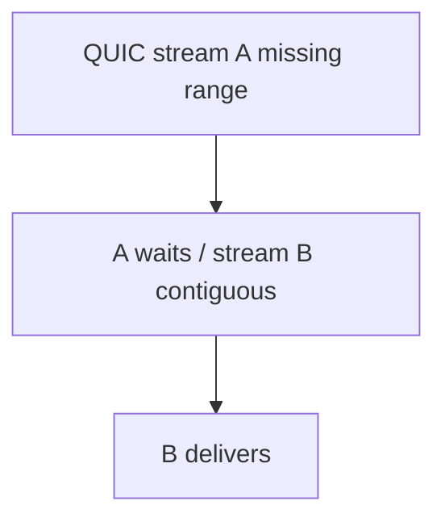

# A02.27 · QUIC streams

[Phase index](../README.md) · [Principal] · 25–40 minutes

Prerequisite [A02.26](A02.26.md) · Next [A02.28](A02.28.md)

## 1. The problem & why it exists

A team assumes that independent QUIC streams imply independent bandwidth.

Use a simulator to reason about ordering, then confirm actual negotiated HTTP/3 with endpoint telemetry. QUIC requires support along the path.

## 2. Visual mental model



```text
01. QUIC stream A missing range
02. A waits / stream B contiguous
03. B delivers
```

This trace isolates one boundary. For a deployed path, name the observer and capture the actual protocol, timing and configuration separately.

## 3. Step-by-step mechanism & minimal dry-run

QUIC tracks reliable byte ranges per stream so one missing range need not block delivery on another. A connection still shares congestion control and connection-level flow limits.

**Dry-run.** QUIC stream A missing range -> A waits / stream B contiguous -> B delivers.

**Failure control.** Predict how the result changes if you reproduce the mistake from section 1. Use the two outputs in section 6 to locate its effect.

## 4. Formal rigor & quantitative math

If stream A waits from 5 to 50 ms and stream B is contiguous at 5 ms, B can avoid 45 ms of cross-stream ordering delay. A common congestion response can still delay sends on B.

Check the worked quantities with NumPy after running `uv sync --locked --extra math`.

```python
import numpy as np

actual = np.subtract(50, 5)
np.testing.assert_allclose(actual, 45)
print(actual)
```

## 5. Progressive design

Compare the two paths in the [runnable fixture](../examples/A02.27.py). Running the fixture uses a bounded in-process fixture.

| Path | Output evidence | Resource consideration | Failure to watch |
| --- | --- | --- | --- |
| Failure control | `50 ms` | Check whether the broken assumption changes time, bytes or retained state | A team assumes that independent QUIC streams imply independent bandwidth. |
| Normal control | `5 ms` | Same task size and local fixture | Apply the measured rule only within its modeled boundary |

## 6. Safe local lab & controlled failure injection

Predict both outputs, then run from the repository root.

```sh
uv run python "01-architecture-A01-to-A20/A02-networking-and-communication/examples/A02.27.py"
uv run python "01-architecture-A01-to-A20/A02-networking-and-communication/examples/A02.27.py" --break
```

**Observe.** Look for `5 ms` in the normal output and `50 ms` in the failure control.

**Diagnose and repair.** Identify the first incorrect boundary in the broken run. Switch back to the normal run and change the deciding input in a scratch copy. Add a third stream C with a hole of its own. Record normal, failure and repaired observations.

**Apply.** Connect the result to [L4](../labs/L4.md). The example exits without starting a persistent service. Remove scratch files after saving the evidence you need.

## 7. Production & multi-cloud bridge

Separate transport stream delivery from application framing and compression dependencies. When comparing managed services on AWS, Azure and Google Cloud, keep DNS, transport, TLS and upstream timing separate and check the actual supported settings.

<details>
<summary>Principal question and answer</summary>

**Question.** What limits congestion across concurrent streams?

The shared QUIC connection control, in the simple one-path model. Separate transport stream delivery from application framing and compression dependencies.

</details>

## 8. Memory hook & mastery checkpoint

**Recall.** QUIC tracks reliable byte ranges per stream so one missing range need not block delivery on another. Explain its boundary using the failure control.

1. What limits congestion across concurrent streams?
2. Can QPACK introduce application-layer header dependencies?
3. Identify the observable boundary affected by the failing control.
4. Predict the normal output and the broken output before execution.
5. Change the input as directed in section 6. Recompute and justify your prediction.

<details>
<summary>Answers and reasoning</summary>

1. The shared QUIC connection control, in the simple one-path model.
2. Yes.
3. Separate transport stream delivery from application framing and compression dependencies.
4. Normal `5 ms`. Broken `50 ms`.
5. Use the relationship from section 4, then run your changed fixture with every other input held constant.

</details>

## Standards and implementation notes

QUIC preserves order within streams and shares connection flow control and congestion constraints. Application dependencies can span streams regardless of transport behavior.

- [RFC 9000 · QUIC transport](https://www.rfc-editor.org/rfc/rfc9000.html)
- [RFC 9002 · QUIC loss detection and congestion control](https://www.rfc-editor.org/rfc/rfc9002.html)
- [RFC 9204 · QPACK](https://www.rfc-editor.org/rfc/rfc9204.html)
