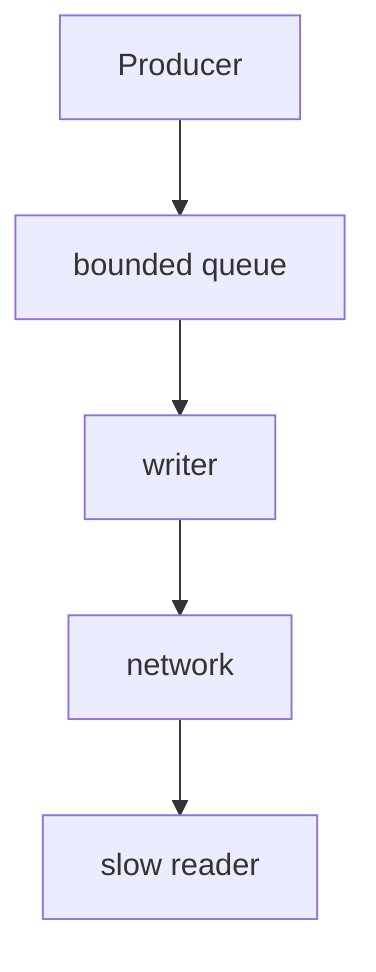

# A02.28 · HTTP streaming and backpressure

[Phase index](../README.md) · [Principal] · 25–40 minutes

Prerequisite [A02.27](A02.27.md) · Next [A02.29](A02.29.md)

## 1. The problem & why it exists

A fast producer builds an unbounded response queue for a slow client.

For small responses, explicit bounded whole-body buffering is simple. For large or unbounded responses, bound chunks and stop work on disconnect.

## 2. Visual mental model



```text
01. Producer
02. bounded queue
03. writer
04. network
05. slow reader
```

This trace isolates one boundary. For a deployed path, name the observer and capture the actual protocol, timing and configuration separately.

## 3. Step-by-step mechanism & minimal dry-run

Backpressure makes producer progress depend on downstream capacity. A bounded queue or awaited write limits memory and can propagate cancellation. Kernel and proxy buffering can conceal slowness briefly.

**Dry-run.** Producer -> bounded queue -> writer -> network -> slow reader.

**Failure control.** Predict how the result changes if you reproduce the mistake from section 1. Use the two outputs in section 6 to locate its effect.

## 4. Formal rigor & quantitative math

With 16 chunks of 8 KiB, the application queue budget is 128 KiB per response before other buffers. At 100 active responses that is 12.5 MiB.

Check the worked quantities with NumPy after running `uv sync --locked --extra math`.

```python
import numpy as np

actual = 100 * np.array(16) * 8 / 1024
np.testing.assert_allclose(actual, 12.5)
print(actual)
```

## 5. Progressive design

Compare the two paths in the [runnable fixture](../examples/A02.28.py). Running the fixture uses a bounded in-process fixture.

| Path | Output evidence | Resource consideration | Failure to watch |
| --- | --- | --- | --- |
| Failure control | `bytes: 163840` | Check whether the broken assumption changes time, bytes or retained state | A fast producer builds an unbounded response queue for a slow client. |
| Normal control | `bytes: 131072` | Same task size and local fixture | Apply the measured rule only within its modeled boundary |

## 6. Safe local lab & controlled failure injection

Predict both outputs, then run from the repository root.

```sh
uv run python "01-architecture-A01-to-A20/A02-networking-and-communication/examples/A02.28.py"
uv run python "01-architecture-A01-to-A20/A02-networking-and-communication/examples/A02.28.py" --break
```

**Observe.** Look for `bytes: 131072` in the normal output and `bytes: 163840` in the failure control.

**Diagnose and repair.** Identify the first incorrect boundary in the broken run. Switch back to the normal run and change the deciding input in a scratch copy. Halve queue size and double chunk size. Record normal, failure and repaired observations.

**Apply.** Connect the result to [L4](../labs/L4.md). The example exits without starting a persistent service. Remove scratch files after saving the evidence you need.

## 7. Production & multi-cloud bridge

Bound buffering and cancellation across the client, proxy and service. When comparing managed services on AWS, Azure and Google Cloud, keep DNS, transport, TLS and upstream timing separate and check the actual supported settings.

<details>
<summary>Principal question and answer</summary>

**Question.** Does a successful write mean the remote application consumed the chunk?

No. Bound buffering and cancellation across the client, proxy and service.

</details>

## 8. Memory hook & mastery checkpoint

**Recall.** Backpressure makes producer progress depend on downstream capacity. Explain its boundary using the failure control.

1. Does a successful write mean the remote application consumed the chunk?
2. What is the queue size at 8 chunks of 4 KiB?
3. Identify the observable boundary affected by the failing control.
4. Predict the normal output and the broken output before execution.
5. Change the input as directed in section 6. Recompute and justify your prediction.

<details>
<summary>Answers and reasoning</summary>

1. No.
2. 32 KiB.
3. Bound buffering and cancellation across the client, proxy and service.
4. Normal `bytes: 131072`. Broken `bytes: 163840`.
5. Use the relationship from section 4, then run your changed fixture with every other input held constant.

</details>
