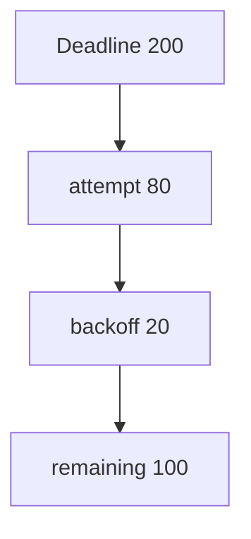

# A02.29 · retries and deadline budgets

[Phase index](../README.md) · [Principal] · 25–40 minutes

Prerequisite [A02.28](A02.28.md) · Next [A02.30](A02.30.md)

## 1. The problem & why it exists

A retry loop uses 100 ms per attempt but the caller's deadline is 200 ms total.

Use zero retries for non-repeatable actions unless the protocol makes them safe. Limit fanout amplification and coordinate retry ownership.

## 2. Visual mental model



```text
01. Deadline 200
02. attempt 80
03. backoff 20
04. remaining 100
```

This trace isolates one boundary. For a deployed path, name the observer and capture the actual protocol, timing and configuration separately.

## 3. Step-by-step mechanism & minimal dry-run

Compute an absolute monotonic deadline. Before each attempt or backoff, subtract elapsed time and budget a viable attempt. Retry only eligible failures and add bounded jitter under concurrency.

**Dry-run.** Deadline 200 -> attempt 80 -> backoff 20 -> remaining 100.

**Failure control.** Predict how the result changes if you reproduce the mistake from section 1. Use the two outputs in section 6 to locate its effect.

## 4. Formal rigor & quantitative math

After 150 ms of a 200 ms budget, a 30 ms backoff leaves 20 ms. If the minimum viable attempt is 40 ms, stop. At most r retries means at most r+1 total attempts at this layer.

Check the worked quantities with NumPy after running `uv sync --locked --extra math`.

```python
import numpy as np

actual = 200 - np.sum([150, 30])
np.testing.assert_allclose(actual, 20)
print(actual)
```

## 5. Progressive design

Compare the two paths in the [runnable fixture](../examples/A02.29.py). Running the fixture uses a bounded in-process fixture.

| Path | Output evidence | Resource consideration | Failure to watch |
| --- | --- | --- | --- |
| Failure control | `admitted: True` | Check whether the broken assumption changes time, bytes or retained state | A retry loop uses 100 ms per attempt but the caller's deadline is 200 ms total. |
| Normal control | `admitted: False` | Same task size and local fixture | Apply the measured rule only within its modeled boundary |

## 6. Safe local lab & controlled failure injection

Predict both outputs, then run from the repository root.

```sh
uv run python "01-architecture-A01-to-A20/A02-networking-and-communication/examples/A02.29.py"
uv run python "01-architecture-A01-to-A20/A02-networking-and-communication/examples/A02.29.py" --break
```

**Observe.** Look for `admitted: False` in the normal output and `admitted: True` in the failure control.

**Diagnose and repair.** Identify the first incorrect boundary in the broken run. Switch back to the normal run and change the deciding input in a scratch copy. Try a backoff of 10 ms. Record normal, failure and repaired observations.

**Apply.** Connect the result to [L4](../labs/L4.md). The example exits without starting a persistent service. Remove scratch files after saving the evidence you need.

## 7. Production & multi-cloud bridge

Record per-attempt reason and terminal budget to distinguish retry storms from real capacity limits. When comparing managed services on AWS, Azure and Google Cloud, keep DNS, transport, TLS and upstream timing separate and check the actual supported settings.

<details>
<summary>Principal question and answer</summary>

**Question.** With two retries at both caller and proxy, what is the worst-case backend attempt count?

Nine per original request, absent other bounds. Record per-attempt reason and terminal budget to distinguish retry storms from real capacity limits.

</details>

## 8. Memory hook & mastery checkpoint

**Recall.** Compute an absolute monotonic deadline. Explain its boundary using the failure control.

1. With two retries at both caller and proxy, what is the worst-case backend attempt count?
2. Which clock should measure elapsed time?
3. Identify the observable boundary affected by the failing control.
4. Predict the normal output and the broken output before execution.
5. Change the input as directed in section 6. Recompute and justify your prediction.

<details>
<summary>Answers and reasoning</summary>

1. Nine per original request, absent other bounds.
2. A monotonic clock.
3. Record per-attempt reason and terminal budget to distinguish retry storms from real capacity limits.
4. Normal `admitted: False`. Broken `admitted: True`.
5. Use the relationship from section 4, then run your changed fixture with every other input held constant.

</details>
