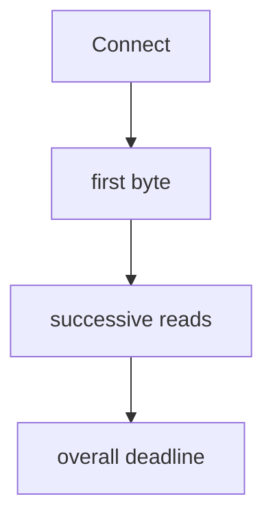

# A02.30 · connect vs read vs overall timeouts

[Phase index](../README.md) · [Principal] · 25–40 minutes

Prerequisite [A02.29](A02.29.md) · Next [A02.31](A02.31.md)

## 1. The problem & why it exists

A server sends one byte periodically and a request never reaches its expected timeout.

Set phase-specific bounds for diagnosis and an overall deadline for user-visible work. Read timeout is useful even when the overall deadline is longer.

## 2. Visual mental model



```text
01. Connect
02. first byte
03. successive reads
04. overall deadline
```

This trace isolates one boundary. For a deployed path, name the observer and capture the actual protocol, timing and configuration separately.

## 3. Step-by-step mechanism & minimal dry-run

Connect timeout bounds establishment. A read inactivity timeout often resets after activity. An overall deadline includes progress and all attempts. Exact defaults and DNS coverage vary by client.

**Dry-run.** Connect -> first byte -> successive reads -> overall deadline.

**Failure control.** Predict how the result changes if you reproduce the mistake from section 1. Use the two outputs in section 6 to locate its effect.

**Part A · Establishment.** Record resolver, TCP connect and TLS handshake separately. A particular client's connect timer may include more than one phase.

**Part B · Progress and completion.** An inactivity timer can reset with each read. Use one overall time budget to bound the complete action, and test a steady trickle separately from a stalled stream.

## 4. Formal rigor & quantitative math

With a 100 ms idle timer and a byte every 80 ms, inactivity never reaches 100 ms. A 250 ms overall deadline still stops at about 250 ms.

Check the worked quantities with NumPy after running `uv sync --locked --extra math`.

```python
import numpy as np

actual = np.max(np.diff([0, 80, 160, 240]))
np.testing.assert_allclose(actual, 80)
print(actual)
```

## 5. Progressive design

Compare the two paths in the [runnable fixture](../examples/A02.30.py). Running the fixture uses a bounded in-process fixture.

| Path | Output evidence | Resource consideration | Failure to watch |
| --- | --- | --- | --- |
| Failure control | `body still active at 320` | Check whether the broken assumption changes time, bytes or retained state | A server sends one byte periodically and a request never reaches its expected timeout. |
| Normal control | `overall deadline at 250` | Same task size and local fixture | Apply the measured rule only within its modeled boundary |

## 6. Safe local lab & controlled failure injection

Predict both outputs, then run from the repository root.

```sh
uv run python "01-architecture-A01-to-A20/A02-networking-and-communication/examples/A02.30.py"
uv run python "01-architecture-A01-to-A20/A02-networking-and-communication/examples/A02.30.py" --break
```

**Observe.** Look for `overall deadline at 250` in the normal output and `body still active at 320` in the failure control.

**Diagnose and repair.** Identify the first incorrect boundary in the broken run. Switch back to the normal run and change the deciding input in a scratch copy. Move the second byte past the inactivity limit. Record normal, failure and repaired observations.

**Apply.** Connect the result to [L4](../labs/L4.md). The example exits without starting a persistent service. Remove scratch files after saving the evidence you need.

## 7. Production & multi-cloud bridge

Watch acquisition, connect, handshake and first-byte timing separately. When comparing managed services on AWS, Azure and Google Cloud, keep DNS, transport, TLS and upstream timing separate and check the actual supported settings.

<details>
<summary>Principal question and answer</summary>

**Question.** Does a read inactivity timeout cap total body duration?

No. Watch acquisition, connect, handshake and first-byte timing separately.

</details>

## 8. Memory hook & mastery checkpoint

**Recall.** Connect timeout bounds establishment. Explain its boundary using the failure control.

1. Does a read inactivity timeout cap total body duration?
2. What should a client log for a stall before connection?
3. Identify the observable boundary affected by the failing control.
4. Predict the normal output and the broken output before execution.
5. Change the input as directed in section 6. Recompute and justify your prediction.

<details>
<summary>Answers and reasoning</summary>

1. No.
2. DNS and connect phase evidence.
3. Watch acquisition, connect, handshake and first-byte timing separately.
4. Normal `overall deadline at 250`. Broken `body still active at 320`.
5. Use the relationship from section 4, then run your changed fixture with every other input held constant.

</details>

## Standards and implementation notes

An NGINX proxy read timeout is measured between successive upstream read operations. It does not serve as a total transfer deadline. Client libraries may apply different scopes.

- [NGINX proxy directives](https://nginx.org/en/docs/http/ngx_http_proxy_module.html)
- [Python socket](https://docs.python.org/3/library/socket.html)
