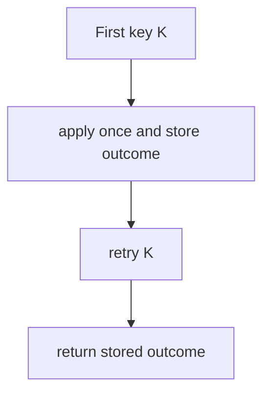

# A02.31 · idempotent network actions

[Phase index](../README.md) · [Principal] · 25–40 minutes

Prerequisite [A02.30](A02.30.md) · Next [A02.32](A02.32.md)

## 1. The problem & why it exists

A payment intent is retried after the response is lost.

For naturally idempotent state replacement, backend conditional writes may suffice. An additive effect needs durable identity and semantics for concurrent duplicates.

## 2. Visual mental model



```text
01. First key K
02. apply once and store outcome
03. retry K
04. return stored outcome
```

This trace isolates one boundary. For a deployed path, name the observer and capture the actual protocol, timing and configuration separately.

## 3. Step-by-step mechanism & minimal dry-run

Use an idempotency key scoped to caller and operation. Persist outcome and request identity atomically with the effect, replay the same result for duplicates, and reject key reuse with a conflicting payload.

**Dry-run.** First key K -> apply once and store outcome -> retry K -> return stored outcome.

**Failure control.** Predict how the result changes if you reproduce the mistake from section 1. Use the two outputs in section 6 to locate its effect.

## 4. Formal rigor & quantitative math

If 100 commands each receive one duplicate, the service receives 200 requests. With correct deduplication there are 100 effects and 100 retained records, ignoring TTL and eviction.

Check the worked quantities with NumPy after running `uv sync --locked --extra math`.

```python
import numpy as np

actual = np.unique(np.repeat(np.arange(100), 2)).size
np.testing.assert_allclose(actual, 100)
print(actual)
```

## 5. Progressive design

Compare the two paths in the [runnable fixture](../examples/A02.31.py). Running the fixture uses a bounded in-process fixture.

| Path | Output evidence | Resource consideration | Failure to watch |
| --- | --- | --- | --- |
| Failure control | `balance: 16` | Check whether the broken assumption changes time, bytes or retained state | A payment intent is retried after the response is lost. |
| Normal control | `balance: 13` | Same task size and local fixture | Apply the measured rule only within its modeled boundary |

## 6. Safe local lab & controlled failure injection

Predict both outputs, then run from the repository root.

```sh
uv run python "01-architecture-A01-to-A20/A02-networking-and-communication/examples/A02.31.py"
uv run python "01-architecture-A01-to-A20/A02-networking-and-communication/examples/A02.31.py" --break
```

**Observe.** Look for `balance: 13` in the normal output and `balance: 16` in the failure control.

**Diagnose and repair.** Identify the first incorrect boundary in the broken run. Switch back to the normal run and change the deciding input in a scratch copy. Replay the same key with a different amount. Record normal, failure and repaired observations.

**Apply.** Connect the result to [L4](../labs/L4.md). The example exits without starting a persistent service. Remove scratch files after saving the evidence you need.

## 7. Production & multi-cloud bridge

Design deduplication duration and tenancy scope using the actual retry horizon. When comparing managed services on AWS, Azure and Google Cloud, keep DNS, transport, TLS and upstream timing separate and check the actual supported settings.

<details>
<summary>Principal question and answer</summary>

**Question.** What if the same key carries a different amount?

Reject the conflicting payload. Design deduplication duration and tenancy scope using the actual retry horizon.

</details>

## 8. Memory hook & mastery checkpoint

**Recall.** Use an idempotency key scoped to caller and operation. Explain its boundary using the failure control.

1. What if the same key carries a different amount?
2. What if the key expires before a retry?
3. Identify the observable boundary affected by the failing control.
4. Predict the normal output and the broken output before execution.
5. Change the input as directed in section 6. Recompute and justify your prediction.

<details>
<summary>Answers and reasoning</summary>

1. Reject the conflicting payload.
2. The old effect can be applied again unless another invariant prevents it.
3. Design deduplication duration and tenancy scope using the actual retry horizon.
4. Normal `balance: 13`. Broken `balance: 16`.
5. Use the relationship from section 4, then run your changed fixture with every other input held constant.

</details>

## Standards and implementation notes

The fixture preserves state only in one process. A production implementation needs durable atomicity between deduplication and the business change, and a strategy for concurrent requests and expiry.

- [RFC 9110 · HTTP semantics](https://www.rfc-editor.org/rfc/rfc9110.html)
