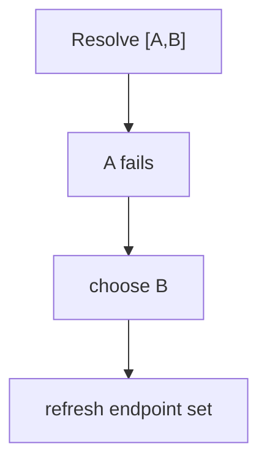

# A02.32 · service discovery and retries

[Phase index](../README.md) · [Principal] · 25–40 minutes

Prerequisite [A02.31](A02.31.md) · Next [A02.33](A02.33.md)

## 1. The problem & why it exists

A discovery client continually retries a disappeared backend.

Use platform discovery for ordinary cases. Add client-side behavior only when health, staleness or failure evidence warrants it.

## 2. Visual mental model



```text
01. Resolve [A,B]
02. A fails
03. choose B
04. refresh endpoint set
```

This trace isolates one boundary. For a deployed path, name the observer and capture the actual protocol, timing and configuration separately.

## 3. Step-by-step mechanism & minimal dry-run

Discovery gives an endpoint set with a freshness model. Retry policy can prefer a different healthy endpoint, subject to deadline, safe action rules and a bounded attempt count. Stale pools need retirement.

**Dry-run.** Resolve [A,B] -> A fails -> choose B -> refresh endpoint set.

**Failure control.** Predict how the result changes if you reproduce the mistake from section 1. Use the two outputs in section 6 to locate its effect.

## 4. Formal rigor & quantitative math

Among three equally selected endpoints with one failed and independent replacement sampling, two attempts both fail with probability 1/9 in the model. Avoiding the same endpoint can eliminate this case when at least one healthy one is known.

Check the worked quantities with NumPy after running `uv sync --locked --extra math`.

```python
import numpy as np

actual = np.prod([1 / 3, 1 / 3])
np.testing.assert_allclose(actual, 0.1111111111111111)
print(actual)
```

## 5. Progressive design

Compare the two paths in the [runnable fixture](../examples/A02.32.py). Running the fixture uses a bounded in-process fixture.

| Path | Output evidence | Resource consideration | Failure to watch |
| --- | --- | --- | --- |
| Failure control | `a success: False` | Check whether the broken assumption changes time, bytes or retained state | A discovery client continually retries a disappeared backend. |
| Normal control | `b success: True` | Same task size and local fixture | Apply the measured rule only within its modeled boundary |

## 6. Safe local lab & controlled failure injection

Predict both outputs, then run from the repository root.

```sh
uv run python "01-architecture-A01-to-A20/A02-networking-and-communication/examples/A02.32.py"
uv run python "01-architecture-A01-to-A20/A02-networking-and-communication/examples/A02.32.py" --break
```

**Observe.** Look for `b success: True` in the normal output and `a success: False` in the failure control.

**Diagnose and repair.** Identify the first incorrect boundary in the broken run. Switch back to the normal run and change the deciding input in a scratch copy. Mark both endpoints failed and define the terminal error. Record normal, failure and repaired observations.

**Apply.** Connect the result to [L1](../labs/L1.md). The example exits without starting a persistent service. Remove scratch files after saving the evidence you need.

## 7. Production & multi-cloud bridge

Log endpoint identity and discovery generation, not just the service name. When comparing managed services on AWS, Azure and Google Cloud, keep DNS, transport, TLS and upstream timing separate and check the actual supported settings.

<details>
<summary>Principal question and answer</summary>

**Question.** Does a cached DNS name guarantee all pooled connections point to current endpoints?

No. Log endpoint identity and discovery generation, not just the service name.

</details>

## 8. Memory hook & mastery checkpoint

**Recall.** Discovery gives an endpoint set with a freshness model. Explain its boundary using the failure control.

1. Does a cached DNS name guarantee all pooled connections point to current endpoints?
2. Should every retry independently re-resolve DNS?
3. Identify the observable boundary affected by the failing control.
4. Predict the normal output and the broken output before execution.
5. Change the input as directed in section 6. Recompute and justify your prediction.

<details>
<summary>Answers and reasoning</summary>

1. No.
2. Usually no, use a bounded refresh policy.
3. Log endpoint identity and discovery generation, not just the service name.
4. Normal `b success: True`. Broken `a success: False`.
5. Use the relationship from section 4, then run your changed fixture with every other input held constant.

</details>
