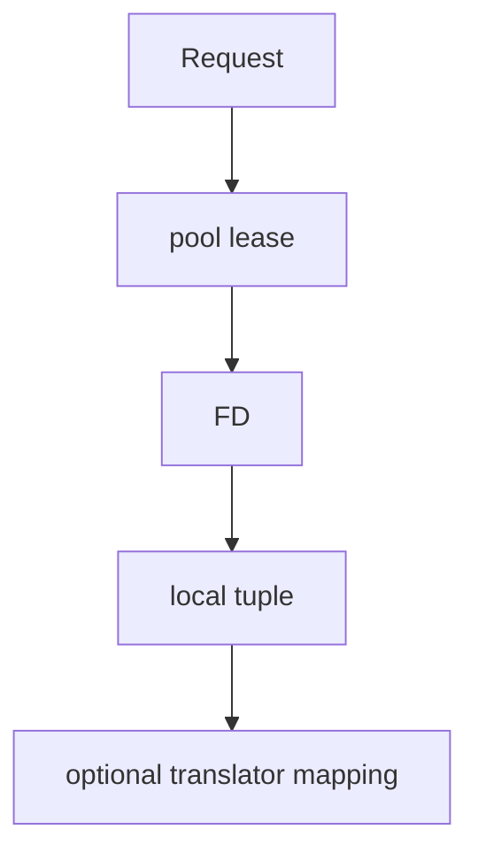

# A02.33 · connection exhaustion

[Phase index](../README.md) · [Principal] · 25–40 minutes

Prerequisite [A02.32](A02.32.md) · Next [A02.34](A02.34.md)

## 1. The problem & why it exists

A client reports connection errors only during high outbound churn.

Reuse connections and bound concurrency. Raise a limit only after identifying which resource is spent and why.

## 2. Visual mental model



```text
01. Request
02. pool lease
03. FD
04. local tuple
05. optional translator mapping
```

This trace isolates one boundary. For a deployed path, name the observer and capture the actual protocol, timing and configuration separately.

## 3. Step-by-step mechanism & minimal dry-run

Limits can occur at the application pool, FD table, ephemeral port allocator or NAT gateway. TIME_WAIT protects TCP tuple reuse and consumes state even after a socket is closed.

**Dry-run.** Request -> pool lease -> FD -> local tuple -> optional translator mapping.

**Failure control.** Predict how the result changes if you reproduce the mistake from section 1. Use the two outputs in section 6 to locate its effect.

## 4. Formal rigor & quantitative math

At 500 completed new connections/s and 60 s retained tuple lifetime, steady retained state is approximately 30000 under stable throughput. Available tuples vary by endpoints and host policy.

Check the worked quantities with NumPy after running `uv sync --locked --extra math`.

```python
import numpy as np

actual = np.multiply(500, 60)
np.testing.assert_allclose(actual, 30000)
print(actual)
```

## 5. Progressive design

Compare the two paths in the [runnable fixture](../examples/A02.33.py). Running the fixture uses a bounded in-process fixture.

| Path | Output evidence | Resource consideration | Failure to watch |
| --- | --- | --- | --- |
| Failure control | `False retained: 0` | Check whether the broken assumption changes time, bytes or retained state | A client reports connection errors only during high outbound churn. |
| Normal control | `True retained: 30000` | Same task size and local fixture | Apply the measured rule only within its modeled boundary |

## 6. Safe local lab & controlled failure injection

Predict both outputs, then run from the repository root.

```sh
uv run python "01-architecture-A01-to-A20/A02-networking-and-communication/examples/A02.33.py"
uv run python "01-architecture-A01-to-A20/A02-networking-and-communication/examples/A02.33.py" --break
```

**Observe.** Look for `True retained: 30000` in the normal output and `False retained: 0` in the failure control.

**Diagnose and repair.** Identify the first incorrect boundary in the broken run. Switch back to the normal run and change the deciding input in a scratch copy. Halve arrival rate and double retention time. Record normal, failure and repaired observations.

**Apply.** Connect the result to [L3](../labs/L3.md). The example exits without starting a persistent service. Remove scratch files after saving the evidence you need.

## 7. Production & multi-cloud bridge

Inspect errors and counts at the allocation boundary instead of tuning global kernel parameters. When comparing managed services on AWS, Azure and Google Cloud, keep DNS, transport, TLS and upstream timing separate and check the actual supported settings.

<details>
<summary>Principal question and answer</summary>

**Question.** Can a low FD count rule out NAT port exhaustion?

No. Inspect errors and counts at the allocation boundary instead of tuning global kernel parameters.

</details>

## 8. Memory hook & mastery checkpoint

**Recall.** Limits can occur at the application pool, FD table, ephemeral port allocator or NAT gateway. Explain its boundary using the failure control.

1. Can a low FD count rule out NAT port exhaustion?
2. What does Little's Law approximate here?
3. Identify the observable boundary affected by the failing control.
4. Predict the normal output and the broken output before execution.
5. Change the input as directed in section 6. Recompute and justify your prediction.

<details>
<summary>Answers and reasoning</summary>

1. No.
2. Average retained mappings or tuples as arrival rate times mean lifetime.
3. Inspect errors and counts at the allocation boundary instead of tuning global kernel parameters.
4. Normal `True retained: 30000`. Broken `False retained: 0`.
5. Use the relationship from section 4, then run your changed fixture with every other input held constant.

</details>
