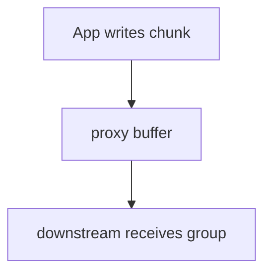

# A02.34 · proxy buffering

[Phase index](../README.md) · [Principal] · 25–40 minutes

Prerequisite [A02.33](A02.33.md) · Next [A02.35](A02.35.md)

## 1. The problem & why it exists

A server flushes tokens but the browser receives them in batches.

Disable buffering only for routes requiring incremental delivery and consider downstream backpressure and resource costs.

## 2. Visual mental model



```text
01. App writes chunk
02. proxy buffer
03. downstream receives group
```

This trace isolates one boundary. For a deployed path, name the observer and capture the actual protocol, timing and configuration separately.

## 3. Step-by-step mechanism & minimal dry-run

A proxy may aggregate upstream bytes before forwarding them. Protocol frames, compression and browser behavior can introduce separate buffering. Buffered output is useful for ordinary bodies but changes streaming latency.

**Dry-run.** App writes chunk -> proxy buffer -> downstream receives group.

**Failure control.** Predict how the result changes if you reproduce the mistake from section 1. Use the two outputs in section 6 to locate its effect.

## 4. Formal rigor & quantitative math

A producer emits one unit every 50 ms. A proxy releasing only three units together can delay the first unit by 100 ms beyond its production time.

Check the worked quantities with NumPy after running `uv sync --locked --extra math`.

```python
import numpy as np

actual = np.subtract(150, 50)
np.testing.assert_allclose(actual, 100)
print(actual)
```

## 5. Progressive design

Compare the two paths in the [runnable fixture](../examples/A02.34.py). Running the fixture uses a bounded in-process fixture.

| Path | Output evidence | Resource consideration | Failure to watch |
| --- | --- | --- | --- |
| Failure control | `emission: 100 ms` | Check whether the broken assumption changes time, bytes or retained state | A server flushes tokens but the browser receives them in batches. |
| Normal control | `emission: 0 ms` | Same task size and local fixture | Apply the measured rule only within its modeled boundary |

## 6. Safe local lab & controlled failure injection

Predict both outputs, then run from the repository root.

```sh
uv run python "01-architecture-A01-to-A20/A02-networking-and-communication/examples/A02.34.py"
uv run python "01-architecture-A01-to-A20/A02-networking-and-communication/examples/A02.34.py" --break
```

**Observe.** Look for `emission: 0 ms` in the normal output and `emission: 100 ms` in the failure control.

**Diagnose and repair.** Identify the first incorrect boundary in the broken run. Switch back to the normal run and change the deciding input in a scratch copy. Double the number of chunks per release. Record normal, failure and repaired observations.

**Apply.** Connect the result to [L4](../labs/L4.md). The example exits without starting a persistent service. Remove scratch files after saving the evidence you need.

## 7. Production & multi-cloud bridge

Keep server flush time separate from first downstream data time. At a load-balancing boundary, compare AWS Application Load Balancer, Azure Application Gateway and Google Cloud Application Load Balancer behavior for the exact route and protocol.

<details>
<summary>Principal question and answer</summary>

**Question.** Does disabling one proxy buffer prove streaming is immediate?

No, other hops and clients can buffer. Keep server flush time separate from first downstream data time.

</details>

## 8. Memory hook & mastery checkpoint

**Recall.** A proxy may aggregate upstream bytes before forwarding them. Explain its boundary using the failure control.

1. Does disabling one proxy buffer prove streaming is immediate?
2. Which measurement locates the first delayed boundary?
3. Identify the observable boundary affected by the failing control.
4. Predict the normal output and the broken output before execution.
5. Change the input as directed in section 6. Recompute and justify your prediction.

<details>
<summary>Answers and reasoning</summary>

1. No, other hops and clients can buffer.
2. Timestamped application, proxy and client chunk observations.
3. Keep server flush time separate from first downstream data time.
4. Normal `emission: 0 ms`. Broken `emission: 100 ms`.
5. Use the relationship from section 4, then run your changed fixture with every other input held constant.

</details>
