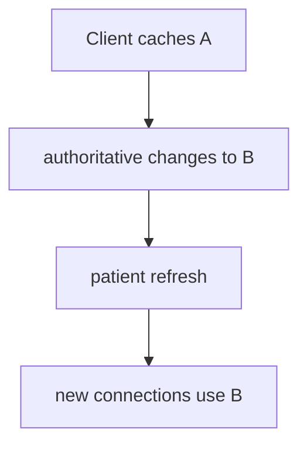

# A02.35 · DNS TTL and failover

[Phase index](../README.md) · [Principal] · 25–40 minutes

Prerequisite [A02.34](A02.34.md) · Next [A02.36](A02.36.md)

## 1. The problem & why it exists

Traffic still hits a dead endpoint after a DNS failover record changes.

Lower TTL ahead of staged changes when necessary, and keep old endpoints valid through the observed drain. Very low TTL increases resolver load.

## 2. Visual mental model



```text
01. Client caches A
02. authoritative changes to B
03. patient refresh
04. new connections use B
```

This trace isolates one boundary. For a deployed path, name the observer and capture the actual protocol, timing and configuration separately.

## 3. Step-by-step mechanism & minimal dry-run

TTL limits cached record reuse under resolver policy. Clients may retain existing connections after DNS answers change. Safe cutovers need an endpoint drain and observed refresh behavior.

**Dry-run.** Client caches A -> authoritative changes to B -> patient refresh -> new connections use B.

**Failure control.** Predict how the result changes if you reproduce the mistake from section 1. Use the two outputs in section 6 to locate its effect.

**Part A · Positive answers.** Check the remaining TTL from the actual recursive resolver and compare the old and new answer sets.

**Part B · Failure and connection lifetime.** Negative answers and resolver failures have their own cache rules. RFC 9520 updates the rules for resolution-failure and DNSSEC-validation-failure caching. An existing socket can reach an old backend after every DNS cache has refreshed.

## 4. Formal rigor & quantitative math

A resolver fetching immediately before a change with 60 s TTL may use the old record for nearly 60 s. A 120 s client cache can extend that timeline in this model.

Check the worked quantities with NumPy after running `uv sync --locked --extra math`.

```python
import numpy as np

actual = np.less([59, 60], 60)
np.testing.assert_allclose(actual, [True, False])
print(actual)
```

## 5. Progressive design

Compare the two paths in the [runnable fixture](../examples/A02.35.py). Running the fixture uses a bounded in-process fixture.

| Path | Output evidence | Resource consideration | Failure to watch |
| --- | --- | --- | --- |
| Failure control | `sees: b` | Check whether the broken assumption changes time, bytes or retained state | Traffic still hits a dead endpoint after a DNS failover record changes. |
| Normal control | `sees: a` | Same task size and local fixture | Apply the measured rule only within its modeled boundary |

## 6. Safe local lab & controlled failure injection

Predict both outputs, then run from the repository root.

```sh
uv run python "01-architecture-A01-to-A20/A02-networking-and-communication/examples/A02.35.py"
uv run python "01-architecture-A01-to-A20/A02-networking-and-communication/examples/A02.35.py" --break
```

**Observe.** Look for `sees: a` in the normal output and `sees: b` in the failure control.

**Diagnose and repair.** Identify the first incorrect boundary in the broken run. Switch back to the normal run and change the deciding input in a scratch copy. Repeat at t=59 and t=60. Record normal, failure and repaired observations.

**Apply.** Connect the result to [L1](../labs/L1.md). The example exits without starting a persistent service. Remove scratch files after saving the evidence you need.

## 7. Production & multi-cloud bridge

Measure selected backend after resolution as well as live connection age. When comparing managed services on AWS, Azure and Google Cloud, keep DNS, transport, TLS and upstream timing separate and check the actual supported settings.

<details>
<summary>Principal question and answer</summary>

**Question.** Does an authoritative update invalidate all caches immediately?

No. Measure selected backend after resolution as well as live connection age.

</details>

## 8. Memory hook & mastery checkpoint

**Recall.** TTL limits cached record reuse under resolver policy. Explain its boundary using the failure control.

1. Does an authoritative update invalidate all caches immediately?
2. If existing sockets survive 5 minutes, is a 30 s TTL an upper bound on traffic to old nodes?
3. Identify the observable boundary affected by the failing control.
4. Predict the normal output and the broken output before execution.
5. Change the input as directed in section 6. Recompute and justify your prediction.

<details>
<summary>Answers and reasoning</summary>

1. No.
2. No.
3. Measure selected backend after resolution as well as live connection age.
4. Normal `sees: a`. Broken `sees: b`.
5. Use the relationship from section 4, then run your changed fixture with every other input held constant.

</details>

## Standards and implementation notes

Track changes to authoritative records, resolver answers, client cache behavior, and reused peer connections. TTL arithmetic only applies to the cache modeled in the exercise.

- [RFC 1034 · DNS concepts](https://www.rfc-editor.org/rfc/rfc1034.html)
- [RFC 2308 · Negative caching](https://www.rfc-editor.org/rfc/rfc2308.html)
- [RFC 9112 · HTTP/1.1](https://www.rfc-editor.org/rfc/rfc9112.html)
- [RFC 9520 · Negative caching of DNS resolution failures](https://www.rfc-editor.org/rfc/rfc9520.html)
