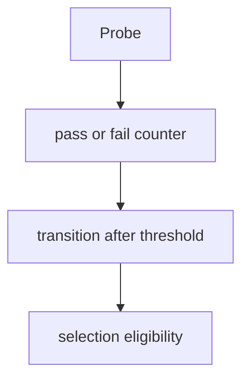

# A02.36 · load-balancer health checks

[Phase index](../README.md) · [Principal] · 25–40 minutes

Prerequisite [A02.35](A02.35.md) · Next [A02.37](A02.37.md)

## 1. The problem & why it exists

A backend passes TCP probes while serving unusable responses.

A TCP probe is adequate only if listener reachability matches the intended guarantee. Use an inexpensive process-specific readiness signal for dependencies that make traffic unsafe.

## 2. Visual mental model



```text
01. Probe
02. pass or fail counter
03. transition after threshold
04. selection eligibility
```

This trace isolates one boundary. For a deployed path, name the observer and capture the actual protocol, timing and configuration separately.

## 3. Step-by-step mechanism & minimal dry-run

A health probe measures only its configured boundary. Readiness should capture whether the instance can accept traffic. Thresholds damp transients; overly broad dependency checks can eject all replicas.

**Dry-run.** Probe -> pass or fail counter -> transition after threshold -> selection eligibility.

**Failure control.** Predict how the result changes if you reproduce the mistake from section 1. Use the two outputs in section 6 to locate its effect.

## 4. Formal rigor & quantitative math

At a fixed 5 s cadence and failure threshold 3, three instantaneous failures after deterioration generally require about 10–15 s from failure to detection, depending on alignment.

Check the worked quantities with NumPy after running `uv sync --locked --extra math`.

```python
import numpy as np

actual = np.multiply([2, 3], 5)
np.testing.assert_allclose(actual, [10, 15])
print(actual)
```

## 5. Progressive design

Compare the two paths in the [runnable fixture](../examples/A02.36.py). Running the fixture uses a bounded in-process fixture.

| Path | Output evidence | Resource consideration | Failure to watch |
| --- | --- | --- | --- |
| Failure control | `probe: 1` | Check whether the broken assumption changes time, bytes or retained state | A backend passes TCP probes while serving unusable responses. |
| Normal control | `probe: 5` | Same task size and local fixture | Apply the measured rule only within its modeled boundary |

## 6. Safe local lab & controlled failure injection

Predict both outputs, then run from the repository root.

```sh
uv run python "01-architecture-A01-to-A20/A02-networking-and-communication/examples/A02.36.py"
uv run python "01-architecture-A01-to-A20/A02-networking-and-communication/examples/A02.36.py" --break
```

**Observe.** Look for `probe: 5` in the normal output and `probe: 1` in the failure control.

**Diagnose and repair.** Identify the first incorrect boundary in the broken run. Switch back to the normal run and change the deciding input in a scratch copy. Change the fourth probe to a success. Record normal, failure and repaired observations.

**Apply.** Connect the result to [L4](../labs/L4.md). The example exits without starting a persistent service. Remove scratch files after saving the evidence you need.

## 7. Production & multi-cloud bridge

Use recorded probe outcomes and independent service error evidence to detect false readiness. At a load-balancing boundary, compare AWS Application Load Balancer, Azure Application Gateway and Google Cloud Application Load Balancer behavior for the exact route and protocol.

<details>
<summary>Principal question and answer</summary>

**Question.** Does liveness have the same purpose as readiness?

No, one informs restart policy while the other informs traffic eligibility. Use recorded probe outcomes and independent service error evidence to detect false readiness.

</details>

## 8. Memory hook & mastery checkpoint

**Recall.** A health probe measures only its configured boundary. Explain its boundary using the failure control.

1. Does liveness have the same purpose as readiness?
2. What can synchronized dependency-based failures cause?
3. Identify the observable boundary affected by the failing control.
4. Predict the normal output and the broken output before execution.
5. Change the input as directed in section 6. Recompute and justify your prediction.

<details>
<summary>Answers and reasoning</summary>

1. No, one informs restart policy while the other informs traffic eligibility.
2. All replicas can be removed together.
3. Use recorded probe outcomes and independent service error evidence to detect false readiness.
4. Normal `probe: 5`. Broken `probe: 1`.
5. Use the relationship from section 4, then run your changed fixture with every other input held constant.

</details>
