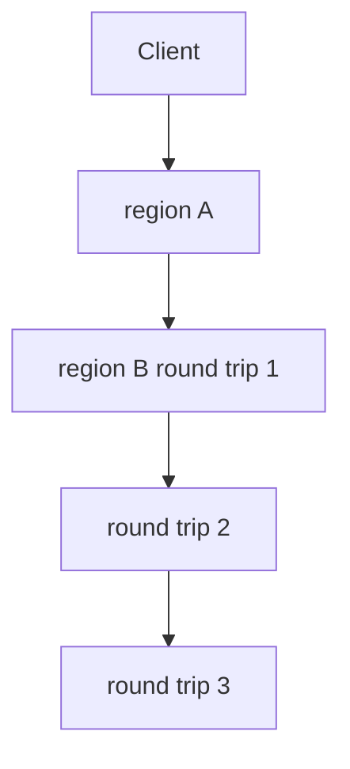

# A02.37 · cross-region latency

[Phase index](../README.md) · [Principal] · 25–40 minutes

Prerequisite [A02.36](A02.36.md) · Next [A02.38](A02.38.md)

## 1. The problem & why it exists

A cross-region request makes three sequential database calls and misses its deadline.

Co-locate chatty components or batch calls. Replication can serve some local reads, with consistency, cost and failure-mode trade-offs.

## 2. Visual mental model



```text
01. Client
02. region A
03. region B round trip 1
04. round trip 2
05. round trip 3
```

This trace isolates one boundary. For a deployed path, name the observer and capture the actual protocol, timing and configuration separately.

## 3. Step-by-step mechanism & minimal dry-run

RTT includes propagation plus forwarding, queuing and serialization. Sequential dependencies multiply the contribution of RTT. Parallel work overlaps only if there are no ordering constraints.

**Dry-run.** Client -> region A -> region B round trip 1 -> round trip 2 -> round trip 3.

**Failure control.** Predict how the result changes if you reproduce the mistake from section 1. Use the two outputs in section 6 to locate its effect.

## 4. Formal rigor & quantitative math

With inter-region RTT 80 ms and three sequential calls, the path contributes about 240 ms before server and client work. One batch reduces the RTT contribution to 80 ms.

Check the worked quantities with NumPy after running `uv sync --locked --extra math`.

```python
import numpy as np

actual = np.multiply(80, 3)
np.testing.assert_allclose(actual, 240)
print(actual)
```

## 5. Progressive design

Compare the two paths in the [runnable fixture](../examples/A02.37.py). Running the fixture uses a bounded in-process fixture.

| Path | Output evidence | Resource consideration | Failure to watch |
| --- | --- | --- | --- |
| Failure control | `floor: 240` | Check whether the broken assumption changes time, bytes or retained state | A cross-region request makes three sequential database calls and misses its deadline. |
| Normal control | `floor: 80` | Same task size and local fixture | Apply the measured rule only within its modeled boundary |

## 6. Safe local lab & controlled failure injection

Predict both outputs, then run from the repository root.

```sh
uv run python "01-architecture-A01-to-A20/A02-networking-and-communication/examples/A02.37.py"
uv run python "01-architecture-A01-to-A20/A02-networking-and-communication/examples/A02.37.py" --break
```

**Observe.** Look for `floor: 80` in the normal output and `floor: 240` in the failure control.

**Diagnose and repair.** Identify the first incorrect boundary in the broken run. Switch back to the normal run and change the deciding input in a scratch copy. Use a four-call workflow split into two independent branches. Record normal, failure and repaired observations.

**Apply.** Connect the result to [L3](../labs/L3.md). The example exits without starting a persistent service. Remove scratch files after saving the evidence you need.

## 7. Production & multi-cloud bridge

Compare measured tail latency and failure behavior across zone and region boundaries. When comparing managed services on AWS, Azure and Google Cloud, keep DNS, transport, TLS and upstream timing separate and check the actual supported settings.

<details>
<summary>Principal question and answer</summary>

**Question.** At 70 ms RTT, what do four serialized cross-region calls contribute?

280 ms. Compare measured tail latency and failure behavior across zone and region boundaries.

</details>

## 8. Memory hook & mastery checkpoint

**Recall.** RTT includes propagation plus forwarding, queuing and serialization. Explain its boundary using the failure control.

1. At 70 ms RTT, what do four serialized cross-region calls contribute?
2. Can parallel calls help if each depends on the previous result?
3. Identify the observable boundary affected by the failing control.
4. Predict the normal output and the broken output before execution.
5. Change the input as directed in section 6. Recompute and justify your prediction.

<details>
<summary>Answers and reasoning</summary>

1. 280 ms.
2. No, change the interface or workflow first.
3. Compare measured tail latency and failure behavior across zone and region boundaries.
4. Normal `floor: 80`. Broken `floor: 240`.
5. Use the relationship from section 4, then run your changed fixture with every other input held constant.

</details>
