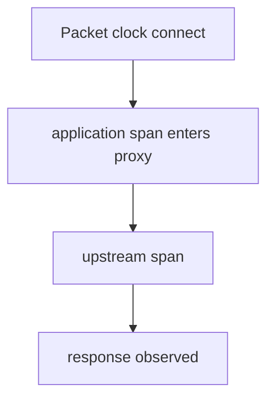

# A02.38 · packet capture and distributed traces

[Phase index](../README.md) · [Principal] · 25–40 minutes

Prerequisite [A02.37](A02.37.md) · Next [A02 exit gate](../README.md#practice-and-exit-gate)

## 1. The problem & why it exists

One user reports a timeout, and packet captures conflict with the application trace.

Collect minimal scoped metadata from consenting local fixtures. Use span timing for app breakdown and captures for loss, retransmissions and connection state.

## 2. Visual mental model



```text
01. Packet clock connect
02. application span enters proxy
03. upstream span
04. response observed
```

This trace isolates one boundary. For a deployed path, name the observer and capture the actual protocol, timing and configuration separately.

## 3. Step-by-step mechanism & minimal dry-run

Packets show transport events at the capture point. Traces show application causality and deployment hops. TLS encrypts content, and clocks can differ, so correlate time windows, protocol tuple and trusted request ID where available.

**Dry-run.** Packet clock connect -> application span enters proxy -> upstream span -> response observed.

**Failure control.** Predict how the result changes if you reproduce the mistake from section 1. Use the two outputs in section 6 to locate its effect.

**Part A · Packet timeline.** Identify interface, local/remote tuple and whether capture occurs before or after any translation. Start before the connection, and keep capture scoped to the local fixture.

**Part B · Application timeline.** Use trace propagation across participating components. Compute union duration for overlapping child spans. A gap between clocks or absent spans can be observational, so verify comparable endpoints before drawing conclusions.

## 4. Formal rigor & quantitative math

If a proxy span lasts 400 ms and the union of its child spans covers 250 ms fully within it, 150 ms remains outside that child. Overlapping child spans need union duration before subtraction.

Check the worked quantities with NumPy after running `uv sync --locked --extra math`.

```python
import numpy as np

actual = 400 - np.count_nonzero((np.arange(400) >= 50) & (np.arange(400) < 300))
np.testing.assert_allclose(actual, 150)
print(actual)
```

## 5. Progressive design

Compare the two paths in the [runnable fixture](../examples/A02.38.py). Running the fixture uses a bounded in-process fixture.

| Path | Output evidence | Resource consideration | Failure to watch |
| --- | --- | --- | --- |
| Failure control | `work: 50` | Check whether the broken assumption changes time, bytes or retained state | One user reports a timeout, and packet captures conflict with the application trace. |
| Normal control | `work: 150` | Same task size and local fixture | Apply the measured rule only within its modeled boundary |

## 6. Safe local lab & controlled failure injection

Predict both outputs, then run from the repository root.

```sh
uv run python "01-architecture-A01-to-A20/A02-networking-and-communication/examples/A02.38.py"
uv run python "01-architecture-A01-to-A20/A02-networking-and-communication/examples/A02.38.py" --break
```

**Observe.** Look for `work: 150` in the normal output and `work: 50` in the failure control.

**Diagnose and repair.** Identify the first incorrect boundary in the broken run. Switch back to the normal run and change the deciding input in a scratch copy. Add a third child disjoint from both current children and compute the union. Record normal, failure and repaired observations.

**Apply.** Connect the result to [L1](../labs/L1.md). The example exits without starting a persistent service. Remove scratch files after saving the evidence you need.

## 7. Production & multi-cloud bridge

Keep correlation IDs out of secret payloads and limit capture scope and retention. When comparing managed services on AWS, Azure and Google Cloud, keep DNS, transport, TLS and upstream timing separate and check the actual supported settings.

<details>
<summary>Principal question and answer</summary>

**Question.** Can a TLS packet capture reveal the plain HTTP path by default?

No. Keep correlation IDs out of secret payloads and limit capture scope and retention.

</details>

## 8. Memory hook & mastery checkpoint

**Recall.** Packets show transport events at the capture point. Explain its boundary using the failure control.

1. Can a TLS packet capture reveal the plain HTTP path by default?
2. What happens when captured clocks disagree?
3. Identify the observable boundary affected by the failing control.
4. Predict the normal output and the broken output before execution.
5. Change the input as directed in section 6. Recompute and justify your prediction.

<details>
<summary>Answers and reasoning</summary>

1. No.
2. Use same-clock intervals and align by shared events rather than absolute equality.
3. Keep correlation IDs out of secret payloads and limit capture scope and retention.
4. Normal `work: 150`. Broken `work: 50`.
5. Use the relationship from section 4, then run your changed fixture with every other input held constant.

</details>

## Standards and implementation notes

W3C Trace Context defines correlation header fields across cooperating services. Packet fields are capture-point-local; use timing anchors and respect trace and capture privacy.

- [W3C Trace Context](https://www.w3.org/TR/trace-context/)
- [RFC 9293 · TCP](https://www.rfc-editor.org/rfc/rfc9293.html)
