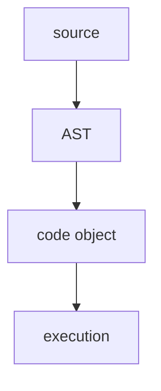

# A03.01 · Python execution pipeline

[Phase index](../README.md) · [Foundation] · 25–40 minutes

Prerequisite [A02 exit gate](../../A02-networking-and-communication/README.md#practice-and-exit-gate) · Next [A03.02](A03.02.md)

## 1. The problem & why it exists

An import starts a job that should run only when the module is launched. Use compile to check syntax, then execute only under the intended entrypoint.

## 2. Visual mental model



```text
1. source
2. AST
3. code object
4. execution
```

The diagram isolates the mechanism on one request or process. Deployment limits and concurrent work can introduce additional boundaries.

## 3. Step-by-step mechanism & minimal dry-run

Parsing yields an AST, compilation yields code objects, and execution performs effects. Import can execute the module body; a main guard protects entrypoint work.

**Trace.** source → AST → code object → execution.

Run the example twice. Identify the first state where the controlled failure changes the behavior or assumption.

## 4. Formal rigor & quantitative math

For m distinct imports with bodies costing c ms each, first loads can cost m×c. Five at 8 ms cost 40 ms; import caching is per interpreter.

Verify the worked calculation with Python.

```python
import math

actual = 5 * 8
assert math.isclose(actual, 40, rel_tol=1e-4)
print(actual)
```

## 5. Progressive design

| Control | Observable evidence | Trade-off |
| --- | --- | --- |
| Failure | `not executed` | Find the boundary where the fixture's incorrect assumption becomes visible. |
| Normal | `3` | Use compile to check syntax, then execute only under the intended entrypoint. |

The [fixture](../examples/A03.01.py) is bounded. Check whether it runs the real runtime primitive or models a decision with fixed inputs before interpreting its output as production evidence.

## 6. Safe local lab & controlled failure injection

From the repository root, after `uv sync --locked --extra api`:

```sh
uv run --extra api python "01-architecture-A01-to-A20/A03-python-runtime-and-backend-apis/examples/A03.01.py"
uv run --extra api python "01-architecture-A01-to-A20/A03-python-runtime-and-backend-apis/examples/A03.01.py" --break
```

Predict both runs, measure the first difference, and rerun the normal control. Change one parameter in the worked example or one input to the fixture, recompute your expected result, and record any mismatch. Remove your scratch copy once you have the evidence. Continue to [L1](../labs/L1.md) for integration practice.

## 7. Production & multi-cloud bridge

Use compile to check syntax, then execute only under the intended entrypoint. For a container deployment on Amazon EKS, Azure AKS or Google Kubernetes Engine, locate the boundary in application code, process configuration and any service in the request path. Collect evidence at the affected boundary before changing infrastructure.

<details>
<summary>Principal discussion</summary>

What phase rejects invalid syntax? Parsing or compilation, before executing that code object. In a design review, state the observable signal that would confirm the diagnosis and name the owner of the boundary.

</details>

## 8. Memory hook & mastery checkpoint

1. What phase rejects invalid syntax?
2. State the observation for each control and locate their first divergence.
3. Change the worked input and calculate the result before running the check.
4. Explain which decision in section 5 you would preserve in a larger deployment.
5. Explain one difference between this fixture and production behavior.

<details>
<summary>Check your answers</summary>

1. Parsing or compilation, before executing that code object.
2. Normal `3`. Failure `not executed`.
3. Apply the relationship in section 4 to the modified input. Verify the output with the same units.
4. Use compile to check syntax, then execute only under the intended entrypoint.
5. Parsing yields an AST, compilation yields code objects, and execution performs effects. Import can execute the module body; a main guard protects entrypoint work.

</details>

## Standards and implementation notes

- [Primary specification or implementation documentation](https://docs.python.org/3/library/ast.html)
