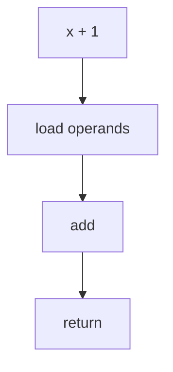

# A03.02 · compilation to bytecode

[Phase index](../README.md) · [Foundation] · 25–40 minutes

Prerequisite [A03.01](A03.01.md) · Next [A03.03](A03.03.md)

## 1. The problem & why it exists

An engineer counts bytecode opcodes as native CPU instructions. Inspect bytecode for behavior and use profiling to answer CPU cost questions.

## 2. Visual mental model



```text
1. x + 1
2. load operands
3. add
4. return
```

The diagram isolates the mechanism on one request or process. Deployment limits and concurrent work can introduce additional boundaries.

## 3. Step-by-step mechanism & minimal dry-run

CPython disassembles its own code objects. The interpreter can specialize execution, and opcode names change across releases. Inspect the actual deployed interpreter.

**Trace.** x + 1 → load operands → add → return.

Run the example twice. Identify the first state where the controlled failure changes the behavior or assumption.

## 4. Formal rigor & quantitative math

If a loop performs n iterations with k bytecode operations per modeled iteration, that path accounts for n×k operations. 100×6 gives 600, excluding setup.

Verify the worked calculation with Python.

```python
import math

actual = 100 * 6
assert math.isclose(actual, 600, rel_tol=1e-4)
print(actual)
```

## 5. Progressive design

| Control | Observable evidence | Trade-off |
| --- | --- | --- |
| Failure | `native count inferred True` | Find the boundary where the fixture's incorrect assumption becomes visible. |
| Normal | `instructions inspected True` | Inspect bytecode for behavior and use profiling to answer CPU cost questions. |

The [fixture](../examples/A03.02.py) is bounded. Check whether it runs the real runtime primitive or models a decision with fixed inputs before interpreting its output as production evidence.

## 6. Safe local lab & controlled failure injection

From the repository root, after `uv sync --locked --extra api`:

```sh
uv run --extra api python "01-architecture-A01-to-A20/A03-python-runtime-and-backend-apis/examples/A03.02.py"
uv run --extra api python "01-architecture-A01-to-A20/A03-python-runtime-and-backend-apis/examples/A03.02.py" --break
```

Predict both runs, measure the first difference, and rerun the normal control. Change one parameter in the worked example or one input to the fixture, recompute your expected result, and record any mismatch. Remove your scratch copy once you have the evidence. Continue to [L1](../labs/L1.md) for integration practice.

## 7. Production & multi-cloud bridge

Inspect bytecode for behavior and use profiling to answer CPU cost questions. For a container deployment on Amazon EKS, Azure AKS or Google Kubernetes Engine, locate the boundary in application code, process configuration and any service in the request path. Collect evidence at the affected boundary before changing infrastructure.

<details>
<summary>Principal discussion</summary>

Is disassembly a native instruction count? No, it describes the Python virtual machine. In a design review, state the observable signal that would confirm the diagnosis and name the owner of the boundary.

</details>

## 8. Memory hook & mastery checkpoint

1. Is disassembly a native instruction count?
2. State the observation for each control and locate their first divergence.
3. Change the worked input and calculate the result before running the check.
4. Explain which decision in section 5 you would preserve in a larger deployment.
5. Explain one difference between this fixture and production behavior.

<details>
<summary>Check your answers</summary>

1. No, it describes the Python virtual machine.
2. Normal `instructions inspected True`. Failure `native count inferred True`.
3. Apply the relationship in section 4 to the modified input. Verify the output with the same units.
4. Inspect bytecode for behavior and use profiling to answer CPU cost questions.
5. CPython disassembles its own code objects. The interpreter can specialize execution, and opcode names change across releases. Inspect the actual deployed interpreter.

</details>

## Standards and implementation notes

- [Primary specification or implementation documentation](https://docs.python.org/3/library/dis.html)
