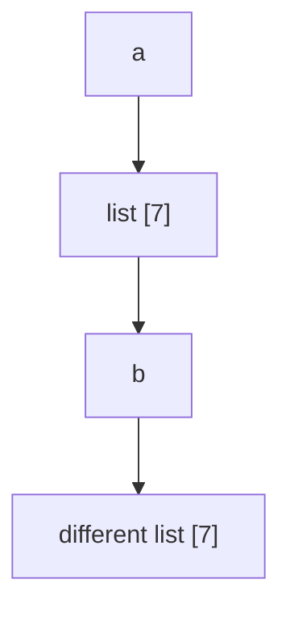

# A03.03 · object identity and references

[Phase index](../README.md) · [Foundation] · 25–40 minutes

Prerequisite [A03.02](A03.02.md) · Next [A03.04](A03.04.md)

## 1. The problem & why it exists

A service compares equal user IDs using identity and rejects a valid request. Use equality for values and identity for designated singleton objects such as None.

## 2. Visual mental model



```text
1. a
2. list [7]
3. b
4. different list [7]
```

The diagram isolates the mechanism on one request or process. Deployment limits and concurrent work can introduce additional boundaries.

## 3. Step-by-step mechanism & minimal dry-run

A name binds to an object. is compares identity and == asks about equality. Python can reuse objects but identity reuse is an implementation detail.

**Trace.** a → list [7]; b → different list [7].

Run the example twice. Identify the first state where the controlled failure changes the behavior or assumption.

## 4. Formal rigor & quantitative math

Two lists of n equal elements can require n element comparisons, while identity is constant-time. For n=3, three equal positions must be visited in the simple model.

Verify the worked calculation with Python.

```python
import math

actual = sum(a == b for a, b in zip([1, 2, 3], [1, 2, 3]))
assert math.isclose(actual, 3, rel_tol=1e-4)
print(actual)
```

## 5. Progressive design

| Control | Observable evidence | Trade-off |
| --- | --- | --- |
| Failure | `False` | Find the boundary where the fixture's incorrect assumption becomes visible. |
| Normal | `True` | Use equality for values and identity for designated singleton objects such as None. |

The [fixture](../examples/A03.03.py) is bounded. Check whether it runs the real runtime primitive or models a decision with fixed inputs before interpreting its output as production evidence.

## 6. Safe local lab & controlled failure injection

From the repository root, after `uv sync --locked --extra api`:

```sh
uv run --extra api python "01-architecture-A01-to-A20/A03-python-runtime-and-backend-apis/examples/A03.03.py"
uv run --extra api python "01-architecture-A01-to-A20/A03-python-runtime-and-backend-apis/examples/A03.03.py" --break
```

Predict both runs, measure the first difference, and rerun the normal control. Change one parameter in the worked example or one input to the fixture, recompute your expected result, and record any mismatch. Remove your scratch copy once you have the evidence. Continue to [L1](../labs/L1.md) for integration practice.

## 7. Production & multi-cloud bridge

Use equality for values and identity for designated singleton objects such as None. For a container deployment on Amazon EKS, Azure AKS or Google Kubernetes Engine, locate the boundary in application code, process configuration and any service in the request path. Collect evidence at the affected boundary before changing infrastructure.

<details>
<summary>Principal discussion</summary>

Can two distinct lists compare equal? Yes, when their elements compare equal. In a design review, state the observable signal that would confirm the diagnosis and name the owner of the boundary.

</details>

## 8. Memory hook & mastery checkpoint

1. Can two distinct lists compare equal?
2. State the observation for each control and locate their first divergence.
3. Change the worked input and calculate the result before running the check.
4. Explain which decision in section 5 you would preserve in a larger deployment.
5. Explain one difference between this fixture and production behavior.

<details>
<summary>Check your answers</summary>

1. Yes, when their elements compare equal.
2. Normal `True`. Failure `False`.
3. Apply the relationship in section 4 to the modified input. Verify the output with the same units.
4. Use equality for values and identity for designated singleton objects such as None.
5. A name binds to an object. is compares identity and == asks about equality. Python can reuse objects but identity reuse is an implementation detail.

</details>

## Standards and implementation notes

- [Primary specification or implementation documentation](https://docs.python.org/3/library/stdtypes.html)
