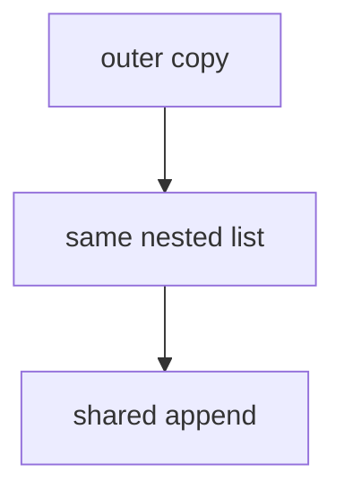

# A03.04 · mutability and aliasing

[Phase index](../README.md) · [Foundation] · 25–40 minutes

Prerequisite [A03.03](A03.03.md) · Next [A03.05](A03.05.md)

## 1. The problem & why it exists

A request modifies a nested setting for every request that follows. Copy only mutable state the new owner will change, and test nested aliases.

## 2. Visual mental model



```text
1. outer copy
2. same nested list
3. shared append
```

The diagram isolates the mechanism on one request or process. Deployment limits and concurrent work can introduce additional boundaries.

## 3. Step-by-step mechanism & minimal dry-run

A shallow copy copies the outer container while retaining references to nested objects. Choose immutable values, targeted copies, or deep copies according to ownership.

**Trace.** outer copy → same nested list → shared append.

Run the example twice. Identify the first state where the controlled failure changes the behavior or assumption.

## 4. Formal rigor & quantitative math

For n reference slots, a shallow list copy needs O(n) time and extra slots. An independent copy of three 4-element rows visits 12 nested positions in addition to the outer structure.

Verify the worked calculation with Python.

```python
import math

actual = 3 * 4
assert math.isclose(actual, 12, rel_tol=1e-4)
print(actual)
```

## 5. Progressive design

| Control | Observable evidence | Trade-off |
| --- | --- | --- |
| Failure | `[[1, 2]]` | Find the boundary where the fixture's incorrect assumption becomes visible. |
| Normal | `[[1]]` | Copy only mutable state the new owner will change, and test nested aliases. |

The [fixture](../examples/A03.04.py) is bounded. Check whether it runs the real runtime primitive or models a decision with fixed inputs before interpreting its output as production evidence.

## 6. Safe local lab & controlled failure injection

From the repository root, after `uv sync --locked --extra api`:

```sh
uv run --extra api python "01-architecture-A01-to-A20/A03-python-runtime-and-backend-apis/examples/A03.04.py"
uv run --extra api python "01-architecture-A01-to-A20/A03-python-runtime-and-backend-apis/examples/A03.04.py" --break
```

Predict both runs, measure the first difference, and rerun the normal control. Change one parameter in the worked example or one input to the fixture, recompute your expected result, and record any mismatch. Remove your scratch copy once you have the evidence. Continue to [L1](../labs/L1.md) for integration practice.

## 7. Production & multi-cloud bridge

Copy only mutable state the new owner will change, and test nested aliases. For a container deployment on Amazon EKS, Azure AKS or Google Kubernetes Engine, locate the boundary in application code, process configuration and any service in the request path. Collect evidence at the affected boundary before changing infrastructure.

<details>
<summary>Principal discussion</summary>

Does list.copy recursively copy children? No. In a design review, state the observable signal that would confirm the diagnosis and name the owner of the boundary.

</details>

## 8. Memory hook & mastery checkpoint

1. Does list.copy recursively copy children?
2. State the observation for each control and locate their first divergence.
3. Change the worked input and calculate the result before running the check.
4. Explain which decision in section 5 you would preserve in a larger deployment.
5. Explain one difference between this fixture and production behavior.

<details>
<summary>Check your answers</summary>

1. No.
2. Normal `[[1]]`. Failure `[[1, 2]]`.
3. Apply the relationship in section 4 to the modified input. Verify the output with the same units.
4. Copy only mutable state the new owner will change, and test nested aliases.
5. A shallow copy copies the outer container while retaining references to nested objects. Choose immutable values, targeted copies, or deep copies according to ownership.

</details>

## Standards and implementation notes

- [Primary specification or implementation documentation](https://docs.python.org/3/library/copy.html)
