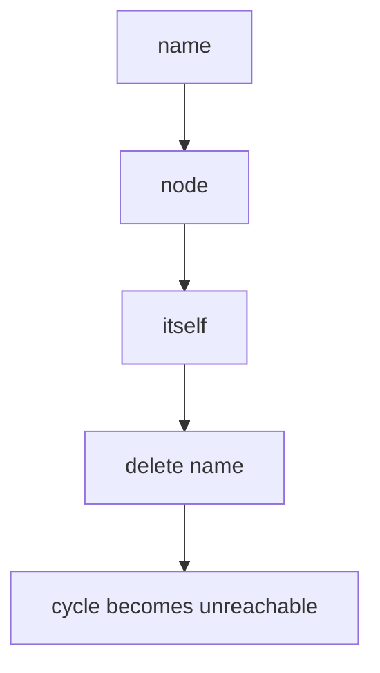

# A03.05 · reference counting/cyclic GC

[Phase index](../README.md) · [Foundation] · 25–40 minutes

Prerequisite [A03.04](A03.04.md) · Next [A03.06](A03.06.md)

## 1. The problem & why it exists

Unreachable cyclic objects appear to survive after a name is deleted. Use explicit cleanup for resources. Treat collection timing as runtime behavior rather than a lifetime contract.

## 2. Visual mental model



```text
1. name
2. node
3. itself
4. delete name
5. cycle becomes unreachable
```

The diagram isolates the mechanism on one request or process. Deployment limits and concurrent work can introduce additional boundaries.

## 3. Step-by-step mechanism & minimal dry-run

CPython combines reference counting with a collector for tracked cycles. A cycle can preserve nonzero reference counts after its last external reference disappears. Other implementations may differ.

**Trace.** name → node → itself; delete name → cycle becomes unreachable.

Run the example twice. Identify the first state where the controlled failure changes the behavior or assumption.

## 4. Formal rigor & quantitative math

A cycle of n singly linked nodes retains n internal edges. A three-node cycle has three edges after all external names are deleted.

Verify the worked calculation with Python.

```python
import math

actual = len([(0, 1), (1, 2), (2, 0)])
assert math.isclose(actual, 3, rel_tol=1e-4)
print(actual)
```

## 5. Progressive design

| Control | Observable evidence | Trade-off |
| --- | --- | --- |
| Failure | `survives: True` | Find the boundary where the fixture's incorrect assumption becomes visible. |
| Normal | `survives: False` | Use explicit cleanup for resources. Treat collection timing as runtime behavior rather than a lifetime contract. |

The [fixture](../examples/A03.05.py) is bounded. Check whether it runs the real runtime primitive or models a decision with fixed inputs before interpreting its output as production evidence.

## 6. Safe local lab & controlled failure injection

From the repository root, after `uv sync --locked --extra api`:

```sh
uv run --extra api python "01-architecture-A01-to-A20/A03-python-runtime-and-backend-apis/examples/A03.05.py"
uv run --extra api python "01-architecture-A01-to-A20/A03-python-runtime-and-backend-apis/examples/A03.05.py" --break
```

Predict both runs, measure the first difference, and rerun the normal control. Change one parameter in the worked example or one input to the fixture, recompute your expected result, and record any mismatch. Remove your scratch copy once you have the evidence. Continue to [L1](../labs/L1.md) for integration practice.

## 7. Production & multi-cloud bridge

Use explicit cleanup for resources. Treat collection timing as runtime behavior rather than a lifetime contract. For a container deployment on Amazon EKS, Azure AKS or Google Kubernetes Engine, locate the boundary in application code, process configuration and any service in the request path. Collect evidence at the affected boundary before changing infrastructure.

<details>
<summary>Principal discussion</summary>

Does del guarantee RSS drops? No. It unbinds a name and allocator or reachability effects can differ. In a design review, state the observable signal that would confirm the diagnosis and name the owner of the boundary.

</details>

## 8. Memory hook & mastery checkpoint

1. Does del guarantee RSS drops?
2. State the observation for each control and locate their first divergence.
3. Change the worked input and calculate the result before running the check.
4. Explain which decision in section 5 you would preserve in a larger deployment.
5. Explain one difference between this fixture and production behavior.

<details>
<summary>Check your answers</summary>

1. No. It unbinds a name and allocator or reachability effects can differ.
2. Normal `survives: False`. Failure `survives: True`.
3. Apply the relationship in section 4 to the modified input. Verify the output with the same units.
4. Use explicit cleanup for resources. Treat collection timing as runtime behavior rather than a lifetime contract.
5. CPython combines reference counting with a collector for tracked cycles. A cycle can preserve nonzero reference counts after its last external reference disappears. Other implementations may differ.

</details>

## Standards and implementation notes

- [Primary specification or implementation documentation](https://docs.python.org/3/library/gc.html)
