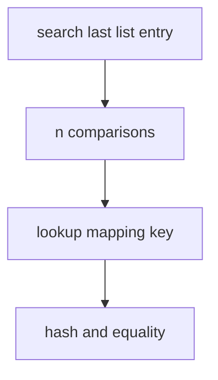

# A03.06 · list/dict runtime costs

[Phase index](../README.md) · [Foundation] · 25–40 minutes

Prerequisite [A03.05](A03.05.md) · Next [A03.07](A03.07.md)

## 1. The problem & why it exists

A request scans a list of IDs repeatedly and becomes slow as accounts grow. Index when repeated lookup justifies extra memory; use a list for ordered iteration or a handful of checks.

## 2. Visual mental model



```text
1. search last list entry
2. n comparisons
3. lookup mapping key
4. hash and equality
```

The diagram isolates the mechanism on one request or process. Deployment limits and concurrent work can introduce additional boundaries.

## 3. Step-by-step mechanism & minimal dry-run

List membership scans elements; dict lookup uses hashes and equality, with expected constant lookup for ordinary keys. Collision behavior and resize costs matter.

**Trace.** search last list entry → n comparisons; lookup mapping key → hash and equality.

Run the example twice. Identify the first state where the controlled failure changes the behavior or assumption.

## 4. Formal rigor & quantitative math

For 100 queries over 1000 entries, a full scan does 100000 comparisons. A dictionary adds O(n) storage and build work before typical O(1) lookups.

Verify the worked calculation with Python.

```python
import math

actual = 100 * 1000
assert math.isclose(actual, 100000, rel_tol=1e-4)
print(actual)
```

## 5. Progressive design

| Control | Observable evidence | Trade-off |
| --- | --- | --- |
| Failure | `1000 key` | Find the boundary where the fixture's incorrect assumption becomes visible. |
| Normal | `1 key` | Index when repeated lookup justifies extra memory; use a list for ordered iteration or a handful of checks. |

The [fixture](../examples/A03.06.py) is bounded. Check whether it runs the real runtime primitive or models a decision with fixed inputs before interpreting its output as production evidence.

## 6. Safe local lab & controlled failure injection

From the repository root, after `uv sync --locked --extra api`:

```sh
uv run --extra api python "01-architecture-A01-to-A20/A03-python-runtime-and-backend-apis/examples/A03.06.py"
uv run --extra api python "01-architecture-A01-to-A20/A03-python-runtime-and-backend-apis/examples/A03.06.py" --break
```

Predict both runs, measure the first difference, and rerun the normal control. Change one parameter in the worked example or one input to the fixture, recompute your expected result, and record any mismatch. Remove your scratch copy once you have the evidence. Continue to [L1](../labs/L1.md) for integration practice.

## 7. Production & multi-cloud bridge

Index when repeated lookup justifies extra memory; use a list for ordered iteration or a handful of checks. For a container deployment on Amazon EKS, Azure AKS or Google Kubernetes Engine, locate the boundary in application code, process configuration and any service in the request path. Collect evidence at the affected boundary before changing infrastructure.

<details>
<summary>Principal discussion</summary>

Is average dictionary lookup a worst-case guarantee? No. In a design review, state the observable signal that would confirm the diagnosis and name the owner of the boundary.

</details>

## 8. Memory hook & mastery checkpoint

1. Is average dictionary lookup a worst-case guarantee?
2. State the observation for each control and locate their first divergence.
3. Change the worked input and calculate the result before running the check.
4. Explain which decision in section 5 you would preserve in a larger deployment.
5. Explain one difference between this fixture and production behavior.

<details>
<summary>Check your answers</summary>

1. No.
2. Normal `1 key`. Failure `1000 key`.
3. Apply the relationship in section 4 to the modified input. Verify the output with the same units.
4. Index when repeated lookup justifies extra memory; use a list for ordered iteration or a handful of checks.
5. List membership scans elements; dict lookup uses hashes and equality, with expected constant lookup for ordinary keys. Collision behavior and resize costs matter.

</details>

## Standards and implementation notes

- [Primary specification or implementation documentation](https://docs.python.org/3/library/stdtypes.html)
