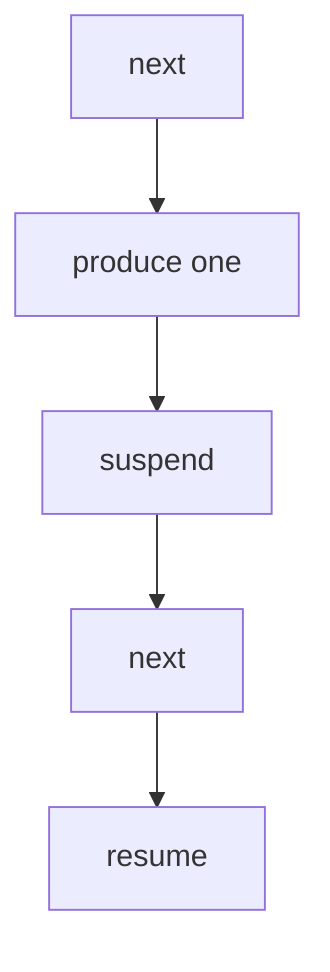

# A03.07 · iterators/generators

[Phase index](../README.md) · [Foundation] · 25–40 minutes

Prerequisite [A03.06](A03.06.md) · Next [A03.08](A03.08.md)

## 1. The problem & why it exists

A pipeline builds an entire list before a client can read its first row. Use a generator when consumption is incremental and resource lifecycle is explicit.

## 2. Visual mental model



```text
1. next
2. produce one
3. suspend
4. next
5. resume
```

The diagram isolates the mechanism on one request or process. Deployment limits and concurrent work can introduce additional boundaries.

## 3. Step-by-step mechanism & minimal dry-run

An iterator supplies the next item on request. A generator suspends with local state at yield and typically resumes once per pull. Once exhausted, that iterator stays exhausted.

**Trace.** next → produce one → suspend → next → resume.

Run the example twice. Identify the first state where the controlled failure changes the behavior or assumption.

## 4. Formal rigor & quantitative math

Keeping n payloads of s bytes costs n×s payload bytes. At 5000×1 KiB that is about 4.88 MiB. Holding one chunk needs 1 KiB under the same model.

Verify the worked calculation with Python.

```python
import math

actual = 5000 / 1024
assert math.isclose(actual, 4.8828125, rel_tol=1e-4)
print(actual)
```

## 5. Progressive design

| Control | Observable evidence | Trade-off |
| --- | --- | --- |
| Failure | `produce 2 → first: 0` | Find the boundary where the fixture's incorrect assumption becomes visible. |
| Normal | `produce 0 → first: 0` | Use a generator when consumption is incremental and resource lifecycle is explicit. |

The [fixture](../examples/A03.07.py) is bounded. Check whether it runs the real runtime primitive or models a decision with fixed inputs before interpreting its output as production evidence.

## 6. Safe local lab & controlled failure injection

From the repository root, after `uv sync --locked --extra api`:

```sh
uv run --extra api python "01-architecture-A01-to-A20/A03-python-runtime-and-backend-apis/examples/A03.07.py"
uv run --extra api python "01-architecture-A01-to-A20/A03-python-runtime-and-backend-apis/examples/A03.07.py" --break
```

Predict both runs, measure the first difference, and rerun the normal control. Change one parameter in the worked example or one input to the fixture, recompute your expected result, and record any mismatch. Remove your scratch copy once you have the evidence. Continue to [L1](../labs/L1.md) for integration practice.

## 7. Production & multi-cloud bridge

Use a generator when consumption is incremental and resource lifecycle is explicit. For a container deployment on Amazon EKS, Azure AKS or Google Kubernetes Engine, locate the boundary in application code, process configuration and any service in the request path. Collect evidence at the affected boundary before changing infrastructure.

<details>
<summary>Principal discussion</summary>

Can you iterate twice over the same exhausted generator? It returns no more items. In a design review, state the observable signal that would confirm the diagnosis and name the owner of the boundary.

</details>

## 8. Memory hook & mastery checkpoint

1. Can you iterate twice over the same exhausted generator?
2. State the observation for each control and locate their first divergence.
3. Change the worked input and calculate the result before running the check.
4. Explain which decision in section 5 you would preserve in a larger deployment.
5. Explain one difference between this fixture and production behavior.

<details>
<summary>Check your answers</summary>

1. It returns no more items.
2. Normal `produce 0 → first: 0`. Failure `produce 2 → first: 0`.
3. Apply the relationship in section 4 to the modified input. Verify the output with the same units.
4. Use a generator when consumption is incremental and resource lifecycle is explicit.
5. An iterator supplies the next item on request. A generator suspends with local state at yield and typically resumes once per pull. Once exhausted, that iterator stays exhausted.

</details>

## Standards and implementation notes

- [Primary specification or implementation documentation](https://docs.python.org/3/library/stdtypes.html)
