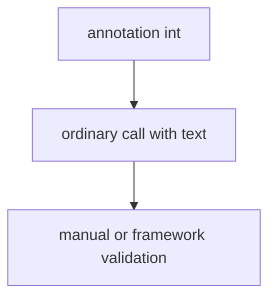

# A03.08 · type hints

[Phase index](../README.md) · [Foundation] · 25–40 minutes

Prerequisite [A03.07](A03.07.md) · Next [A03.09](A03.09.md)

## 1. The problem & why it exists

A handler assumes the integer annotation already rejected a JSON string. Use type checking for internal code and explicit runtime validation for untrusted data.

## 2. Visual mental model



```text
1. annotation int
2. ordinary call with text
3. manual or framework validation
```

The diagram isolates the mechanism on one request or process. Deployment limits and concurrent work can introduce additional boundaries.

## 3. Step-by-step mechanism & minimal dry-run

Annotations give metadata to tools and libraries. Ordinary Python calls do not enforce them. Validation at an input boundary constructs a value under a runtime contract.

**Trace.** annotation int → ordinary call with text → manual or framework validation.

Run the example twice. Identify the first state where the controlled failure changes the behavior or assumption.

## 4. Formal rigor & quantitative math

If n fields each require c checks, cost is n×c checks. For 6 fields at 2 checks each, expect 12 checks in this model.

Verify the worked calculation with Python.

```python
import math

actual = 6 * 2
assert math.isclose(actual, 12, rel_tol=1e-4)
print(actual)
```

## 5. Progressive design

| Control | Observable evidence | Trade-off |
| --- | --- | --- |
| Failure | `77` | Find the boundary where the fixture's incorrect assumption becomes visible. |
| Normal | `rejected` | Use type checking for internal code and explicit runtime validation for untrusted data. |

The [fixture](../examples/A03.08.py) is bounded. Check whether it runs the real runtime primitive or models a decision with fixed inputs before interpreting its output as production evidence.

## 6. Safe local lab & controlled failure injection

From the repository root, after `uv sync --locked --extra api`:

```sh
uv run --extra api python "01-architecture-A01-to-A20/A03-python-runtime-and-backend-apis/examples/A03.08.py"
uv run --extra api python "01-architecture-A01-to-A20/A03-python-runtime-and-backend-apis/examples/A03.08.py" --break
```

Predict both runs, measure the first difference, and rerun the normal control. Change one parameter in the worked example or one input to the fixture, recompute your expected result, and record any mismatch. Remove your scratch copy once you have the evidence. Continue to [L1](../labs/L1.md) for integration practice.

## 7. Production & multi-cloud bridge

Use type checking for internal code and explicit runtime validation for untrusted data. For a container deployment on Amazon EKS, Azure AKS or Google Kubernetes Engine, locate the boundary in application code, process configuration and any service in the request path. Collect evidence at the affected boundary before changing infrastructure.

<details>
<summary>Principal discussion</summary>

Does a function annotation convert a string to int? No. In a design review, state the observable signal that would confirm the diagnosis and name the owner of the boundary.

</details>

## 8. Memory hook & mastery checkpoint

1. Does a function annotation convert a string to int?
2. State the observation for each control and locate their first divergence.
3. Change the worked input and calculate the result before running the check.
4. Explain which decision in section 5 you would preserve in a larger deployment.
5. Explain one difference between this fixture and production behavior.

<details>
<summary>Check your answers</summary>

1. No.
2. Normal `rejected`. Failure `77`.
3. Apply the relationship in section 4 to the modified input. Verify the output with the same units.
4. Use type checking for internal code and explicit runtime validation for untrusted data.
5. Annotations give metadata to tools and libraries. Ordinary Python calls do not enforce them. Validation at an input boundary constructs a value under a runtime contract.

</details>

## Standards and implementation notes

- [Primary specification or implementation documentation](https://docs.python.org/3/library/typing.html)
