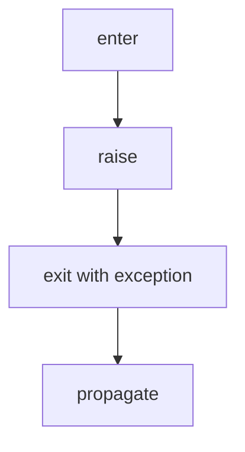

# A03.09 · exceptions and context managers

[Phase index](../README.md) · [Foundation] · 25–40 minutes

Prerequisite [A03.08](A03.08.md) · Next [A03.10](A03.10.md)

## 1. The problem & why it exists

A failed write skips cleanup and leaves a file handle open. Use context managers for resource scopes and keep errors visible unless you can recover.

## 2. Visual mental model



```text
1. enter
2. raise
3. exit with exception
4. propagate
```

The diagram isolates the mechanism on one request or process. Deployment limits and concurrent work can introduce additional boundaries.

## 3. Step-by-step mechanism & minimal dry-run

With calls __enter__ and __exit__ around a block. On an exception __exit__ receives exception details and can deliberately suppress it. finally runs on ordinary unwinding.

**Trace.** enter → raise → exit with exception → propagate.

Run the example twice. Identify the first state where the controlled failure changes the behavior or assumption.

## 4. Formal rigor & quantitative math

If each failure leaks f handles, k failures leak k×f. Fifty failures at two handles each retain 100 handles.

Verify the worked calculation with Python.

```python
import math

actual = 50 * 2
assert math.isclose(actual, 100, rel_tol=1e-4)
print(actual)
```

## 5. Progressive design

| Control | Observable evidence | Trade-off |
| --- | --- | --- |
| Failure | `['open']` | Find the boundary where the fixture's incorrect assumption becomes visible. |
| Normal | `'close'` | Use context managers for resource scopes and keep errors visible unless you can recover. |

The [fixture](../examples/A03.09.py) is bounded. Check whether it runs the real runtime primitive or models a decision with fixed inputs before interpreting its output as production evidence.

## 6. Safe local lab & controlled failure injection

From the repository root, after `uv sync --locked --extra api`:

```sh
uv run --extra api python "01-architecture-A01-to-A20/A03-python-runtime-and-backend-apis/examples/A03.09.py"
uv run --extra api python "01-architecture-A01-to-A20/A03-python-runtime-and-backend-apis/examples/A03.09.py" --break
```

Predict both runs, measure the first difference, and rerun the normal control. Change one parameter in the worked example or one input to the fixture, recompute your expected result, and record any mismatch. Remove your scratch copy once you have the evidence. Continue to [L1](../labs/L1.md) for integration practice.

## 7. Production & multi-cloud bridge

Use context managers for resource scopes and keep errors visible unless you can recover. For a container deployment on Amazon EKS, Azure AKS or Google Kubernetes Engine, locate the boundary in application code, process configuration and any service in the request path. Collect evidence at the affected boundary before changing infrastructure.

<details>
<summary>Principal discussion</summary>

When can an exception disappear from a with block? When its exit method returns a truthy value, among other explicit catches. In a design review, state the observable signal that would confirm the diagnosis and name the owner of the boundary.

</details>

## 8. Memory hook & mastery checkpoint

1. When can an exception disappear from a with block?
2. State the observation for each control and locate their first divergence.
3. Change the worked input and calculate the result before running the check.
4. Explain which decision in section 5 you would preserve in a larger deployment.
5. Explain one difference between this fixture and production behavior.

<details>
<summary>Check your answers</summary>

1. When its exit method returns a truthy value, among other explicit catches.
2. Normal `'close'`. Failure `['open']`.
3. Apply the relationship in section 4 to the modified input. Verify the output with the same units.
4. Use context managers for resource scopes and keep errors visible unless you can recover.
5. With calls __enter__ and __exit__ around a block. On an exception __exit__ receives exception details and can deliberately suppress it. finally runs on ordinary unwinding.

</details>

## Standards and implementation notes

- [Primary specification or implementation documentation](https://docs.python.org/3/library/contextlib.html)
