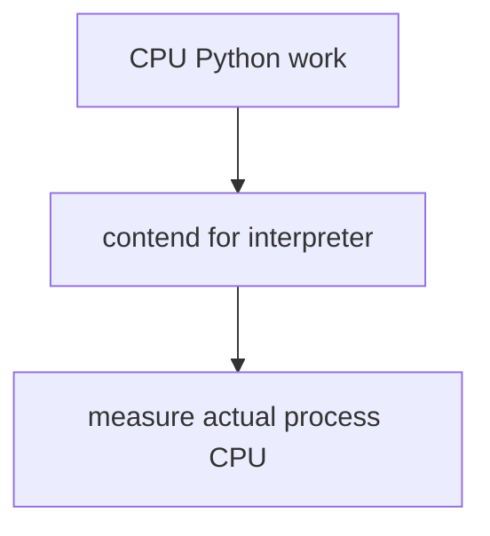

# A03.10 · Python GIL and concurrency scope

[Phase index](../README.md) · [Core] · 25–40 minutes

Prerequisite [A03.09](A03.09.md) · Next [A03.11](A03.11.md)

## 1. The problem & why it exists

Adding threads fails to accelerate CPU-bound Python work. Measure your build. Consider processes or free-threaded compatibility where justified.

## 2. Visual mental model



```text
1. CPU Python work
2. contend for interpreter
3. measure actual process CPU
```

The diagram isolates the mechanism on one request or process. Deployment limits and concurrent work can introduce additional boundaries.

## 3. Step-by-step mechanism & minimal dry-run

Conventional CPython builds have a GIL around much Python execution. Native calls can release it; free-threaded builds have different behavior and some extensions affect mode. Compound state still requires synchronization.

**Trace.** CPU Python work → contend for interpreter → measure actual process CPU.

Run the example twice. Identify the first state where the controlled failure changes the behavior or assumption.

## 4. Formal rigor & quantitative math

Two 100 ms CPU jobs need 200 ms of total CPU. One usable core has a 200 ms service floor before overhead; two cores can ideally finish in 100 ms if execution actually overlaps.

Verify the worked calculation with Python.

```python
import math

actual = sum([100, 100])
assert math.isclose(actual, 200, rel_tol=1e-4)
print(actual)
```

## 5. Progressive design

| Control | Observable evidence | Trade-off |
| --- | --- | --- |
| Failure | `ms: 100` | Find the boundary where the fixture's incorrect assumption becomes visible. |
| Normal | `ms: 200` | Measure your build. Consider processes or free-threaded compatibility where justified. |

The [fixture](../examples/A03.10.py) is bounded. Check whether it runs the real runtime primitive or models a decision with fixed inputs before interpreting its output as production evidence.

## 6. Safe local lab & controlled failure injection

From the repository root, after `uv sync --locked --extra api`:

```sh
uv run --extra api python "01-architecture-A01-to-A20/A03-python-runtime-and-backend-apis/examples/A03.10.py"
uv run --extra api python "01-architecture-A01-to-A20/A03-python-runtime-and-backend-apis/examples/A03.10.py" --break
```

Predict both runs, measure the first difference, and rerun the normal control. Change one parameter in the worked example or one input to the fixture, recompute your expected result, and record any mismatch. Remove your scratch copy once you have the evidence. Continue to [L2](../labs/L2.md) for integration practice.

## 7. Production & multi-cloud bridge

Measure your build. Consider processes or free-threaded compatibility where justified. For a container deployment on Amazon EKS, Azure AKS or Google Kubernetes Engine, locate the boundary in application code, process configuration and any service in the request path. Collect evidence at the affected boundary before changing infrastructure.

<details>
<summary>Principal discussion</summary>

Does the GIL protect a multi-step invariant? No. In a design review, state the observable signal that would confirm the diagnosis and name the owner of the boundary.

</details>

## 8. Memory hook & mastery checkpoint

1. Does the GIL protect a multi-step invariant?
2. State the observation for each control and locate their first divergence.
3. Change the worked input and calculate the result before running the check.
4. Explain which decision in section 5 you would preserve in a larger deployment.
5. Explain one difference between this fixture and production behavior.

<details>
<summary>Check your answers</summary>

1. No.
2. Normal `ms: 200`. Failure `ms: 100`.
3. Apply the relationship in section 4 to the modified input. Verify the output with the same units.
4. Measure your build. Consider processes or free-threaded compatibility where justified.
5. Conventional CPython builds have a GIL around much Python execution. Native calls can release it; free-threaded builds have different behavior and some extensions affect mode. Compound state still requires synchronization.

</details>

## Standards and implementation notes

- [Primary specification or implementation documentation](https://docs.python.org/3/howto/free-threading-python.html)
