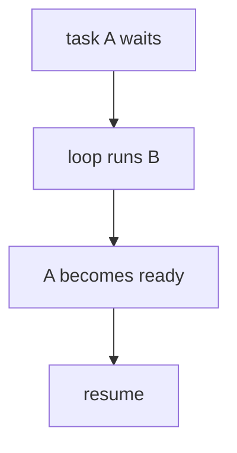

# A03.11 · coroutines, await and cooperative scheduling

[Phase index](../README.md) · [Core] · 25–40 minutes

Prerequisite [A03.10](A03.10.md) · Next [A03.12](A03.12.md)

## 1. The problem & why it exists

An async function calls a synchronous delay and stalls unrelated requests. Use a natively async operation or bounded offloading for blocking I/O.

## 2. Visual mental model



```text
1. task A waits
2. loop runs B
3. A becomes ready
4. resume
```

The diagram isolates the mechanism on one request or process. Deployment limits and concurrent work can introduce additional boundaries.

## 3. Step-by-step mechanism & minimal dry-run

A coroutine advances until it yields control, commonly by awaiting an incomplete future. Awaiting already-ready work might continue immediately. A synchronous blocking call ties up the loop thread.

**Trace.** task A waits → loop runs B → A becomes ready → resume.

Run the example twice. Identify the first state where the controlled failure changes the behavior or assumption.

## 4. Formal rigor & quantitative math

Three independent 40 ms waits occupy roughly 40 ms if overlapped versus 120 ms when serialized, plus scheduling overhead.

Verify the worked calculation with Python.

```python
import math

actual = max([40, 40, 40])
assert math.isclose(actual, 40, rel_tol=1e-4)
print(actual)
```

## 5. Progressive design

| Control | Observable evidence | Trade-off |
| --- | --- | --- |
| Failure | `done 1 → start 2` | Find the boundary where the fixture's incorrect assumption becomes visible. |
| Normal | `start 2 → done 1` | Use a natively async operation or bounded offloading for blocking I/O. |

The [fixture](../examples/A03.11.py) is bounded. Check whether it runs the real runtime primitive or models a decision with fixed inputs before interpreting its output as production evidence.

## 6. Safe local lab & controlled failure injection

From the repository root, after `uv sync --locked --extra api`:

```sh
uv run --extra api python "01-architecture-A01-to-A20/A03-python-runtime-and-backend-apis/examples/A03.11.py"
uv run --extra api python "01-architecture-A01-to-A20/A03-python-runtime-and-backend-apis/examples/A03.11.py" --break
```

Predict both runs, measure the first difference, and rerun the normal control. Change one parameter in the worked example or one input to the fixture, recompute your expected result, and record any mismatch. Remove your scratch copy once you have the evidence. Continue to [L2](../labs/L2.md) for integration practice.

## 7. Production & multi-cloud bridge

Use a natively async operation or bounded offloading for blocking I/O. For a container deployment on Amazon EKS, Azure AKS or Google Kubernetes Engine, locate the boundary in application code, process configuration and any service in the request path. Collect evidence at the affected boundary before changing infrastructure.

<details>
<summary>Principal discussion</summary>

Does writing async def make blocking code nonblocking? No. In a design review, state the observable signal that would confirm the diagnosis and name the owner of the boundary.

</details>

## 8. Memory hook & mastery checkpoint

1. Does writing async def make blocking code nonblocking?
2. State the observation for each control and locate their first divergence.
3. Change the worked input and calculate the result before running the check.
4. Explain which decision in section 5 you would preserve in a larger deployment.
5. Explain one difference between this fixture and production behavior.

<details>
<summary>Check your answers</summary>

1. No.
2. Normal `start 2 → done 1`. Failure `done 1 → start 2`.
3. Apply the relationship in section 4 to the modified input. Verify the output with the same units.
4. Use a natively async operation or bounded offloading for blocking I/O.
5. A coroutine advances until it yields control, commonly by awaiting an incomplete future. Awaiting already-ready work might continue immediately. A synchronous blocking call ties up the loop thread.

</details>

## Standards and implementation notes

- [Primary specification or implementation documentation](https://docs.python.org/3/library/asyncio-task.html)
