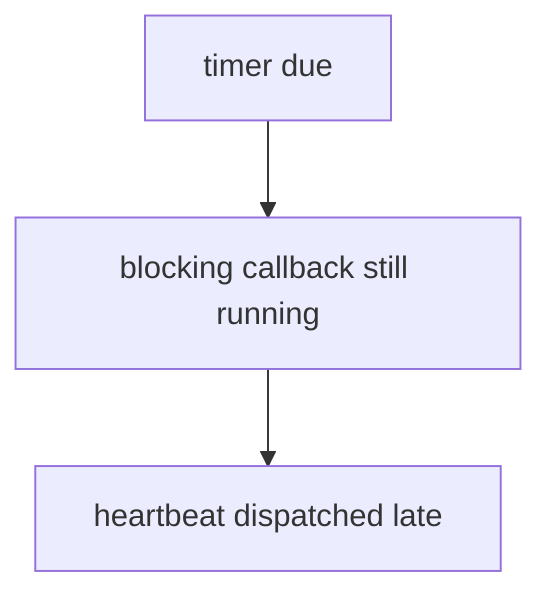

# A03.12 · event loop

[Phase index](../README.md) · [Core] · 25–40 minutes

Prerequisite [A03.11](A03.11.md) · Next [A03.13](A03.13.md)

## 1. The problem & why it exists

A periodic heartbeat misses its interval under an otherwise idle CPU graph. Measure event-loop lag alongside request latency and process CPU.

## 2. Visual mental model



```text
1. timer due
2. blocking callback still running
3. heartbeat dispatched late
```

The diagram isolates the mechanism on one request or process. Deployment limits and concurrent work can introduce additional boundaries.

## 3. Step-by-step mechanism & minimal dry-run

An event loop dispatches ready callbacks, timers and I/O notifications. A callback that runs too long delays everything else scheduled on that thread.

**Trace.** timer due → blocking callback still running → heartbeat dispatched late.

Run the example twice. Identify the first state where the controlled failure changes the behavior or assumption.

## 4. Formal rigor & quantitative math

A 50 ms stall overlapping a timer due after 15 ms induces up to 35 ms extra delay in this simplified timeline.

Verify the worked calculation with Python.

```python
import math

actual = 50 - 15
assert math.isclose(actual, 35, rel_tol=1e-4)
print(actual)
```

## 5. Progressive design

| Control | Observable evidence | Trade-off |
| --- | --- | --- |
| Failure | `timer delayed: True` | Find the boundary where the fixture's incorrect assumption becomes visible. |
| Normal | `timer delayed: False` | Measure event-loop lag alongside request latency and process CPU. |

The [fixture](../examples/A03.12.py) is bounded. Check whether it runs the real runtime primitive or models a decision with fixed inputs before interpreting its output as production evidence.

## 6. Safe local lab & controlled failure injection

From the repository root, after `uv sync --locked --extra api`:

```sh
uv run --extra api python "01-architecture-A01-to-A20/A03-python-runtime-and-backend-apis/examples/A03.12.py"
uv run --extra api python "01-architecture-A01-to-A20/A03-python-runtime-and-backend-apis/examples/A03.12.py" --break
```

Predict both runs, measure the first difference, and rerun the normal control. Change one parameter in the worked example or one input to the fixture, recompute your expected result, and record any mismatch. Remove your scratch copy once you have the evidence. Continue to [L2](../labs/L2.md) for integration practice.

## 7. Production & multi-cloud bridge

Measure event-loop lag alongside request latency and process CPU. For a container deployment on Amazon EKS, Azure AKS or Google Kubernetes Engine, locate the boundary in application code, process configuration and any service in the request path. Collect evidence at the affected boundary before changing infrastructure.

<details>
<summary>Principal discussion</summary>

Can time.sleep cause loop lag while CPU is low? Yes. In a design review, state the observable signal that would confirm the diagnosis and name the owner of the boundary.

</details>

## 8. Memory hook & mastery checkpoint

1. Can time.sleep cause loop lag while CPU is low?
2. State the observation for each control and locate their first divergence.
3. Change the worked input and calculate the result before running the check.
4. Explain which decision in section 5 you would preserve in a larger deployment.
5. Explain one difference between this fixture and production behavior.

<details>
<summary>Check your answers</summary>

1. Yes.
2. Normal `timer delayed: False`. Failure `timer delayed: True`.
3. Apply the relationship in section 4 to the modified input. Verify the output with the same units.
4. Measure event-loop lag alongside request latency and process CPU.
5. An event loop dispatches ready callbacks, timers and I/O notifications. A callback that runs too long delays everything else scheduled on that thread.

</details>

## Standards and implementation notes

- [Primary specification or implementation documentation](https://docs.python.org/3/library/asyncio-eventloop.html)
