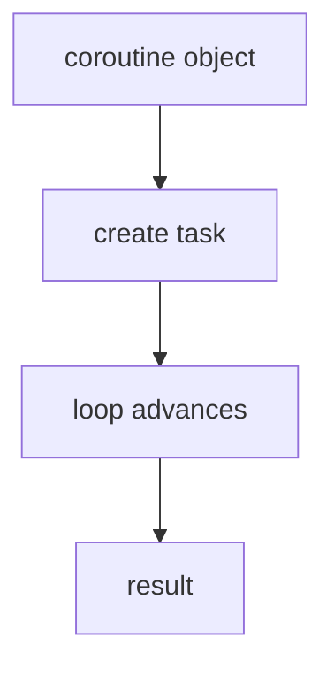

# A03.13 · Task/Future

[Phase index](../README.md) · [Core] · 25–40 minutes

Prerequisite [A03.12](A03.12.md) · Next [A03.14](A03.14.md)

## 1. The problem & why it exists

A function creates a coroutine but never schedules or awaits it. Use structured fanout and await owned tasks.

## 2. Visual mental model



```text
1. coroutine object
2. create task
3. loop advances
4. result
```

The diagram isolates the mechanism on one request or process. Deployment limits and concurrent work can introduce additional boundaries.

## 3. Step-by-step mechanism & minimal dry-run

A coroutine object is awaitable. A Task schedules a coroutine on the event loop. A Future represents a result that somebody else may resolve. Keep task ownership explicit.

**Trace.** coroutine object → create task → loop advances → result.

Run the example twice. Identify the first state where the controlled failure changes the behavior or assumption.

## 4. Formal rigor & quantitative math

If n tasks each retain s bytes, retained task-local payload can reach n×s. Fifty at 20 KiB retain roughly 1000 KiB, excluding overhead.

Verify the worked calculation with Python.

```python
import math

actual = 50 * 20
assert math.isclose(actual, 1000, rel_tol=1e-4)
print(actual)
```

## 5. Progressive design

| Control | Observable evidence | Trade-off |
| --- | --- | --- |
| Failure | `[]` | Find the boundary where the fixture's incorrect assumption becomes visible. |
| Normal | `executed` | Use structured fanout and await owned tasks. |

The [fixture](../examples/A03.13.py) is bounded. Check whether it runs the real runtime primitive or models a decision with fixed inputs before interpreting its output as production evidence.

## 6. Safe local lab & controlled failure injection

From the repository root, after `uv sync --locked --extra api`:

```sh
uv run --extra api python "01-architecture-A01-to-A20/A03-python-runtime-and-backend-apis/examples/A03.13.py"
uv run --extra api python "01-architecture-A01-to-A20/A03-python-runtime-and-backend-apis/examples/A03.13.py" --break
```

Predict both runs, measure the first difference, and rerun the normal control. Change one parameter in the worked example or one input to the fixture, recompute your expected result, and record any mismatch. Remove your scratch copy once you have the evidence. Continue to [L2](../labs/L2.md) for integration practice.

## 7. Production & multi-cloud bridge

Use structured fanout and await owned tasks. For a container deployment on Amazon EKS, Azure AKS or Google Kubernetes Engine, locate the boundary in application code, process configuration and any service in the request path. Collect evidence at the affected boundary before changing infrastructure.

<details>
<summary>Principal discussion</summary>

Does calling an async function immediately run its body? No. In a design review, state the observable signal that would confirm the diagnosis and name the owner of the boundary.

</details>

## 8. Memory hook & mastery checkpoint

1. Does calling an async function immediately run its body?
2. State the observation for each control and locate their first divergence.
3. Change the worked input and calculate the result before running the check.
4. Explain which decision in section 5 you would preserve in a larger deployment.
5. Explain one difference between this fixture and production behavior.

<details>
<summary>Check your answers</summary>

1. No.
2. Normal `executed`. Failure `[]`.
3. Apply the relationship in section 4 to the modified input. Verify the output with the same units.
4. Use structured fanout and await owned tasks.
5. A coroutine object is awaitable. A Task schedules a coroutine on the event loop. A Future represents a result that somebody else may resolve. Keep task ownership explicit.

</details>

## Standards and implementation notes

- [Primary specification or implementation documentation](https://docs.python.org/3/library/asyncio-task.html)
