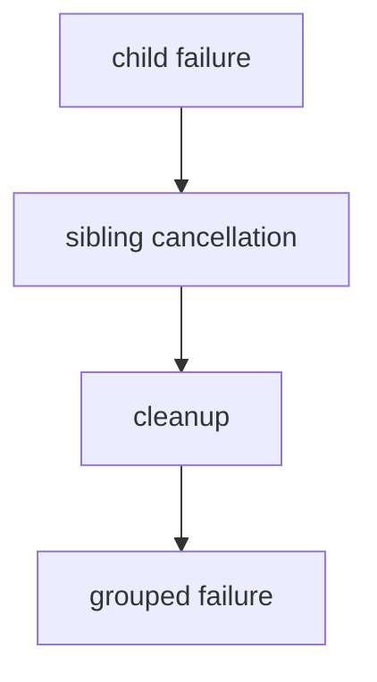

# A03.14 · cancellation and TaskGroup

[Phase index](../README.md) · [Core] · 25–40 minutes

Prerequisite [A03.13](A03.13.md) · Next [A03.15](A03.15.md)

## 1. The problem & why it exists

One failed request leaves sibling work running after the client gave up. Preserve cancellation after cleanup and bound downstream work independently.

## 2. Visual mental model



```text
1. child failure
2. sibling cancellation
3. cleanup
4. grouped failure
```

The diagram isolates the mechanism on one request or process. Deployment limits and concurrent work can introduce additional boundaries.

## 3. Step-by-step mechanism & minimal dry-run

TaskGroup cancels remaining children when a child fails with a non-cancellation exception, then waits and raises grouped failures. Cancellation is delivered at an opportunity to resume; cleanup belongs in finally.

**Trace.** child failure → sibling cancellation → cleanup → grouped failure.

Run the example twice. Identify the first state where the controlled failure changes the behavior or assumption.

## 4. Formal rigor & quantitative math

If three siblings each have 100 ms left, cancellation can avoid up to 300 ms of remaining serial-equivalent work, less cleanup and already-running work.

Verify the worked calculation with Python.

```python
import math

actual = 3 * 100
assert math.isclose(actual, 300, rel_tol=1e-4)
print(actual)
```

## 5. Progressive design

| Control | Observable evidence | Trade-off |
| --- | --- | --- |
| Failure | `sibling finished` | Find the boundary where the fixture's incorrect assumption becomes visible. |
| Normal | `sibling cancelled` | Preserve cancellation after cleanup and bound downstream work independently. |

The [fixture](../examples/A03.14.py) is bounded. Check whether it runs the real runtime primitive or models a decision with fixed inputs before interpreting its output as production evidence.

## 6. Safe local lab & controlled failure injection

From the repository root, after `uv sync --locked --extra api`:

```sh
uv run --extra api python "01-architecture-A01-to-A20/A03-python-runtime-and-backend-apis/examples/A03.14.py"
uv run --extra api python "01-architecture-A01-to-A20/A03-python-runtime-and-backend-apis/examples/A03.14.py" --break
```

Predict both runs, measure the first difference, and rerun the normal control. Change one parameter in the worked example or one input to the fixture, recompute your expected result, and record any mismatch. Remove your scratch copy once you have the evidence. Continue to [L2](../labs/L2.md) for integration practice.

## 7. Production & multi-cloud bridge

Preserve cancellation after cleanup and bound downstream work independently. For a container deployment on Amazon EKS, Azure AKS or Google Kubernetes Engine, locate the boundary in application code, process configuration and any service in the request path. Collect evidence at the affected boundary before changing infrastructure.

<details>
<summary>Principal discussion</summary>

Should a coroutine swallow CancelledError as ordinary success? Usually no. In a design review, state the observable signal that would confirm the diagnosis and name the owner of the boundary.

</details>

## 8. Memory hook & mastery checkpoint

1. Should a coroutine swallow CancelledError as ordinary success?
2. State the observation for each control and locate their first divergence.
3. Change the worked input and calculate the result before running the check.
4. Explain which decision in section 5 you would preserve in a larger deployment.
5. Explain one difference between this fixture and production behavior.

<details>
<summary>Check your answers</summary>

1. Usually no.
2. Normal `sibling cancelled`. Failure `sibling finished`.
3. Apply the relationship in section 4 to the modified input. Verify the output with the same units.
4. Preserve cancellation after cleanup and bound downstream work independently.
5. TaskGroup cancels remaining children when a child fails with a non-cancellation exception, then waits and raises grouped failures. Cancellation is delivered at an opportunity to resume; cleanup belongs in finally.

</details>

## Standards and implementation notes

- [Primary specification or implementation documentation](https://docs.python.org/3/library/asyncio-task.html)
