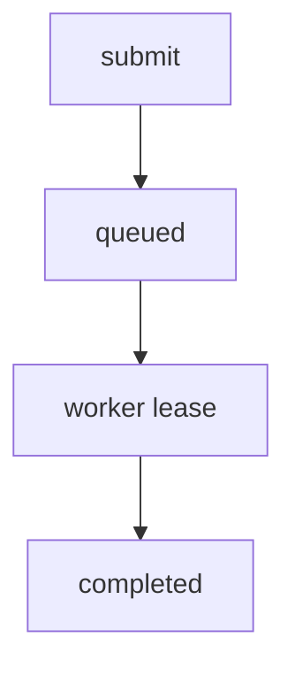

# A03.15 · threads/processes and pools

[Phase index](../README.md) · [Core] · 25–40 minutes

Prerequisite [A03.14](A03.14.md) · Next [A03.16](A03.16.md)

## 1. The problem & why it exists

A server creates a new thread for every unit of work and runs out of memory. Reuse pools, bound pending work, and benchmark representative jobs.

## 2. Visual mental model



```text
1. submit
2. queued
3. worker lease
4. completed
```

The diagram isolates the mechanism on one request or process. Deployment limits and concurrent work can introduce additional boundaries.

## 3. Step-by-step mechanism & minimal dry-run

Pools bound worker count. Threads share process memory. Processes have serialization and startup costs plus separate memory. Use an explicit multiprocessing context when behavior matters.

**Trace.** submit → queued → worker lease → completed.

Run the example twice. Identify the first state where the controlled failure changes the behavior or assumption.

## 4. Formal rigor & quantitative math

At four workers and 50 ms/job, ideal service capacity is 80 jobs/s. Under sustained higher arrival the queue grows unless admission is bounded.

Verify the worked calculation with Python.

```python
import math

actual = 4 / 0.05
assert math.isclose(actual, 80, rel_tol=1e-4)
print(actual)
```

## 5. Progressive design

| Control | Observable evidence | Trade-off |
| --- | --- | --- |
| Failure | `workers: 12` | Find the boundary where the fixture's incorrect assumption becomes visible. |
| Normal | `workers: 3` | Reuse pools, bound pending work, and benchmark representative jobs. |

The [fixture](../examples/A03.15.py) is bounded. Check whether it runs the real runtime primitive or models a decision with fixed inputs before interpreting its output as production evidence.

## 6. Safe local lab & controlled failure injection

From the repository root, after `uv sync --locked --extra api`:

```sh
uv run --extra api python "01-architecture-A01-to-A20/A03-python-runtime-and-backend-apis/examples/A03.15.py"
uv run --extra api python "01-architecture-A01-to-A20/A03-python-runtime-and-backend-apis/examples/A03.15.py" --break
```

Predict both runs, measure the first difference, and rerun the normal control. Change one parameter in the worked example or one input to the fixture, recompute your expected result, and record any mismatch. Remove your scratch copy once you have the evidence. Continue to [L2](../labs/L2.md) for integration practice.

## 7. Production & multi-cloud bridge

Reuse pools, bound pending work, and benchmark representative jobs. For a container deployment on Amazon EKS, Azure AKS or Google Kubernetes Engine, locate the boundary in application code, process configuration and any service in the request path. Collect evidence at the affected boundary before changing infrastructure.

<details>
<summary>Principal discussion</summary>

Will a process pool automatically share ordinary Python objects? No. In a design review, state the observable signal that would confirm the diagnosis and name the owner of the boundary.

</details>

## 8. Memory hook & mastery checkpoint

1. Will a process pool automatically share ordinary Python objects?
2. State the observation for each control and locate their first divergence.
3. Change the worked input and calculate the result before running the check.
4. Explain which decision in section 5 you would preserve in a larger deployment.
5. Explain one difference between this fixture and production behavior.

<details>
<summary>Check your answers</summary>

1. No.
2. Normal `workers: 3`. Failure `workers: 12`.
3. Apply the relationship in section 4 to the modified input. Verify the output with the same units.
4. Reuse pools, bound pending work, and benchmark representative jobs.
5. Pools bound worker count. Threads share process memory. Processes have serialization and startup costs plus separate memory. Use an explicit multiprocessing context when behavior matters.

</details>

## Standards and implementation notes

- [Primary specification or implementation documentation](https://docs.python.org/3/library/concurrent.futures.html)
