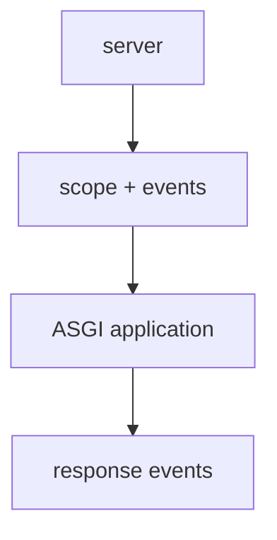

# A03.16 · ASGI vs WSGI

[Phase index](../README.md) · [Core] · 25–40 minutes

Prerequisite [A03.15](A03.15.md) · Next [A03.17](A03.17.md)

## 1. The problem & why it exists

A deployment expects a traditional WSGI callable to negotiate WebSockets. Place an explicit adapter where a supported translation is sufficient. Use native ASGI for WebSockets.

## 2. Visual mental model



```text
1. server
2. scope + events
3. ASGI application
4. response events
```

The diagram isolates the mechanism on one request or process. Deployment limits and concurrent work can introduce additional boundaries.

## 3. Step-by-step mechanism & minimal dry-run

WSGI defines a synchronous request/response interface. ASGI uses scope and asynchronous receive/send messages for supported protocol types, including HTTP and WebSockets.

**Trace.** server → scope + events → ASGI application → response events.

Run the example twice. Identify the first state where the controlled failure changes the behavior or assumption.

## 4. Formal rigor & quantitative math

At rate r and average open lifetime t, steady open count is roughly r×t. Ten connections/s at 30 s average yield about 300 concurrent open connections.

Verify the worked calculation with Python.

```python
import math

actual = 10 * 30
assert math.isclose(actual, 300, rel_tol=1e-4)
print(actual)
```

## 5. Progressive design

| Control | Observable evidence | Trade-off |
| --- | --- | --- |
| Failure | `accepted: False` | Find the boundary where the fixture's incorrect assumption becomes visible. |
| Normal | `accepted: True` | Place an explicit adapter where a supported translation is sufficient. Use native ASGI for WebSockets. |

The [fixture](../examples/A03.16.py) is bounded. Check whether it runs the real runtime primitive or models a decision with fixed inputs before interpreting its output as production evidence.

## 6. Safe local lab & controlled failure injection

From the repository root, after `uv sync --locked --extra api`:

```sh
uv run --extra api python "01-architecture-A01-to-A20/A03-python-runtime-and-backend-apis/examples/A03.16.py"
uv run --extra api python "01-architecture-A01-to-A20/A03-python-runtime-and-backend-apis/examples/A03.16.py" --break
```

Predict both runs, measure the first difference, and rerun the normal control. Change one parameter in the worked example or one input to the fixture, recompute your expected result, and record any mismatch. Remove your scratch copy once you have the evidence. Continue to [L2](../labs/L2.md) for integration practice.

## 7. Production & multi-cloud bridge

Place an explicit adapter where a supported translation is sufficient. Use native ASGI for WebSockets. For a container deployment on Amazon EKS, Azure AKS or Google Kubernetes Engine, locate the boundary in application code, process configuration and any service in the request path. Collect evidence at the affected boundary before changing infrastructure.

<details>
<summary>Principal discussion</summary>

Why does a WebSocket need more than a WSGI response iterable? It has bidirectional connection-scoped events. In a design review, state the observable signal that would confirm the diagnosis and name the owner of the boundary.

</details>

## 8. Memory hook & mastery checkpoint

1. Why does a WebSocket need more than a WSGI response iterable?
2. State the observation for each control and locate their first divergence.
3. Change the worked input and calculate the result before running the check.
4. Explain which decision in section 5 you would preserve in a larger deployment.
5. Explain one difference between this fixture and production behavior.

<details>
<summary>Check your answers</summary>

1. It has bidirectional connection-scoped events.
2. Normal `accepted: True`. Failure `accepted: False`.
3. Apply the relationship in section 4 to the modified input. Verify the output with the same units.
4. Place an explicit adapter where a supported translation is sufficient. Use native ASGI for WebSockets.
5. WSGI defines a synchronous request/response interface. ASGI uses scope and asynchronous receive/send messages for supported protocol types, including HTTP and WebSockets.

</details>

## Standards and implementation notes

- [Primary specification or implementation documentation](https://asgi.readthedocs.io/en/latest/specs/www.html)
- [WSGI specification](https://peps.python.org/pep-3333/)
