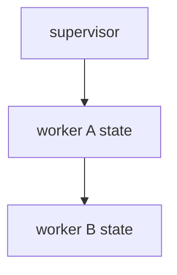

# A03.17 · Uvicorn worker model

[Phase index](../README.md) · [Core] · 25–40 minutes

Prerequisite [A03.16](A03.16.md) · Next [A03.18](A03.18.md)

## 1. The problem & why it exists

A team expects workers to share an in-memory request counter. Use one worker when sufficient and external state for coordination across workers.

## 2. Visual mental model



```text
1. supervisor
2. worker A state
3. worker B state
```

The diagram isolates the mechanism on one request or process. Deployment limits and concurrent work can introduce additional boundaries.

## 3. Step-by-step mechanism & minimal dry-run

Uvicorn can run multiple worker processes. Each worker has its own process state and application lifespan. A load balancer or process manager handles distribution and worker lifecycle.

**Trace.** supervisor → worker A state; worker B state.

Run the example twice. Identify the first state where the controlled failure changes the behavior or assumption.

## 4. Formal rigor & quantitative math

If each of four workers uses 75 MiB private memory, budget 300 MiB before shared and server overhead.

Verify the worked calculation with Python.

```python
import math

actual = 4 * 75
assert math.isclose(actual, 300, rel_tol=1e-4)
print(actual)
```

## 5. Progressive design

| Control | Observable evidence | Trade-off |
| --- | --- | --- |
| Failure | `shared counter: 2` | Find the boundary where the fixture's incorrect assumption becomes visible. |
| Normal | `worker counter: 1` | Use one worker when sufficient and external state for coordination across workers. |

The [fixture](../examples/A03.17.py) is bounded. Check whether it runs the real runtime primitive or models a decision with fixed inputs before interpreting its output as production evidence.

## 6. Safe local lab & controlled failure injection

From the repository root, after `uv sync --locked --extra api`:

```sh
uv run --extra api python "01-architecture-A01-to-A20/A03-python-runtime-and-backend-apis/examples/A03.17.py"
uv run --extra api python "01-architecture-A01-to-A20/A03-python-runtime-and-backend-apis/examples/A03.17.py" --break
```

Predict both runs, measure the first difference, and rerun the normal control. Change one parameter in the worked example or one input to the fixture, recompute your expected result, and record any mismatch. Remove your scratch copy once you have the evidence. Continue to [L2](../labs/L2.md) for integration practice.

## 7. Production & multi-cloud bridge

Use one worker when sufficient and external state for coordination across workers. For a container deployment on Amazon EKS, Azure AKS or Google Kubernetes Engine, locate the boundary in application code, process configuration and any service in the request path. Collect evidence at the affected boundary before changing infrastructure.

<details>
<summary>Principal discussion</summary>

Does adding workers share a per-worker connection pool? No. In a design review, state the observable signal that would confirm the diagnosis and name the owner of the boundary.

</details>

## 8. Memory hook & mastery checkpoint

1. Does adding workers share a per-worker connection pool?
2. State the observation for each control and locate their first divergence.
3. Change the worked input and calculate the result before running the check.
4. Explain which decision in section 5 you would preserve in a larger deployment.
5. Explain one difference between this fixture and production behavior.

<details>
<summary>Check your answers</summary>

1. No.
2. Normal `worker counter: 1`. Failure `shared counter: 2`.
3. Apply the relationship in section 4 to the modified input. Verify the output with the same units.
4. Use one worker when sufficient and external state for coordination across workers.
5. Uvicorn can run multiple worker processes. Each worker has its own process state and application lifespan. A load balancer or process manager handles distribution and worker lifecycle.

</details>

## Standards and implementation notes

- [Primary specification or implementation documentation](https://uvicorn.dev/deployment/)
