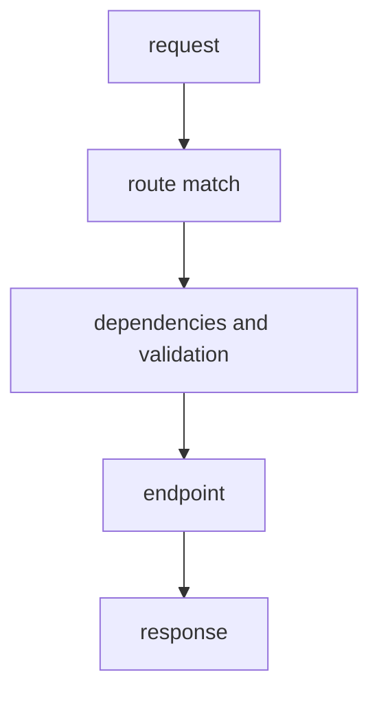

# A03.18 · FastAPI route lifecycle

[Phase index](../README.md) · [Core] · 25–40 minutes

Prerequisite [A03.17](A03.17.md) · Next [A03.19](A03.19.md)

## 1. The problem & why it exists

A 422 response has no record of the handler running. Keep side effects out of validation and dependencies unless their execution contract permits it.

## 2. Visual mental model



```text
1. request
2. route match
3. dependencies and validation
4. endpoint
5. response
```

The diagram isolates the mechanism on one request or process. Deployment limits and concurrent work can introduce additional boundaries.

## 3. Step-by-step mechanism & minimal dry-run

FastAPI matches a path and method, resolves dependencies and validates request data before calling the endpoint when requirements are met. Response validation can happen afterward.

**Trace.** request → route match → dependencies and validation → endpoint → response.

Run the example twice. Identify the first state where the controlled failure changes the behavior or assumption.

## 4. Formal rigor & quantitative math

If validation plus dependencies cost 4 ms and a handler costs 8 ms, normal in-process work totals 12 ms in the simple serial model.

Verify the worked calculation with Python.

```python
import math

actual = 4 + 8
assert math.isclose(actual, 12, rel_tol=1e-4)
print(actual)
```

## 5. Progressive design

| Control | Observable evidence | Trade-off |
| --- | --- | --- |
| Failure | `status: 422 handler calls: 0` | Find the boundary where the fixture's incorrect assumption becomes visible. |
| Normal | `status: 200 handler calls: 1` | Keep side effects out of validation and dependencies unless their execution contract permits it. |

The [fixture](../examples/A03.18.py) is bounded. Check whether it runs the real runtime primitive or models a decision with fixed inputs before interpreting its output as production evidence.

## 6. Safe local lab & controlled failure injection

From the repository root, after `uv sync --locked --extra api`:

```sh
uv run --extra api python "01-architecture-A01-to-A20/A03-python-runtime-and-backend-apis/examples/A03.18.py"
uv run --extra api python "01-architecture-A01-to-A20/A03-python-runtime-and-backend-apis/examples/A03.18.py" --break
```

Predict both runs, measure the first difference, and rerun the normal control. Change one parameter in the worked example or one input to the fixture, recompute your expected result, and record any mismatch. Remove your scratch copy once you have the evidence. Continue to [L2](../labs/L2.md) for integration practice.

## 7. Production & multi-cloud bridge

Keep side effects out of validation and dependencies unless their execution contract permits it. For a container deployment on Amazon EKS, Azure AKS or Google Kubernetes Engine, locate the boundary in application code, process configuration and any service in the request path. Collect evidence at the affected boundary before changing infrastructure.

<details>
<summary>Principal discussion</summary>

Can a validation failure still pass through middleware? Yes. In a design review, state the observable signal that would confirm the diagnosis and name the owner of the boundary.

</details>

## 8. Memory hook & mastery checkpoint

1. Can a validation failure still pass through middleware?
2. State the observation for each control and locate their first divergence.
3. Change the worked input and calculate the result before running the check.
4. Explain which decision in section 5 you would preserve in a larger deployment.
5. Explain one difference between this fixture and production behavior.

<details>
<summary>Check your answers</summary>

1. Yes.
2. Normal `status: 200 handler calls: 1`. Failure `status: 422 handler calls: 0`.
3. Apply the relationship in section 4 to the modified input. Verify the output with the same units.
4. Keep side effects out of validation and dependencies unless their execution contract permits it.
5. FastAPI matches a path and method, resolves dependencies and validates request data before calling the endpoint when requirements are met. Response validation can happen afterward.

</details>

## Standards and implementation notes

- [Primary specification or implementation documentation](https://fastapi.tiangolo.com/tutorial/body/)
