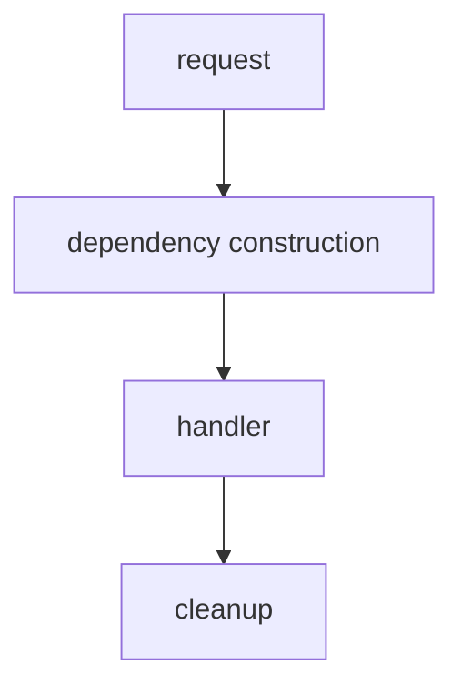

# A03.19 · dependency injection

[Phase index](../README.md) · [Core] · 25–40 minutes

Prerequisite [A03.18](A03.18.md) · Next [A03.20](A03.20.md)

## 1. The problem & why it exists

A route constructs a connection repeatedly and cannot isolate tests. Inject service boundaries and override dependencies in focused tests.

## 2. Visual mental model



```text
1. request
2. dependency construction
3. handler
4. cleanup
```

The diagram isolates the mechanism on one request or process. Deployment limits and concurrent work can introduce additional boundaries.

## 3. Step-by-step mechanism & minimal dry-run

A dependency provides a value derived from request or application state. FastAPI resolves dependency graphs and may cache results per request. Use yield dependencies for explicit lifetime management.

**Trace.** request → dependency construction → handler → cleanup.

Run the example twice. Identify the first state where the controlled failure changes the behavior or assumption.

## 4. Formal rigor & quantitative math

Two consumers can share one request-scoped cached dependency. At 5 ms/construction that saves 5 ms versus constructing twice.

Verify the worked calculation with Python.

```python
import math

actual = 2 * 5 - 5
assert math.isclose(actual, 5, rel_tol=1e-4)
print(actual)
```

## 5. Progressive design

| Control | Observable evidence | Trade-off |
| --- | --- | --- |
| Failure | `live-source` | Find the boundary where the fixture's incorrect assumption becomes visible. |
| Normal | `test-source` | Inject service boundaries and override dependencies in focused tests. |

The [fixture](../examples/A03.19.py) is bounded. Check whether it runs the real runtime primitive or models a decision with fixed inputs before interpreting its output as production evidence.

## 6. Safe local lab & controlled failure injection

From the repository root, after `uv sync --locked --extra api`:

```sh
uv run --extra api python "01-architecture-A01-to-A20/A03-python-runtime-and-backend-apis/examples/A03.19.py"
uv run --extra api python "01-architecture-A01-to-A20/A03-python-runtime-and-backend-apis/examples/A03.19.py" --break
```

Predict both runs, measure the first difference, and rerun the normal control. Change one parameter in the worked example or one input to the fixture, recompute your expected result, and record any mismatch. Remove your scratch copy once you have the evidence. Continue to [L2](../labs/L2.md) for integration practice.

## 7. Production & multi-cloud bridge

Inject service boundaries and override dependencies in focused tests. For a container deployment on Amazon EKS, Azure AKS or Google Kubernetes Engine, locate the boundary in application code, process configuration and any service in the request path. Collect evidence at the affected boundary before changing infrastructure.

<details>
<summary>Principal discussion</summary>

Does dependency caching imply a cross-request singleton? No. In a design review, state the observable signal that would confirm the diagnosis and name the owner of the boundary.

</details>

## 8. Memory hook & mastery checkpoint

1. Does dependency caching imply a cross-request singleton?
2. State the observation for each control and locate their first divergence.
3. Change the worked input and calculate the result before running the check.
4. Explain which decision in section 5 you would preserve in a larger deployment.
5. Explain one difference between this fixture and production behavior.

<details>
<summary>Check your answers</summary>

1. No.
2. Normal `test-source`. Failure `live-source`.
3. Apply the relationship in section 4 to the modified input. Verify the output with the same units.
4. Inject service boundaries and override dependencies in focused tests.
5. A dependency provides a value derived from request or application state. FastAPI resolves dependency graphs and may cache results per request. Use yield dependencies for explicit lifetime management.

</details>

## Standards and implementation notes

- [Primary specification or implementation documentation](https://fastapi.tiangolo.com/tutorial/dependencies/)
