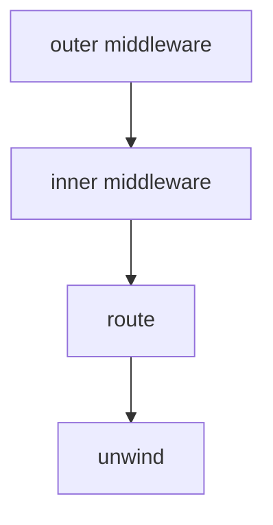

# A03.20 · middleware

[Phase index](../README.md) · [Core] · 25–40 minutes

Prerequisite [A03.19](A03.19.md) · Next [A03.21](A03.21.md)

## 1. The problem & why it exists

A trace header is missing when a route returns an error early. Order instrumentation deliberately and avoid buffering streams unless needed.

## 2. Visual mental model



```text
1. outer middleware
2. inner middleware
3. route
4. unwind
```

The diagram isolates the mechanism on one request or process. Deployment limits and concurrent work can introduce additional boundaries.

## 3. Step-by-step mechanism & minimal dry-run

Middleware wraps the request path and observes downstream responses or exceptions according to stack order. Pure ASGI middleware can cover streaming events directly.

**Trace.** outer middleware → inner middleware → route → unwind.

Run the example twice. Identify the first state where the controlled failure changes the behavior or assumption.

## 4. Formal rigor & quantitative math

For k serial layers each adding c µs, round-trip overhead is approximately k×c µs if c includes both sides. Four at 25 µs add 100 µs.

Verify the worked calculation with Python.

```python
import math

actual = 4 * 25
assert math.isclose(actual, 100, rel_tol=1e-4)
print(actual)
```

## 5. Progressive design

| Control | Observable evidence | Trade-off |
| --- | --- | --- |
| Failure | `404 None` | Find the boundary where the fixture's incorrect assumption becomes visible. |
| Normal | `404 wrapped` | Order instrumentation deliberately and avoid buffering streams unless needed. |

The [fixture](../examples/A03.20.py) is bounded. Check whether it runs the real runtime primitive or models a decision with fixed inputs before interpreting its output as production evidence.

## 6. Safe local lab & controlled failure injection

From the repository root, after `uv sync --locked --extra api`:

```sh
uv run --extra api python "01-architecture-A01-to-A20/A03-python-runtime-and-backend-apis/examples/A03.20.py"
uv run --extra api python "01-architecture-A01-to-A20/A03-python-runtime-and-backend-apis/examples/A03.20.py" --break
```

Predict both runs, measure the first difference, and rerun the normal control. Change one parameter in the worked example or one input to the fixture, recompute your expected result, and record any mismatch. Remove your scratch copy once you have the evidence. Continue to [L2](../labs/L2.md) for integration practice.

## 7. Production & multi-cloud bridge

Order instrumentation deliberately and avoid buffering streams unless needed. For a container deployment on Amazon EKS, Azure AKS or Google Kubernetes Engine, locate the boundary in application code, process configuration and any service in the request path. Collect evidence at the affected boundary before changing infrastructure.

<details>
<summary>Principal discussion</summary>

Does middleware ordering affect what gets observed? Yes. In a design review, state the observable signal that would confirm the diagnosis and name the owner of the boundary.

</details>

## 8. Memory hook & mastery checkpoint

1. Does middleware ordering affect what gets observed?
2. State the observation for each control and locate their first divergence.
3. Change the worked input and calculate the result before running the check.
4. Explain which decision in section 5 you would preserve in a larger deployment.
5. Explain one difference between this fixture and production behavior.

<details>
<summary>Check your answers</summary>

1. Yes.
2. Normal `404 wrapped`. Failure `404 None`.
3. Apply the relationship in section 4 to the modified input. Verify the output with the same units.
4. Order instrumentation deliberately and avoid buffering streams unless needed.
5. Middleware wraps the request path and observes downstream responses or exceptions according to stack order. Pure ASGI middleware can cover streaming events directly.

</details>

## Standards and implementation notes

- [Primary specification or implementation documentation](https://fastapi.tiangolo.com/tutorial/middleware/)
