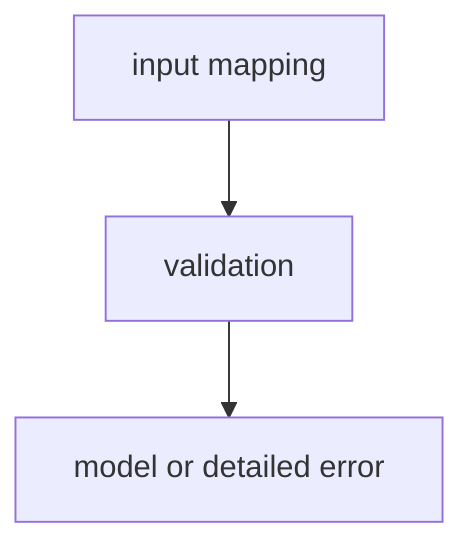

# A03.21 · Pydantic validation

[Phase index](../README.md) · [Core] · 25–40 minutes

Prerequisite [A03.20](A03.20.md) · Next [A03.22](A03.22.md)

## 1. The problem & why it exists

A client sends a textual quantity, and coercion hides a precision or schema mistake. Use strict validation for fields where type ambiguity is dangerous and apply bounds separately.

## 2. Visual mental model



```text
1. input mapping
2. validation
3. model or detailed error
```

The diagram isolates the mechanism on one request or process. Deployment limits and concurrent work can introduce additional boundaries.

## 3. Step-by-step mechanism & minimal dry-run

Pydantic validates into a typed model. Strict mode rejects some coercions accepted by default; behavior can also depend on input mode such as JSON versus Python objects.

**Trace.** input mapping → validation → model or detailed error.

Run the example twice. Identify the first state where the controlled failure changes the behavior or assumption.

## 4. Formal rigor & quantitative math

For n rows with f fixed-size inspected fields, basic validation is O(n×f). Ten rows by six fields means 60 fields before nested work.

Verify the worked calculation with Python.

```python
import math

actual = 10 * 6
assert math.isclose(actual, 60, rel_tol=1e-4)
print(actual)
```

## 5. Progressive design

| Control | Observable evidence | Trade-off |
| --- | --- | --- |
| Failure | `amount=3` | Find the boundary where the fixture's incorrect assumption becomes visible. |
| Normal | `strict rejection` | Use strict validation for fields where type ambiguity is dangerous and apply bounds separately. |

The [fixture](../examples/A03.21.py) is bounded. Check whether it runs the real runtime primitive or models a decision with fixed inputs before interpreting its output as production evidence.

## 6. Safe local lab & controlled failure injection

From the repository root, after `uv sync --locked --extra api`:

```sh
uv run --extra api python "01-architecture-A01-to-A20/A03-python-runtime-and-backend-apis/examples/A03.21.py"
uv run --extra api python "01-architecture-A01-to-A20/A03-python-runtime-and-backend-apis/examples/A03.21.py" --break
```

Predict both runs, measure the first difference, and rerun the normal control. Change one parameter in the worked example or one input to the fixture, recompute your expected result, and record any mismatch. Remove your scratch copy once you have the evidence. Continue to [L3](../labs/L3.md) for integration practice.

## 7. Production & multi-cloud bridge

Use strict validation for fields where type ambiguity is dangerous and apply bounds separately. For a container deployment on Amazon EKS, Azure AKS or Google Kubernetes Engine, locate the boundary in application code, process configuration and any service in the request path. Collect evidence at the affected boundary before changing infrastructure.

<details>
<summary>Principal discussion</summary>

Is validated data automatically authorized? No. In a design review, state the observable signal that would confirm the diagnosis and name the owner of the boundary.

</details>

## 8. Memory hook & mastery checkpoint

1. Is validated data automatically authorized?
2. State the observation for each control and locate their first divergence.
3. Change the worked input and calculate the result before running the check.
4. Explain which decision in section 5 you would preserve in a larger deployment.
5. Explain one difference between this fixture and production behavior.

<details>
<summary>Check your answers</summary>

1. No.
2. Normal `strict rejection`. Failure `amount=3`.
3. Apply the relationship in section 4 to the modified input. Verify the output with the same units.
4. Use strict validation for fields where type ambiguity is dangerous and apply bounds separately.
5. Pydantic validates into a typed model. Strict mode rejects some coercions accepted by default; behavior can also depend on input mode such as JSON versus Python objects.

</details>

## Standards and implementation notes

- [Primary specification or implementation documentation](https://docs.pydantic.dev/latest/concepts/strict_mode/)
