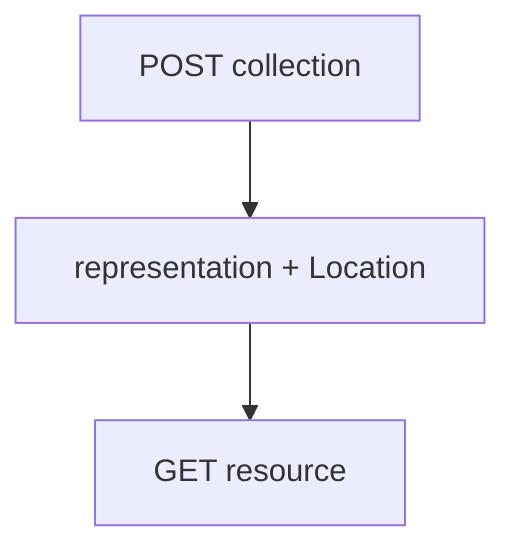

# A03.22 · API resource modeling

[Phase index](../README.md) · [Core] · 25–40 minutes

Prerequisite [A03.21](A03.21.md) · Next [A03.23](A03.23.md)

## 1. The problem & why it exists

An API reply leaks internal identifiers and ties clients to table layout. Use an explicit response model and evolved representations. Avoid exposing fields simply because storage contains them.

## 2. Visual mental model



```text
1. POST collection
2. representation + Location
3. GET resource
```

The diagram isolates the mechanism on one request or process. Deployment limits and concurrent work can introduce additional boundaries.

## 3. Step-by-step mechanism & minimal dry-run

Model externally meaningful resource identity and representation separately from storage schema. Expose stable identifiers and use status and methods consistent with the contract.

**Trace.** POST collection → representation + Location → GET resource.

Run the example twice. Identify the first state where the controlled failure changes the behavior or assumption.

## 4. Formal rigor & quantitative math

If a response sends five extra 20 B fields across 1000 responses, their payload alone adds 100000 bytes.

Verify the worked calculation with Python.

```python
import math

actual = 5 * 20 * 1000
assert math.isclose(actual, 100000, rel_tol=1e-4)
print(actual)
```

## 5. Progressive design

| Control | Observable evidence | Trade-off |
| --- | --- | --- |
| Failure | `internal_cost` | Find the boundary where the fixture's incorrect assumption becomes visible. |
| Normal | `['id', 'label']` | Use an explicit response model and evolved representations. Avoid exposing fields simply because storage contains them. |

The [fixture](../examples/A03.22.py) is bounded. Check whether it runs the real runtime primitive or models a decision with fixed inputs before interpreting its output as production evidence.

## 6. Safe local lab & controlled failure injection

From the repository root, after `uv sync --locked --extra api`:

```sh
uv run --extra api python "01-architecture-A01-to-A20/A03-python-runtime-and-backend-apis/examples/A03.22.py"
uv run --extra api python "01-architecture-A01-to-A20/A03-python-runtime-and-backend-apis/examples/A03.22.py" --break
```

Predict both runs, measure the first difference, and rerun the normal control. Change one parameter in the worked example or one input to the fixture, recompute your expected result, and record any mismatch. Remove your scratch copy once you have the evidence. Continue to [L3](../labs/L3.md) for integration practice.

## 7. Production & multi-cloud bridge

Use an explicit response model and evolved representations. Avoid exposing fields simply because storage contains them. For a container deployment on Amazon EKS, Azure AKS or Google Kubernetes Engine, locate the boundary in application code, process configuration and any service in the request path. Collect evidence at the affected boundary before changing infrastructure.

<details>
<summary>Principal discussion</summary>

Does a resource have to mirror exactly one table row? No. In a design review, state the observable signal that would confirm the diagnosis and name the owner of the boundary.

</details>

## 8. Memory hook & mastery checkpoint

1. Does a resource have to mirror exactly one table row?
2. State the observation for each control and locate their first divergence.
3. Change the worked input and calculate the result before running the check.
4. Explain which decision in section 5 you would preserve in a larger deployment.
5. Explain one difference between this fixture and production behavior.

<details>
<summary>Check your answers</summary>

1. No.
2. Normal `['id', 'label']`. Failure `internal_cost`.
3. Apply the relationship in section 4 to the modified input. Verify the output with the same units.
4. Use an explicit response model and evolved representations. Avoid exposing fields simply because storage contains them.
5. Model externally meaningful resource identity and representation separately from storage schema. Expose stable identifiers and use status and methods consistent with the contract.

</details>

## Standards and implementation notes

- [Primary specification or implementation documentation](https://www.rfc-editor.org/rfc/rfc9110.html)
