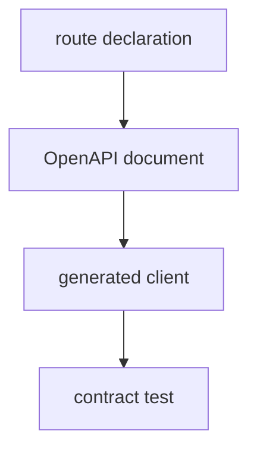

# A03.23 · OpenAPI

[Phase index](../README.md) · [Core] · 25–40 minutes

Prerequisite [A03.22](A03.22.md) · Next [A03.24](A03.24.md)

## 1. The problem & why it exists

A generated client accepts an invalid payload because the schema is stale. Keep schemas versioned and check real success and failure responses.

## 2. Visual mental model



```text
1. route declaration
2. OpenAPI document
3. generated client
4. contract test
```

The diagram isolates the mechanism on one request or process. Deployment limits and concurrent work can introduce additional boundaries.

## 3. Step-by-step mechanism & minimal dry-run

OpenAPI describes paths, parameters, bodies, responses and security. A schema can be generated from executable routes but still needs validation against behavior and supported clients.

**Trace.** route declaration → OpenAPI document → generated client → contract test.

Run the example twice. Identify the first state where the controlled failure changes the behavior or assumption.

## 4. Formal rigor & quantitative math

With p operations and r cases per operation, a full sample suite costs p×r requests. Eight operations with three cases produce 24 checks.

Verify the worked calculation with Python.

```python
import math

actual = 8 * 3
assert math.isclose(actual, 24, rel_tol=1e-4)
print(actual)
```

## 5. Progressive design

| Control | Observable evidence | Trade-off |
| --- | --- | --- |
| Failure | `exists: False` | Find the boundary where the fixture's incorrect assumption becomes visible. |
| Normal | `exists: True` | Keep schemas versioned and check real success and failure responses. |

The [fixture](../examples/A03.23.py) is bounded. Check whether it runs the real runtime primitive or models a decision with fixed inputs before interpreting its output as production evidence.

## 6. Safe local lab & controlled failure injection

From the repository root, after `uv sync --locked --extra api`:

```sh
uv run --extra api python "01-architecture-A01-to-A20/A03-python-runtime-and-backend-apis/examples/A03.23.py"
uv run --extra api python "01-architecture-A01-to-A20/A03-python-runtime-and-backend-apis/examples/A03.23.py" --break
```

Predict both runs, measure the first difference, and rerun the normal control. Change one parameter in the worked example or one input to the fixture, recompute your expected result, and record any mismatch. Remove your scratch copy once you have the evidence. Continue to [L3](../labs/L3.md) for integration practice.

## 7. Production & multi-cloud bridge

Keep schemas versioned and check real success and failure responses. For a container deployment on Amazon EKS, Azure AKS or Google Kubernetes Engine, locate the boundary in application code, process configuration and any service in the request path. Collect evidence at the affected boundary before changing infrastructure.

<details>
<summary>Principal discussion</summary>

Does declaring a security scheme enforce authorization? No. In a design review, state the observable signal that would confirm the diagnosis and name the owner of the boundary.

</details>

## 8. Memory hook & mastery checkpoint

1. Does declaring a security scheme enforce authorization?
2. State the observation for each control and locate their first divergence.
3. Change the worked input and calculate the result before running the check.
4. Explain which decision in section 5 you would preserve in a larger deployment.
5. Explain one difference between this fixture and production behavior.

<details>
<summary>Check your answers</summary>

1. No.
2. Normal `exists: True`. Failure `exists: False`.
3. Apply the relationship in section 4 to the modified input. Verify the output with the same units.
4. Keep schemas versioned and check real success and failure responses.
5. OpenAPI describes paths, parameters, bodies, responses and security. A schema can be generated from executable routes but still needs validation against behavior and supported clients.

</details>

## Standards and implementation notes

- [Primary specification or implementation documentation](https://spec.openapis.org/oas/latest.html)
