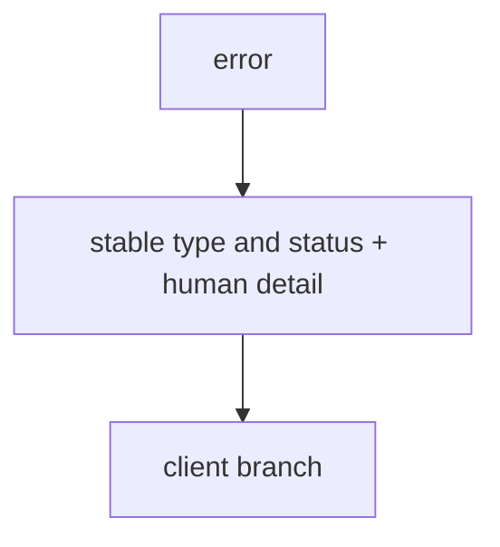

# A03.24 · errors and versioning

[Phase index](../README.md) · [Core] · 25–40 minutes

Prerequisite [A03.23](A03.23.md) · Next [A03.25](A03.25.md)

## 1. The problem & why it exists

A client parses human-readable error text and breaks after a wording edit. Keep status and stable codes contractual and consider consumer assumptions before changing representations.

## 2. Visual mental model



```text
1. error
2. stable type and status + human detail
3. client branch
```

The diagram isolates the mechanism on one request or process. Deployment limits and concurrent work can introduce additional boundaries.

## 3. Step-by-step mechanism & minimal dry-run

Stable machine-readable problem types or error codes support clients. Versioning should define compatibility and migration. An additive field can still break strict consumers.

**Trace.** error → stable type and status + human detail → client branch.

Run the example twice. Identify the first state where the controlled failure changes the behavior or assumption.

## 4. Formal rigor & quantitative math

Three client versions across four error cases require 12 checks in a simple compatibility matrix.

Verify the worked calculation with Python.

```python
import math

actual = 3 * 4
assert math.isclose(actual, 12, rel_tol=1e-4)
print(actual)
```

## 5. Progressive design

| Control | Observable evidence | Trade-off |
| --- | --- | --- |
| Failure | `branch: False` | Find the boundary where the fixture's incorrect assumption becomes visible. |
| Normal | `branch: True` | Keep status and stable codes contractual and consider consumer assumptions before changing representations. |

The [fixture](../examples/A03.24.py) is bounded. Check whether it runs the real runtime primitive or models a decision with fixed inputs before interpreting its output as production evidence.

## 6. Safe local lab & controlled failure injection

From the repository root, after `uv sync --locked --extra api`:

```sh
uv run --extra api python "01-architecture-A01-to-A20/A03-python-runtime-and-backend-apis/examples/A03.24.py"
uv run --extra api python "01-architecture-A01-to-A20/A03-python-runtime-and-backend-apis/examples/A03.24.py" --break
```

Predict both runs, measure the first difference, and rerun the normal control. Change one parameter in the worked example or one input to the fixture, recompute your expected result, and record any mismatch. Remove your scratch copy once you have the evidence. Continue to [L3](../labs/L3.md) for integration practice.

## 7. Production & multi-cloud bridge

Keep status and stable codes contractual and consider consumer assumptions before changing representations. For a container deployment on Amazon EKS, Azure AKS or Google Kubernetes Engine, locate the boundary in application code, process configuration and any service in the request path. Collect evidence at the affected boundary before changing infrastructure.

<details>
<summary>Principal discussion</summary>

Can problem detail be localized? Yes, consumers should branch on contract fields. In a design review, state the observable signal that would confirm the diagnosis and name the owner of the boundary.

</details>

## 8. Memory hook & mastery checkpoint

1. Can problem detail be localized?
2. State the observation for each control and locate their first divergence.
3. Change the worked input and calculate the result before running the check.
4. Explain which decision in section 5 you would preserve in a larger deployment.
5. Explain one difference between this fixture and production behavior.

<details>
<summary>Check your answers</summary>

1. Yes, consumers should branch on contract fields.
2. Normal `branch: True`. Failure `branch: False`.
3. Apply the relationship in section 4 to the modified input. Verify the output with the same units.
4. Keep status and stable codes contractual and consider consumer assumptions before changing representations.
5. Stable machine-readable problem types or error codes support clients. Versioning should define compatibility and migration. An additive field can still break strict consumers.

</details>

## Standards and implementation notes

- [Primary specification or implementation documentation](https://www.rfc-editor.org/rfc/rfc9457.html)
