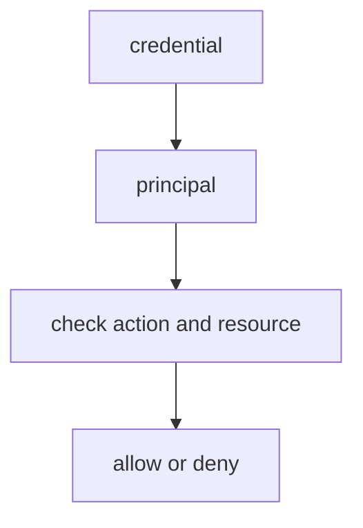

# A03.25 · authN vs authZ

[Phase index](../README.md) · [Core] · 25–40 minutes

Prerequisite [A03.24](A03.24.md) · Next [A03.26](A03.26.md)

## 1. The problem & why it exists

A logged-in user can read a different customer's object. Deny by default, bind tenant from trusted identity, and test cross-tenant denial.

## 2. Visual mental model



```text
1. credential
2. principal
3. check action and resource
4. allow or deny
```

The diagram isolates the mechanism on one request or process. Deployment limits and concurrent work can introduce additional boundaries.

## 3. Step-by-step mechanism & minimal dry-run

Authentication establishes identity; authorization decides if that subject may perform an action on the resource. Tenant, owner and role checks belong at trusted boundaries.

**Trace.** credential → principal → check action and resource → allow or deny.

Run the example twice. Identify the first state where the controlled failure changes the behavior or assumption.

## 4. Formal rigor & quantitative math

A tenant-qualified key indexed by tenant and ID reduces lookup to one qualified access in the fixture. A full scan would inspect up to n resources.

Verify the worked calculation with Python.

```python
import math

actual = len({("a", 1): "a", ("b", 1): "b"})
assert math.isclose(actual, 2, rel_tol=1e-4)
print(actual)
```

## 5. Progressive design

| Control | Observable evidence | Trade-off |
| --- | --- | --- |
| Failure | `allowed: True` | Find the boundary where the fixture's incorrect assumption becomes visible. |
| Normal | `allowed: False` | Deny by default, bind tenant from trusted identity, and test cross-tenant denial. |

The [fixture](../examples/A03.25.py) is bounded. Check whether it runs the real runtime primitive or models a decision with fixed inputs before interpreting its output as production evidence.

## 6. Safe local lab & controlled failure injection

From the repository root, after `uv sync --locked --extra api`:

```sh
uv run --extra api python "01-architecture-A01-to-A20/A03-python-runtime-and-backend-apis/examples/A03.25.py"
uv run --extra api python "01-architecture-A01-to-A20/A03-python-runtime-and-backend-apis/examples/A03.25.py" --break
```

Predict both runs, measure the first difference, and rerun the normal control. Change one parameter in the worked example or one input to the fixture, recompute your expected result, and record any mismatch. Remove your scratch copy once you have the evidence. Continue to [L3](../labs/L3.md) for integration practice.

## 7. Production & multi-cloud bridge

Deny by default, bind tenant from trusted identity, and test cross-tenant denial. For a container deployment on Amazon EKS, Azure AKS or Google Kubernetes Engine, locate the boundary in application code, process configuration and any service in the request path. Collect evidence at the affected boundary before changing infrastructure.

<details>
<summary>Principal discussion</summary>

Does a valid token grant access to every object? No. In a design review, state the observable signal that would confirm the diagnosis and name the owner of the boundary.

</details>

## 8. Memory hook & mastery checkpoint

1. Does a valid token grant access to every object?
2. State the observation for each control and locate their first divergence.
3. Change the worked input and calculate the result before running the check.
4. Explain which decision in section 5 you would preserve in a larger deployment.
5. Explain one difference between this fixture and production behavior.

<details>
<summary>Check your answers</summary>

1. No.
2. Normal `allowed: False`. Failure `allowed: True`.
3. Apply the relationship in section 4 to the modified input. Verify the output with the same units.
4. Deny by default, bind tenant from trusted identity, and test cross-tenant denial.
5. Authentication establishes identity; authorization decides if that subject may perform an action on the resource. Tenant, owner and role checks belong at trusted boundaries.

</details>

## Standards and implementation notes

- [Primary specification or implementation documentation](https://www.rfc-editor.org/rfc/rfc9110.html)
- [OWASP Authorization Cheat Sheet](https://cheatsheetseries.owasp.org/cheatsheets/Authorization_Cheat_Sheet.html)
