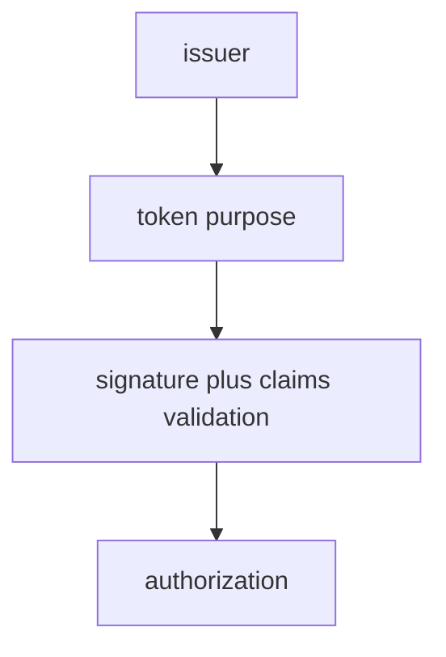

# A03.26 · OAuth 2.0/OIDC/JWT

[Phase index](../README.md) · [Core] · 25–40 minutes

Prerequisite [A03.25](A03.25.md) · Next [A03.27](A03.27.md)

## 1. The problem & why it exists

A backend accepts an ID token as a generic access token. Use a vetted provider and verifier. The example checks metadata only and performs no token verification.

## 2. Visual mental model



```text
1. issuer
2. token purpose
3. signature plus claims validation
4. authorization
```

The diagram isolates the mechanism on one request or process. Deployment limits and concurrent work can introduce additional boundaries.

## 3. Step-by-step mechanism & minimal dry-run

OAuth delegates access. OIDC adds authentication and an ID Token. JWT is a format with validation rules; token kind, issuer, audience, allowed algorithms and applicability must be checked with maintained libraries.

**Trace.** issuer → token purpose → signature plus claims validation → authorization.

Run the example twice. Identify the first state where the controlled failure changes the behavior or assumption.

## 4. Formal rigor & quantitative math

With token lifetime t and allowed clock skew s, a validator accepting expiration with s leeway can accept until exp+s. At 300 s plus 30 s, the modeled upper window is 330 s.

Verify the worked calculation with Python.

```python
import math

actual = 300 + 30
assert math.isclose(actual, 330, rel_tol=1e-4)
print(actual)
```

## 5. Progressive design

| Control | Observable evidence | Trade-off |
| --- | --- | --- |
| Failure | `purpose: True` | Find the boundary where the fixture's incorrect assumption becomes visible. |
| Normal | `purpose: False` | Use a vetted provider and verifier. The example checks metadata only and performs no token verification. |

The [fixture](../examples/A03.26.py) is bounded. Check whether it runs the real runtime primitive or models a decision with fixed inputs before interpreting its output as production evidence.

## 6. Safe local lab & controlled failure injection

From the repository root, after `uv sync --locked --extra api`:

```sh
uv run --extra api python "01-architecture-A01-to-A20/A03-python-runtime-and-backend-apis/examples/A03.26.py"
uv run --extra api python "01-architecture-A01-to-A20/A03-python-runtime-and-backend-apis/examples/A03.26.py" --break
```

Predict both runs, measure the first difference, and rerun the normal control. Change one parameter in the worked example or one input to the fixture, recompute your expected result, and record any mismatch. Remove your scratch copy once you have the evidence. Continue to [L3](../labs/L3.md) for integration practice.

## 7. Production & multi-cloud bridge

Use a vetted provider and verifier. The example checks metadata only and performs no token verification. For a container deployment on Amazon EKS, Azure AKS or Google Kubernetes Engine, locate the boundary in application code, process configuration and any service in the request path. Collect evidence at the affected boundary before changing infrastructure.

<details>
<summary>Principal discussion</summary>

Is decoding JWT payload a signature check? No. In a design review, state the observable signal that would confirm the diagnosis and name the owner of the boundary.

</details>

## 8. Memory hook & mastery checkpoint

1. Is decoding JWT payload a signature check?
2. State the observation for each control and locate their first divergence.
3. Change the worked input and calculate the result before running the check.
4. Explain which decision in section 5 you would preserve in a larger deployment.
5. Explain one difference between this fixture and production behavior.

<details>
<summary>Check your answers</summary>

1. No.
2. Normal `purpose: False`. Failure `purpose: True`.
3. Apply the relationship in section 4 to the modified input. Verify the output with the same units.
4. Use a vetted provider and verifier. The example checks metadata only and performs no token verification.
5. OAuth delegates access. OIDC adds authentication and an ID Token. JWT is a format with validation rules; token kind, issuer, audience, allowed algorithms and applicability must be checked with maintained libraries.

</details>

## Standards and implementation notes

- [Primary specification or implementation documentation](https://www.rfc-editor.org/rfc/rfc9700.html)
- [OpenID Connect Core](https://openid.net/specs/openid-connect-core-1_0.html)
- [JWT Best Current Practices](https://www.rfc-editor.org/rfc/rfc8725.html)
