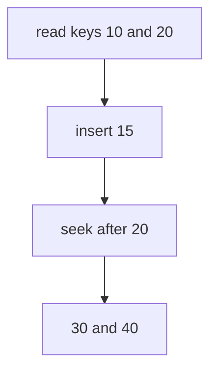

# A03.27 · pagination and cursor semantics

[Phase index](../README.md) · [Core] · 25–40 minutes

Prerequisite [A03.26](A03.26.md) · Next [A03.28](A03.28.md)

## 1. The problem & why it exists

Offset pages duplicate records after inserts change row positions. Use offset for small stable lists. Use opaque, scoped cursors when stable traversal and cost matter.

## 2. Visual mental model



```text
1. read keys 10 and 20
2. insert 15
3. seek after 20
4. 30 and 40
```

The diagram isolates the mechanism on one request or process. Deployment limits and concurrent work can introduce additional boundaries.

## 3. Step-by-step mechanism & minimal dry-run

A keyset cursor represents the last ordered key. Use deterministic ordering with a unique tie-breaker and bind cursor semantics to filters and authorization scope. Snapshot consistency is separate.

**Trace.** read keys 10 and 20 → insert 15 → seek after 20 → 30 and 40.

Run the example twice. Identify the first state where the controlled failure changes the behavior or assumption.

## 4. Formal rigor & quantitative math

Skipping o rows then reading k can inspect o+k index entries. At o=10000 and k=25 that is 10025, versus a seek plus 25 entries for a suitable index.

Verify the worked calculation with Python.

```python
import math

actual = 10_000 + 25
assert math.isclose(actual, 10025, rel_tol=1e-4)
print(actual)
```

## 5. Progressive design

| Control | Observable evidence | Trade-off |
| --- | --- | --- |
| Failure | `[20, 30]` | Find the boundary where the fixture's incorrect assumption becomes visible. |
| Normal | `[30, 40]` | Use offset for small stable lists. Use opaque, scoped cursors when stable traversal and cost matter. |

The [fixture](../examples/A03.27.py) is bounded. Check whether it runs the real runtime primitive or models a decision with fixed inputs before interpreting its output as production evidence.

## 6. Safe local lab & controlled failure injection

From the repository root, after `uv sync --locked --extra api`:

```sh
uv run --extra api python "01-architecture-A01-to-A20/A03-python-runtime-and-backend-apis/examples/A03.27.py"
uv run --extra api python "01-architecture-A01-to-A20/A03-python-runtime-and-backend-apis/examples/A03.27.py" --break
```

Predict both runs, measure the first difference, and rerun the normal control. Change one parameter in the worked example or one input to the fixture, recompute your expected result, and record any mismatch. Remove your scratch copy once you have the evidence. Continue to [L3](../labs/L3.md) for integration practice.

## 7. Production & multi-cloud bridge

Use offset for small stable lists. Use opaque, scoped cursors when stable traversal and cost matter. For a container deployment on Amazon EKS, Azure AKS or Google Kubernetes Engine, locate the boundary in application code, process configuration and any service in the request path. Collect evidence at the affected boundary before changing infrastructure.

<details>
<summary>Principal discussion</summary>

Why include a tie-breaker? Equal sort values would otherwise leave ambiguous boundaries. In a design review, state the observable signal that would confirm the diagnosis and name the owner of the boundary.

</details>

## 8. Memory hook & mastery checkpoint

1. Why include a tie-breaker?
2. State the observation for each control and locate their first divergence.
3. Change the worked input and calculate the result before running the check.
4. Explain which decision in section 5 you would preserve in a larger deployment.
5. Explain one difference between this fixture and production behavior.

<details>
<summary>Check your answers</summary>

1. Equal sort values would otherwise leave ambiguous boundaries.
2. Normal `[30, 40]`. Failure `[20, 30]`.
3. Apply the relationship in section 4 to the modified input. Verify the output with the same units.
4. Use offset for small stable lists. Use opaque, scoped cursors when stable traversal and cost matter.
5. A keyset cursor represents the last ordered key. Use deterministic ordering with a unique tie-breaker and bind cursor semantics to filters and authorization scope. Snapshot consistency is separate.

</details>

## Standards and implementation notes

- [Primary specification or implementation documentation](https://www.rfc-editor.org/rfc/rfc9110.html)
