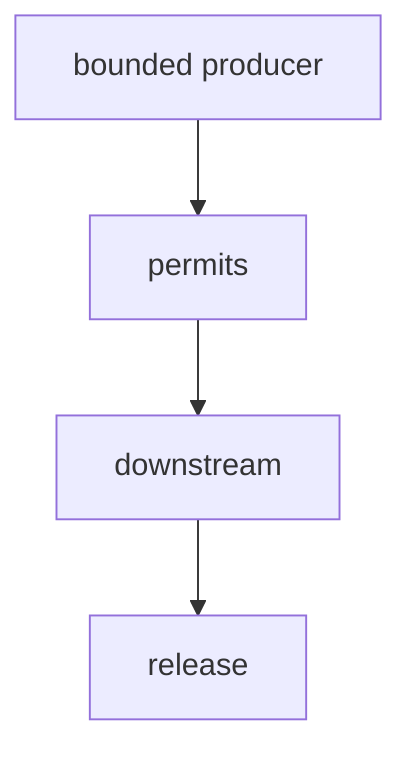

# A03.28 · bounded async fanout

[Phase index](../README.md) · [Principal] · 25–40 minutes

Prerequisite [A03.27](A03.27.md) · Next [A03.29](A03.29.md)

## 1. The problem & why it exists

A bulk request starts many downstream operations and triggers connection-pool starvation. Use a fixed worker set or bounded batches and budget downstream capacity.

## 2. Visual mental model



```text
1. bounded producer
2. permits
3. downstream
4. release
```

The diagram isolates the mechanism on one request or process. Deployment limits and concurrent work can introduce additional boundaries.

## 3. Step-by-step mechanism & minimal dry-run

Bound both in-flight operations and queued work. A semaphore bounds entry to a protected section; creating all tasks at once still retains them. Structured cancellation handles failures.

**Trace.** bounded producer → permits → downstream → release.

Run the example twice. Identify the first state where the controlled failure changes the behavior or assumption.

## 4. Formal rigor & quantitative math

For n=10 equal 50 ms operations with k=3 permits, ideal waves are ceil(n/k)=4 and service time about 200 ms.

Verify the worked calculation with Python.

```python
import math

actual = ((10 + 2) // 3) * 50
assert math.isclose(actual, 200, rel_tol=1e-4)
print(actual)
```

## 5. Progressive design

| Control | Observable evidence | Trade-off |
| --- | --- | --- |
| Failure | `flight: 9` | Find the boundary where the fixture's incorrect assumption becomes visible. |
| Normal | `flight: 3` | Use a fixed worker set or bounded batches and budget downstream capacity. |

The [fixture](../examples/A03.28.py) is bounded. Check whether it runs the real runtime primitive or models a decision with fixed inputs before interpreting its output as production evidence.

## 6. Safe local lab & controlled failure injection

From the repository root, after `uv sync --locked --extra api`:

```sh
uv run --extra api python "01-architecture-A01-to-A20/A03-python-runtime-and-backend-apis/examples/A03.28.py"
uv run --extra api python "01-architecture-A01-to-A20/A03-python-runtime-and-backend-apis/examples/A03.28.py" --break
```

Predict both runs, measure the first difference, and rerun the normal control. Change one parameter in the worked example or one input to the fixture, recompute your expected result, and record any mismatch. Remove your scratch copy once you have the evidence. Continue to [L4](../labs/L4.md) for integration practice.

## 7. Production & multi-cloud bridge

Use a fixed worker set or bounded batches and budget downstream capacity. For a container deployment on Amazon EKS, Azure AKS or Google Kubernetes Engine, locate the boundary in application code, process configuration and any service in the request path. Collect evidence at the affected boundary before changing infrastructure.

<details>
<summary>Principal discussion</summary>

Does a semaphore by itself bound task creation? No. In a design review, state the observable signal that would confirm the diagnosis and name the owner of the boundary.

</details>

## 8. Memory hook & mastery checkpoint

1. Does a semaphore by itself bound task creation?
2. State the observation for each control and locate their first divergence.
3. Change the worked input and calculate the result before running the check.
4. Explain which decision in section 5 you would preserve in a larger deployment.
5. Explain one difference between this fixture and production behavior.

<details>
<summary>Check your answers</summary>

1. No.
2. Normal `flight: 3`. Failure `flight: 9`.
3. Apply the relationship in section 4 to the modified input. Verify the output with the same units.
4. Use a fixed worker set or bounded batches and budget downstream capacity.
5. Bound both in-flight operations and queued work. A semaphore bounds entry to a protected section; creating all tasks at once still retains them. Structured cancellation handles failures.

</details>

## Standards and implementation notes

- [Primary specification or implementation documentation](https://docs.python.org/3/library/asyncio-task.html)
