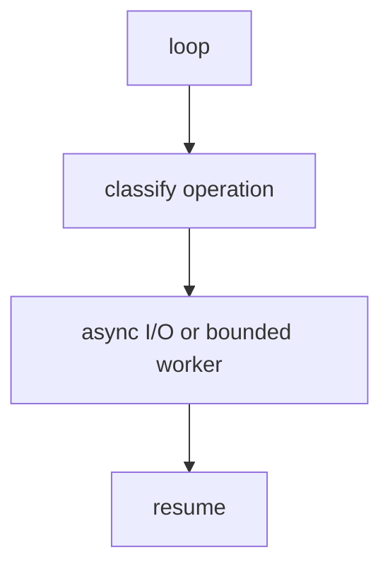

# A03.29 · CPU/I/O work separation

[Phase index](../README.md) · [Principal] · 25–40 minutes

Prerequisite [A03.28](A03.28.md) · Next [A03.30](A03.30.md)

## 1. The problem & why it exists

An async endpoint performs synchronous parsing and delays unrelated I/O. Separate job types and measure loop lag, service time and queue delay.

## 2. Visual mental model



```text
1. loop
2. classify operation
3. async I/O or bounded worker
4. resume
```

The diagram isolates the mechanism on one request or process. Deployment limits and concurrent work can introduce additional boundaries.

## 3. Step-by-step mechanism & minimal dry-run

Async concurrency overlaps waiting. CPU work should be measured and isolated in appropriate workers when it would block the loop. Thread offload may still contend for CPU.

**Trace.** loop → classify operation → async I/O or bounded worker → resume.

Run the example twice. Identify the first state where the controlled failure changes the behavior or assumption.

## 4. Formal rigor & quantitative math

A 120 ms CPU section blocks the loop for roughly 120 ms if run inline. Eight such jobs require 960 ms total CPU, regardless of coroutine syntax.

Verify the worked calculation with Python.

```python
import math

actual = 8 * 120
assert math.isclose(actual, 960, rel_tol=1e-4)
print(actual)
```

## 5. Progressive design

| Control | Observable evidence | Trade-off |
| --- | --- | --- |
| Failure | `dispatched: False` | Find the boundary where the fixture's incorrect assumption becomes visible. |
| Normal | `dispatched: True` | Separate job types and measure loop lag, service time and queue delay. |

The [fixture](../examples/A03.29.py) is bounded. Check whether it runs the real runtime primitive or models a decision with fixed inputs before interpreting its output as production evidence.

## 6. Safe local lab & controlled failure injection

From the repository root, after `uv sync --locked --extra api`:

```sh
uv run --extra api python "01-architecture-A01-to-A20/A03-python-runtime-and-backend-apis/examples/A03.29.py"
uv run --extra api python "01-architecture-A01-to-A20/A03-python-runtime-and-backend-apis/examples/A03.29.py" --break
```

Predict both runs, measure the first difference, and rerun the normal control. Change one parameter in the worked example or one input to the fixture, recompute your expected result, and record any mismatch. Remove your scratch copy once you have the evidence. Continue to [L2](../labs/L2.md) for integration practice.

## 7. Production & multi-cloud bridge

Separate job types and measure loop lag, service time and queue delay. For a container deployment on Amazon EKS, Azure AKS or Google Kubernetes Engine, locate the boundary in application code, process configuration and any service in the request path. Collect evidence at the affected boundary before changing infrastructure.

<details>
<summary>Principal discussion</summary>

Can async speed up external model generation itself? It can overlap waits and improve concurrency, but does not reduce model compute by itself. In a design review, state the observable signal that would confirm the diagnosis and name the owner of the boundary.

</details>

## 8. Memory hook & mastery checkpoint

1. Can async speed up external model generation itself?
2. State the observation for each control and locate their first divergence.
3. Change the worked input and calculate the result before running the check.
4. Explain which decision in section 5 you would preserve in a larger deployment.
5. Explain one difference between this fixture and production behavior.

<details>
<summary>Check your answers</summary>

1. It can overlap waits and improve concurrency, but does not reduce model compute by itself.
2. Normal `dispatched: True`. Failure `dispatched: False`.
3. Apply the relationship in section 4 to the modified input. Verify the output with the same units.
4. Separate job types and measure loop lag, service time and queue delay.
5. Async concurrency overlaps waiting. CPU work should be measured and isolated in appropriate workers when it would block the loop. Thread offload may still contend for CPU.

</details>

## Standards and implementation notes

- [Primary specification or implementation documentation](https://docs.python.org/3/howto/free-threading-python.html)
