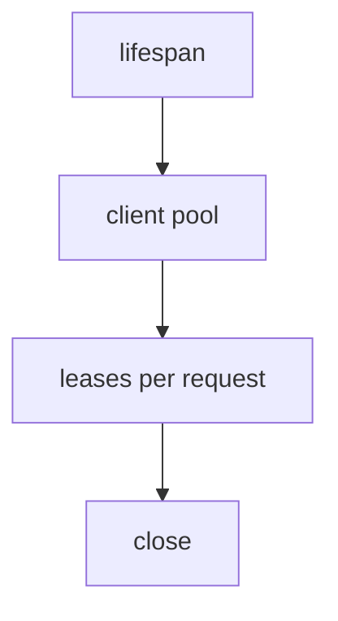

# A03.30 · connection pooling

[Phase index](../README.md) · [Principal] · 25–40 minutes

Prerequisite [A03.29](A03.29.md) · Next [A03.31](A03.31.md)

## 1. The problem & why it exists

A client creates a new transport for each HTTP request and runs out of sockets. Use a scoped client per compatible configuration and bound pool and pool wait.

## 2. Visual mental model



```text
1. lifespan
2. client pool
3. leases per request
4. close
```

The diagram isolates the mechanism on one request or process. Deployment limits and concurrent work can introduce additional boundaries.

## 3. Step-by-step mechanism & minimal dry-run

A shared client owns connection pooling and connection reuse. Distinguish pool acquisition from connect and read waits. Close the shared client during application shutdown.

**Trace.** lifespan → client pool → leases per request → close.

Run the example twice. Identify the first state where the controlled failure changes the behavior or assumption.

## 4. Formal rigor & quantitative math

If setup costs 50 ms and 10 sequential calls reuse one connection, mean setup is 5 ms per call under the model.

Verify the worked calculation with Python.

```python
import math

actual = 50 / 10
assert math.isclose(actual, 5, rel_tol=1e-4)
print(actual)
```

## 5. Progressive design

| Control | Observable evidence | Trade-off |
| --- | --- | --- |
| Failure | `cost ms: 500` | Find the boundary where the fixture's incorrect assumption becomes visible. |
| Normal | `cost ms: 50` | Use a scoped client per compatible configuration and bound pool and pool wait. |

The [fixture](../examples/A03.30.py) is bounded. Check whether it runs the real runtime primitive or models a decision with fixed inputs before interpreting its output as production evidence.

## 6. Safe local lab & controlled failure injection

From the repository root, after `uv sync --locked --extra api`:

```sh
uv run --extra api python "01-architecture-A01-to-A20/A03-python-runtime-and-backend-apis/examples/A03.30.py"
uv run --extra api python "01-architecture-A01-to-A20/A03-python-runtime-and-backend-apis/examples/A03.30.py" --break
```

Predict both runs, measure the first difference, and rerun the normal control. Change one parameter in the worked example or one input to the fixture, recompute your expected result, and record any mismatch. Remove your scratch copy once you have the evidence. Continue to [L4](../labs/L4.md) for integration practice.

## 7. Production & multi-cloud bridge

Use a scoped client per compatible configuration and bound pool and pool wait. For a container deployment on Amazon EKS, Azure AKS or Google Kubernetes Engine, locate the boundary in application code, process configuration and any service in the request path. Collect evidence at the affected boundary before changing infrastructure.

<details>
<summary>Principal discussion</summary>

Can a connection limit create a queue? Yes, unless rejected immediately. In a design review, state the observable signal that would confirm the diagnosis and name the owner of the boundary.

</details>

## 8. Memory hook & mastery checkpoint

1. Can a connection limit create a queue?
2. State the observation for each control and locate their first divergence.
3. Change the worked input and calculate the result before running the check.
4. Explain which decision in section 5 you would preserve in a larger deployment.
5. Explain one difference between this fixture and production behavior.

<details>
<summary>Check your answers</summary>

1. Yes, unless rejected immediately.
2. Normal `cost ms: 50`. Failure `cost ms: 500`.
3. Apply the relationship in section 4 to the modified input. Verify the output with the same units.
4. Use a scoped client per compatible configuration and bound pool and pool wait.
5. A shared client owns connection pooling and connection reuse. Distinguish pool acquisition from connect and read waits. Close the shared client during application shutdown.

</details>

## Standards and implementation notes

- [Primary specification or implementation documentation](https://www.python-httpx.org/advanced/resource-limits/)
