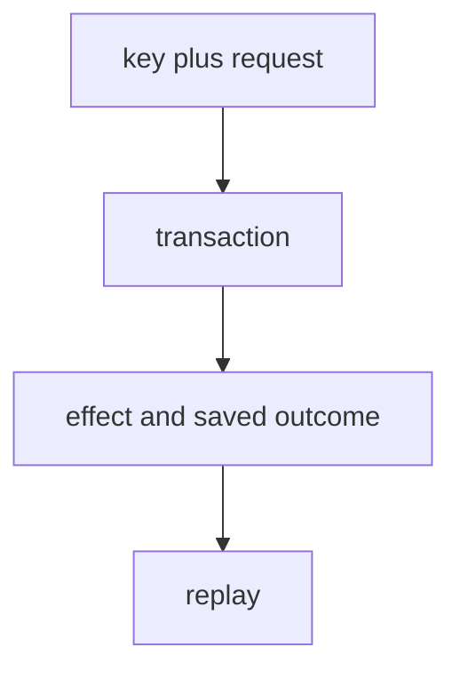

# A03.31 · idempotency keys

[Phase index](../README.md) · [Principal] · 25–40 minutes

Prerequisite [A03.30](A03.30.md) · Next [A03.32](A03.32.md)

## 1. The problem & why it exists

An API charges twice when the first response is lost. Use durable uniqueness and document expiry and concurrent handling. Avoid process-local caches for cross-worker correctness.

## 2. Visual mental model



```text
1. key plus request
2. transaction
3. effect and saved outcome
4. replay
```

The diagram isolates the mechanism on one request or process. Deployment limits and concurrent work can introduce additional boundaries.

## 3. Step-by-step mechanism & minimal dry-run

Bind an idempotency key to the tenant, operation and canonical request payload. Atomically commit the effect and outcome record and reject conflicting key reuse.

**Trace.** key plus request → transaction → effect and saved outcome → replay.

Run the example twice. Identify the first state where the controlled failure changes the behavior or assumption.

## 4. Formal rigor & quantitative math

With n logical commands and d duplicates, requests total n+d while effects remain n. At 50 commands and 20 replays that is 70 requests and 50 effects.

Verify the worked calculation with Python.

```python
import math

actual = 50 + 20
assert math.isclose(actual, 70, rel_tol=1e-4)
print(actual)
```

## 5. Progressive design

| Control | Observable evidence | Trade-off |
| --- | --- | --- |
| Failure | `commits: 2` | Find the boundary where the fixture's incorrect assumption becomes visible. |
| Normal | `commits: 1` | Use durable uniqueness and document expiry and concurrent handling. Avoid process-local caches for cross-worker correctness. |

The [fixture](../examples/A03.31.py) is bounded. Check whether it runs the real runtime primitive or models a decision with fixed inputs before interpreting its output as production evidence.

## 6. Safe local lab & controlled failure injection

From the repository root, after `uv sync --locked --extra api`:

```sh
uv run --extra api python "01-architecture-A01-to-A20/A03-python-runtime-and-backend-apis/examples/A03.31.py"
uv run --extra api python "01-architecture-A01-to-A20/A03-python-runtime-and-backend-apis/examples/A03.31.py" --break
```

Predict both runs, measure the first difference, and rerun the normal control. Change one parameter in the worked example or one input to the fixture, recompute your expected result, and record any mismatch. Remove your scratch copy once you have the evidence. Continue to [L3](../labs/L3.md) for integration practice.

## 7. Production & multi-cloud bridge

Use durable uniqueness and document expiry and concurrent handling. Avoid process-local caches for cross-worker correctness. For a container deployment on Amazon EKS, Azure AKS or Google Kubernetes Engine, locate the boundary in application code, process configuration and any service in the request path. Collect evidence at the affected boundary before changing infrastructure.

<details>
<summary>Principal discussion</summary>

What should happen with the same key and a different body? A conflict under this contract. In a design review, state the observable signal that would confirm the diagnosis and name the owner of the boundary.

</details>

## 8. Memory hook & mastery checkpoint

1. What should happen with the same key and a different body?
2. State the observation for each control and locate their first divergence.
3. Change the worked input and calculate the result before running the check.
4. Explain which decision in section 5 you would preserve in a larger deployment.
5. Explain one difference between this fixture and production behavior.

<details>
<summary>Check your answers</summary>

1. A conflict under this contract.
2. Normal `commits: 1`. Failure `commits: 2`.
3. Apply the relationship in section 4 to the modified input. Verify the output with the same units.
4. Use durable uniqueness and document expiry and concurrent handling. Avoid process-local caches for cross-worker correctness.
5. Bind an idempotency key to the tenant, operation and canonical request payload. Atomically commit the effect and outcome record and reject conflicting key reuse.

</details>

## Standards and implementation notes

- [Primary specification or implementation documentation](https://www.rfc-editor.org/rfc/rfc9110.html)
- [SQLite transactions](https://www.sqlite.org/lang_transaction.html)
